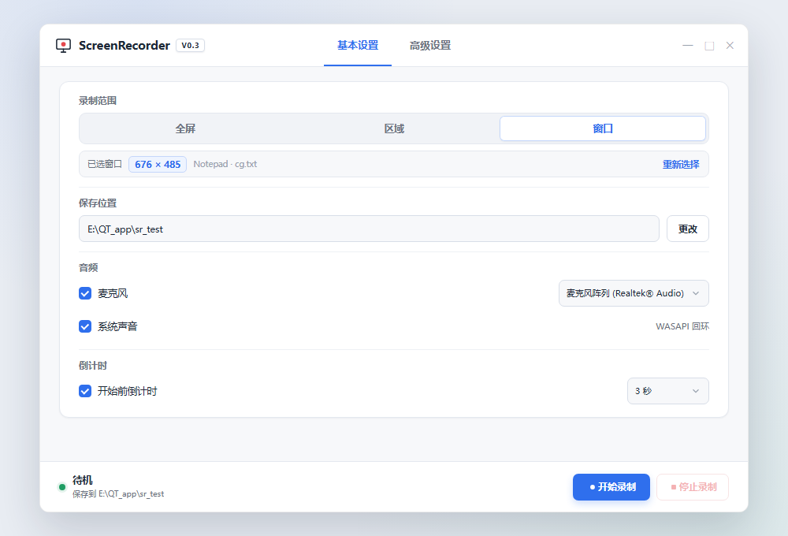
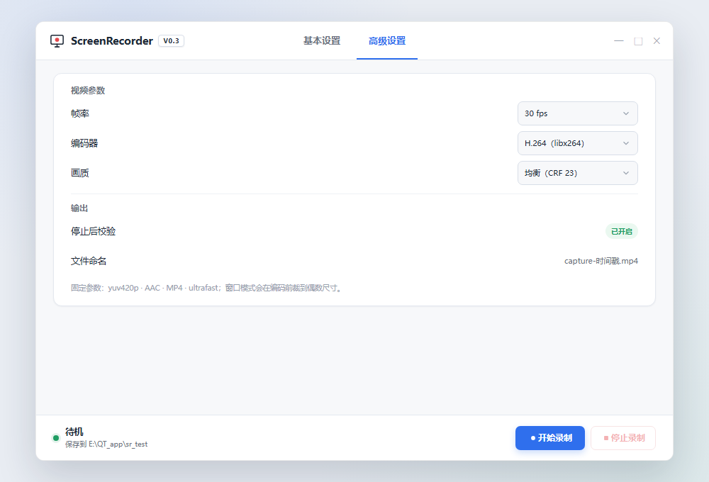
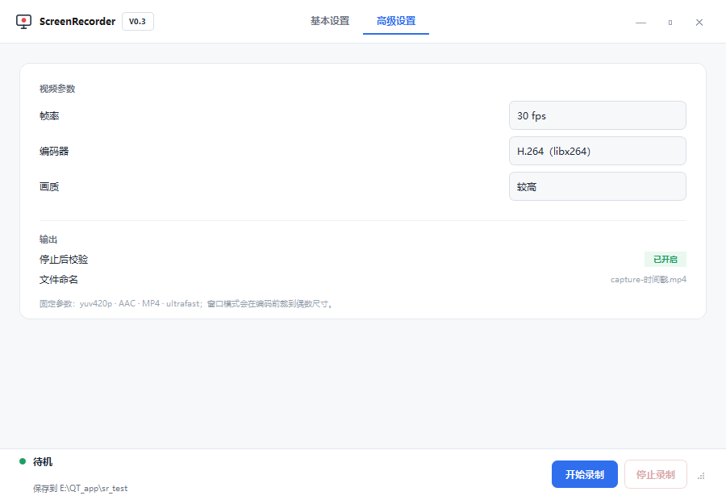
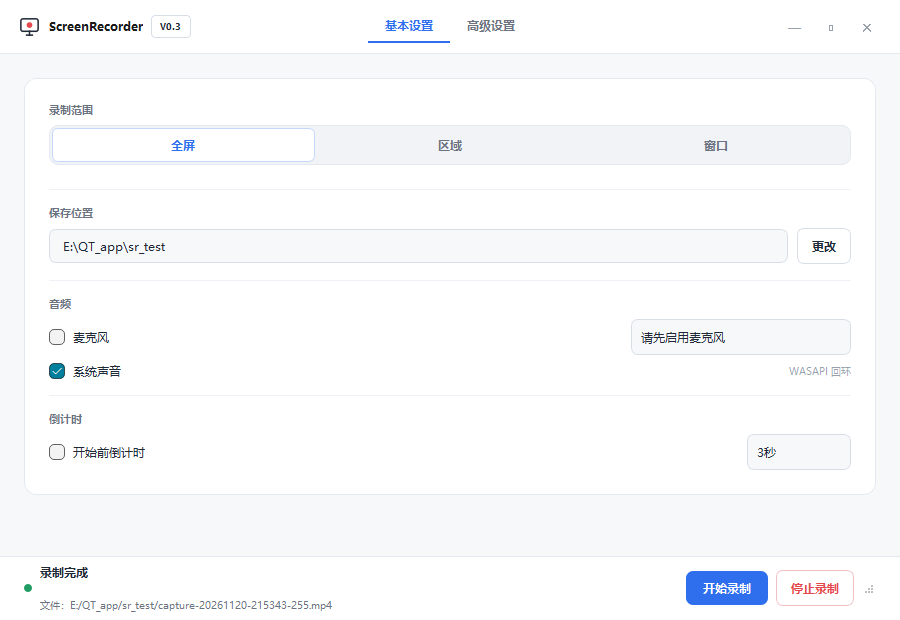
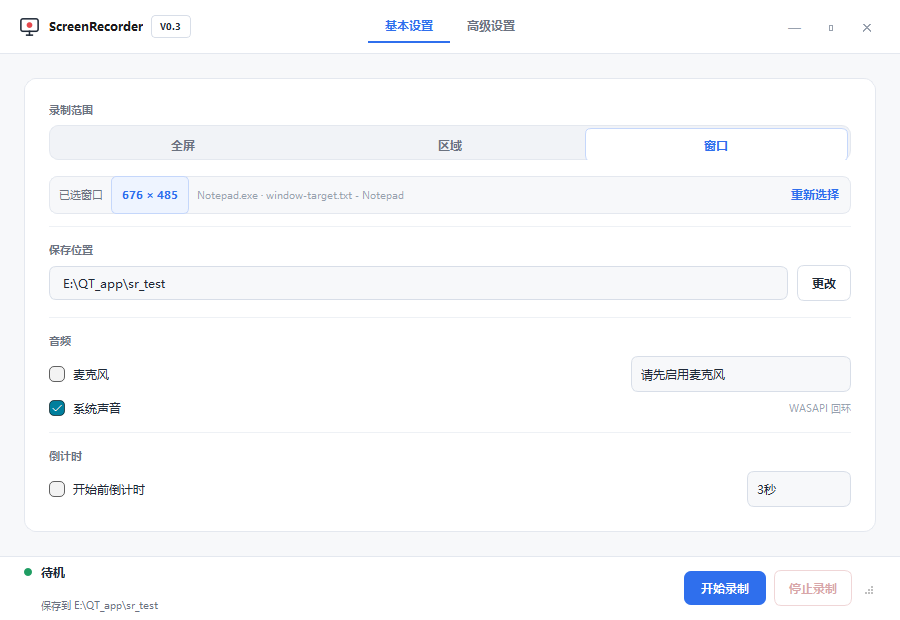
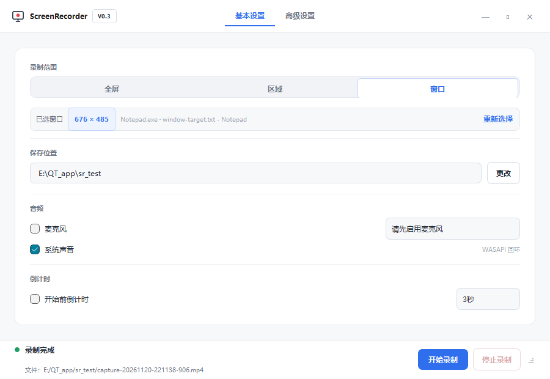
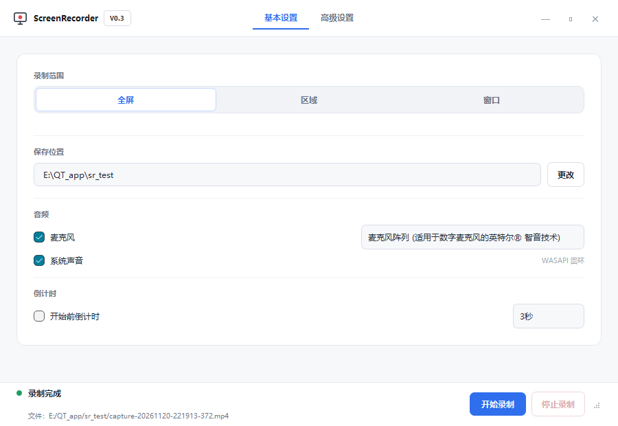

# ScreenRecorder

Windows 屏幕录制学习工具，使用 **Qt 6 Widgets + CMake + C++**，通过外部 FFmpeg 的 `gdigrab` 采集画面，支持系统声音回环和麦克风。

## 界面预览

### 设计稿（v3）

**基本设置**


**窗口模式**



**高级设置**



### 实际界面

**基本设置**


**高级设置**



**录制完成**



**窗口模式**



**窗口录制完成**



**系统声音 + 麦克风混音**



> 设计稿的 HTML 源文件在 [design/ui-mockup-v3.html](design/ui-mockup-v3.html)。

## 当前功能

- 无边框窗口 + 自定义标题栏（图标、应用名、版本、窗口控制、拖动、双击最大化、右下角缩放）。
- “基本设置 / 高级设置”两页：单面板分区、底部常驻状态和开始/停止。
- 录制范围：全屏 / 区域 / 窗口。
  - 区域支持拖拽选区、实时尺寸提示和顶部确认工具条；
  - 窗口支持选择目标窗口、客户区尺寸显示，遮挡时仍录制目标窗口内容。
- 保存目录、录制模式、帧率、编码器和画质使用 `QSettings` 持久化。
- 帧率 10 / 15 / 30 fps；H.264 / H.265；三档画质（CRF）。
- 麦克风（DirectShow）与系统声音（WASAPI 回环 + 命名管道）；两路同时开启时用 FFmpeg `amix` 混成一条 AAC 音轨，避免播放器只读第一条音轨。
- 录制前倒计时、取消倒计时、停止超时保护和 ffprobe 输出校验。
- 区域/全屏使用显式 `offset + video_size`；窗口使用 `hwnd=` 并裁剪到偶数尺寸；停止后用 ffprobe 校验宽高。
- 窗口录制中最小化或关闭目标窗口时自动停止，保留已录片段并在底部说明原因。

## 构建

环境：

- Windows 10/11
- Qt 6.8（MinGW 64-bit）
- CMake 3.19+
- FFmpeg 8.x，`ffmpeg.exe` 和 `ffprobe.exe` 在 `PATH` 中

```powershell
cmake -S . -B build
cmake --build build --target screenRecorder -j 4
```

## 运行

```powershell
# 确保 Qt 和 MinGW 运行库在 PATH 中
build\screenRecorder.exe
```

启动录制前会检查 FFmpeg 的 `gdigrab` 和所选编码器是否可用。

## 项目结构

| 文件 | 说明 |
| --- | --- |
| `mainwindow.*` | 主窗口、页面布局、录制参数和 FFmpeg 进程生命周期 |
| `windowtitlebar.*` | 无边框窗口的自定义标题栏和缩放手柄 |
| `regionselector.*` | 区域选择遮罩、尺寸提示和顶部确认工具条 |
| `windowenumerator.*` | Win32 顶层窗口枚举与过滤 |
| `windowpickerdialog.*` | 选择录制窗口的对话框 |
| `systemaudio.*` | WASAPI 回环采集 |
| `systemaudiothread.*` | 采集线程、命名管道和停止处理 |
| `audiopipe.*` | 命名管道读写 |
| `audiotimeline.*` | 音频时间线补静音/跳重叠 |
| `recordingparams.h` | 帧率、编码器、画质等编译期配置表 |
| `tests/` | 音频时间线和录制参数测试 |

## 测试

```powershell
cmake --build build --target audiotimeline_test recordingparams_test -j 4
build\audiotimeline_test.exe
build\recordingparams_test.exe
```

预期：`PASS: 25 checks`、`recordingparams: 30/30 checks passed`。

## 开发记录

逐阶段的开发、验证、踩坑和学习点记录在 [学习记录.md](学习记录.md)。
