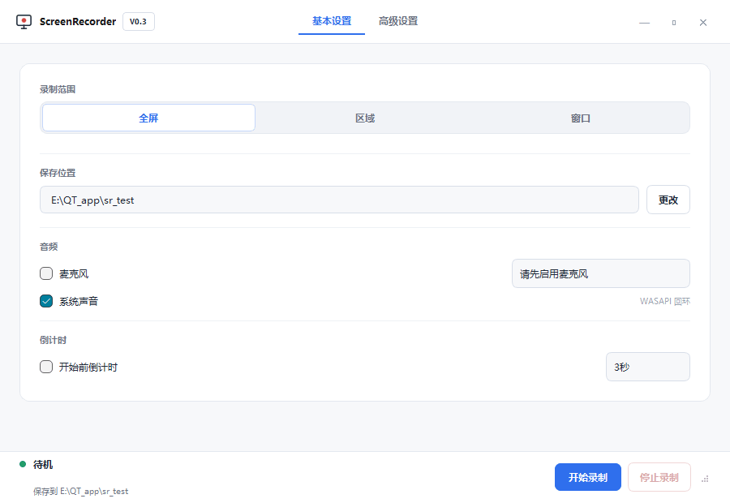

# ScreenRecorder

**一个用 Qt 6 + C++ + FFmpeg 写的 Windows 屏幕录制工具：全屏 / 区域 / 窗口三种录制模式，支持系统声音与麦克风混音、倒计时和录制后自动校验。**

[**下载最新安装包**](https://github.com/hao1960/ScreenRecorder/releases/latest) ·
[从源码构建](#从源码构建) ·
[已知限制](#已知限制) ·
[开发记录](学习记录.md)



## 功能

- **三种录制范围**：全屏、拖拽选区、选择单个应用窗口。
- **窗口录制**：目标窗口被其他窗口遮挡时仍能录到目标内容；窗口移动/遮挡不影响，最小化或关闭时自动停止并保留已录片段。
- **音频**：系统声音（WASAPI 回环）、麦克风（DirectShow）；两路同时开启时用 `amix` 混成一条 AAC 音轨，统一 48 kHz 立体声。
- **录制控制**：1～5 秒倒计时、取消倒计时、停止超时保护、开始/停止按钮在录制中始终可见。
- **输出校验**：停止后用 `ffprobe` 检查编码、宽高、时长和音频流；尺寸不符合预期时明确提示。
- **设置持久化**：保存目录、录制模式、帧率、编码器、画质、麦克风设备等写入 `QSettings`。
- **界面**：无边框自定义标题栏、基本/高级两页设置、底部常驻状态和操作栏。

## 系统要求

- Windows 10 / 11（x64）
- 安装包已包含 Qt 运行库、MinGW 运行库和 FFmpeg，**不需要单独安装 Qt 或配置 FFmpeg PATH**
- 录制 1080p 建议至少 4 GB 内存，并为视频预留足够磁盘空间

## 安装

1. 打开 [Releases](https://github.com/hao1960/ScreenRecorder/releases/latest)，下载最新的 `ScreenRecorder-*-setup.exe`。
2. 运行安装包，按向导完成安装；默认安装到当前用户目录，不需要管理员权限。
3. 从开始菜单启动 `ScreenRecorder`。
4. 卸载：Windows 设置 → 应用 → ScreenRecorder → 卸载，或开始菜单里的卸载快捷方式。

> 安装包目前没有代码签名，Windows SmartScreen 可能提示“未知发布者”；这是未签名安装包的正常提示。

## 从源码构建

环境：

- Qt 6.8（MinGW 64-bit）
- CMake 3.19+
- MinGW-w64（随 Qt 安装）
- FFmpeg 8.x（`ffmpeg.exe` + `ffprobe.exe`）

```powershell
cmake -S . -B build -G "MinGW Makefiles" -DCMAKE_BUILD_TYPE=Release `
  -DCMAKE_PREFIX_PATH="E:\QT\6.8.2\mingw_64"
cmake --build build --target screenRecorder -j 4
```

运行：

```powershell
# 方式一：把 ffmpeg.exe / ffprobe.exe 放到 screenRecorder.exe 同目录
# 方式二：把 FFmpeg 加入 PATH
build\screenRecorder.exe
```

程序会先查找 exe 同目录下的 `ffmpeg.exe`/`ffprobe.exe`，找不到再查 `PATH`。

## FFmpeg 与许可

- 安装包计划随包附带 `ffmpeg.exe`、`ffprobe.exe`，用户不需要自己配置 PATH。
- 当前使用的 FFmpeg 是 **GPL 构建**（包含 libx264/libx265），分发时需要遵守 GPLv3：提供许可证文本、对应源码或有效的源码获取方式。
- 详细第三方声明见 [licenses/THIRD_PARTY_NOTICES.txt](licenses/THIRD_PARTY_NOTICES.txt)。
- 应用代码使用 MIT License；Qt 以 LGPLv3 动态链接方式使用；FFmpeg 按其 GPLv3 条款分发。

> 这不是法律意见。正式发布前请按 FFmpeg/Qt 的许可证核对源码提供方式和声明文本。

## 已知限制

- 窗口录制第一版不跟随窗口尺寸变化；开始录制后改变窗口大小，成片保持开始时的客户区尺寸。
- 多显示器、不同缩放比例（高 DPI）还没有系统验收；当前主要在单屏 1920×1080 / 100% 下开发。
- 音频起点对齐（视频首帧 vs 音频首包）还没有标定；双路混音的音量平衡也需要更多听感调整。
- 暂不支持暂停/继续、托盘、系统级快捷键和录制历史。
- 安装包未签名。

## 开发记录

每个阶段的实现、验证、踩坑和学习点记录在 [学习记录.md](学习记录.md)；设计稿和截图在 [design/](design/)。

## 项目结构

| 文件 | 说明 |
| --- | --- |
| `mainwindow.*` | 主窗口、页面布局、录制参数和 FFmpeg 进程生命周期 |
| `windowtitlebar.*` | 无边框窗口的自定义标题栏和缩放手柄 |
| `regionselector.*` | 区域选择遮罩、尺寸提示和确认工具条 |
| `windowenumerator.*` | Win32 顶层窗口枚举与过滤 |
| `windowpickerdialog.*` | 选择录制窗口的对话框 |
| `systemaudio.*` / `systemaudiothread.*` | WASAPI 回环采集和采集线程 |
| `audiotimeline.*` | 音频时间线补静音/跳重叠 |
| `recordingparams.h` | 帧率、编码器、画质等编译期配置表 |
| `tests/` | 音频时间线和录制参数测试 |

## License

- 应用代码：[MIT](LICENSE)
- 第三方组件：[THIRD_PARTY_NOTICES.txt](licenses/THIRD_PARTY_NOTICES.txt)
