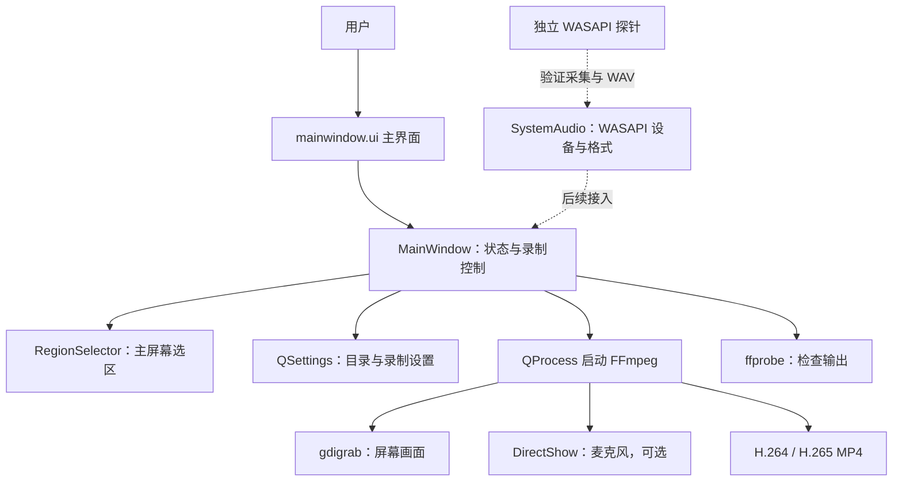
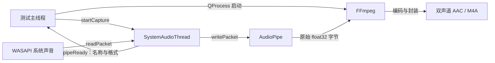

# ScreenRecorder 开发与学习记录

> 记录截至 2026-11-18。本文结合项目源码和开发对话整理；“已实现”“已测试”和“待开发”分别标注。后续每完成一个阶段，在文末追加记录。

## 1. 如何使用本文

- 按“目标 → 步骤 → 关键代码 → 验证 → 学习点”复习。
- 代码以项目实际文件为准；后续修改后同步更新对应记录。
- `build/` 是构建目录，可能被清理，也不随 Git 跟踪；文末备份了学习用探针和测试源码。
- 用户实际测试、编译通过与仅有代码实现分别记录，避免把计划中的功能当成已完成。

**概念说明**：模块是负责一类工作的代码集合；接口是模块对外提供的操作；状态描述当前处于哪个阶段。阅读时先回答“输入是什么、处理什么、输出是什么”，再看具体语法。

**阅读顺序**：先看本节概念和流程，再看代码注释，最后执行测试。标为“关键代码”的块通常是摘录，可能引用已有变量，不能直接当成独立程序；附录和完整测试示例才包含完整入口。中文注释解释操作目的和先后关系，后续可根据实际理解追加笔记。

## 2. 项目框架



实线表示当前应用中的调用关系；虚线表示学习探针和待接入关系。`SystemAudio` 已加入构建目标，但主窗口尚未使用它；系统声音开关目前禁用。

**概念说明**：界面负责接收用户操作，主窗口负责协调，录制进程负责采集和编码。类之间通过方法和信号协作，进程之间通过输入输出或管道传数据。图中连线表达调用或依赖，不表示所有模块都在同一个线程执行。

**流程解释**：用户点击开始 → 主窗口读取设置并检查环境 → 必要时倒计时 → 启动 FFmpeg → 停止并完成文件封装 → 检查输出。原生系统声音通道已由用户报告独立串联测试符合预期；11.16 的“播放→暂停→恢复”实测通过；11.17 已把系统声音接入录屏主窗口（管道先行、参数后补、停止先收线程再发 q），等待真实录制联合验收。

## 3. 当前进度

| 功能 | 当前状态与验证 |
| --- | --- |
| 主界面、开始与停止 | 已实现，用户已进行录制测试。 |
| 区域选择 | 已实现主屏幕选区；不同缩放和多显示器场景仍需专门验证。 |
| 目录、模式、帧率记忆 | 使用 `QSettings`；帧率录制结果已由用户用 ffprobe 检查，设置恢复需按实际测试结果确认。 |
| 帧率 | 10、15、30 fps；用户测得 10、15、约 29.52 fps。 |
| 编码器与画质 | H.264/H.265 及三档画质；用户确认两种编码输出和画质选项可录制，画质仍可优化。 |
| 麦克风 | DirectShow 采集；用户确认 AAC 音轨存在且回放有声音；无声文件无音轨。 |
| 倒计时 | 1～5 秒；用户报告录制通过，倒计时期间停止按钮不可用。取消和其他组合仍应逐项确认。 |
| 系统声音 | 独立采集、WAV 回放、采集线程启动停止及管道连接、写入、取消、断开测试均经用户确认通过；原同步管道探针已输出可回放 M4A。11.16 的 `--pause-test` 暂停空白保留实测通过（输出 9993.98ms vs 墙钟 10028ms，ffprobe 9.994s）。11.17 已接入录屏主窗口：勾选系统声音后自动建管道、按真实格式补参数、停止时先收线程再发 q，主程序构建通过；真实录制联合验收（ffprobe 双流、音画同步）待执行。 |
| 音频混音 | 11.31 已实现并验证：系统声 + 麦克风同时开启时用 `amix` 混成一条 AAC 音轨；输出统一为 48 kHz/2 声道，系统单独和双路都是单条音频流。音量平衡和起点对齐仍待处理。 |
| 音频时间线 | 11.14 的播放暂停观察通过：包跨度约 9.988 秒，收到的帧仅对应 7.610 秒。11.15 计算器已补齐；11.16 由用户接入线程与管道，补静音 157631 帧实测通过；11.17 接入主窗口并构建通过。11.18 的 `setOrigin`/`setTimelineOrigin` 已写入，但主窗口 `started` 回调尚未调用，音频起点仍由首包决定；真实对齐待验收。 |
| 视频首版验收 | 11.19 已验收尺寸：全屏 1920×1080 / 5.8 秒 / 约 28.45 fps，区域 1402×796 / 19.2 秒 / 约 29.58 fps，ffprobe 宽高与期望一致。多显示器与高 DPI 仍未实测。 |
| 区域尺寸提示 | 11.20 已验证通过：选区旁实时显示 `宽 × 高`，拖拽、确认、取消和边缘摆放均符合预期。 |
| 选区顶部工具条 | 11.21 已验证通过：确认/取消位于顶部居中工具条，按钮显示、点击和重新拖拽均正常。 |
| 窗口捕获 | 11.30 已实现并验证：窗口模式、选择对话框、`hwnd` 参数、crop 取偶、最小化/关闭自动停止；Notepad `676×485` 客户区录出 `676×484`，音频流正常。 |
| 窗口枚举 | 11.23 探针已构建运行：过滤后 7 个窗口，中文标题正常；Notepad 的 `client=676x485` 与 gdigrab 输出一致。 |
| 窗口选择对话框 | 11.24 已完成并手动检查；`window_picker_test` 可打开列表，最小化行置灰。主窗口接入在 11.30 的步骤里。 |
| 界面重构 | 11.29 已实现并验证：无边框标题栏（图标 + ScreenRecorder + V0.3）、基本/高级两页、底部状态与开始/停止；全屏 2.7 秒录制和窗口缩放通过。窗口模式仍待接入。 |
| 测试 | 已有独立 CMake 测试目标，用户手动构建运行；尚未接入 CTest 或持续集成。学习探针和测试源码位于 `build/`，文末有备份。 |

**概念说明**：“编译通过”表示代码能生成程序；“测试通过”表示某次具体场景符合预期。测试过五秒双声道采集，不等于已经验证长时间、多声道或切换设备，记录时应保留测试条件。

## 4. 应用入口与界面

**目标**：建立 Qt Widgets 主窗口，显示录制状态与操作控件。

**文件**：`main.cpp`、`mainwindow.ui`、`mainwindow.h`、`mainwindow.cpp`。

**概念说明**：

- `QApplication` 管理 Widgets 应用和事件循环；`exec()` 持续分发点击、定时器和窗口事件。
- `MainWindow` 是主窗口类，`w` 是它的一个对象；构造函数执行初始化，`show()` 显示窗口。
- `.ui` 记录界面控件和布局，`ui->setupUi(this)` 创建这些控件；`this` 指当前主窗口对象。
- 信号表示“发生了一件事”，槽函数或 lambda 是响应代码。`objectName` 是代码查找具体控件的名字，显示文字是用户看到的内容。
- 布局管理控件的位置和伸缩；弹簧吸收剩余空间，避免依赖固定坐标排列。

**开发步骤**：

1. 在 `main.cpp` 创建 `QApplication`，设置应用身份并显示 `MainWindow`。
2. 在 Qt Designer 添加状态、录制区域、保存目录、帧率、编码器、音频和倒计时控件。
3. 给 `centralwidget` 设置水平布局：左侧纵向排列控件，右侧使用水平弹簧。
4. 在 `MainWindow` 构造函数执行 `ui->setupUi(this)`，再连接按钮和状态。

**关键代码**：

```cpp
// 1. 建立应用运行环境。
QApplication a(argc, argv);
// 2. 给 QSettings 等功能指定应用身份。
QCoreApplication::setOrganizationName("HaoLearning");
QCoreApplication::setApplicationName("ScreenRecorder");
// 3. 创建窗口并显示。
MainWindow w;
w.show();
// 4. 进入事件循环，等待并处理用户操作。
return QApplication::exec();
```

**学习点**：事件循环、`QMainWindow`、Designer 控件的 `objectName`、布局和信号槽。界面上存在的控件不等于功能已经接通。

## 5. 录制主流程与 FFmpeg

**目标**：异步启动录制，正常停止并验证输出。

**概念说明**：

- FFmpeg 是单独运行的程序；`QProcess` 是 Qt 用于启动和管理子进程的对象。
- 异步表示启动后不一直等待进程结束，界面可以继续响应；同步等待会阻塞调用线程。
- `QStringList` 中每一项是一个命令行参数，不需要把所有内容拼成一条 shell 命令。
- 标准输入用于向进程写数据或命令，标准错误通常包含 FFmpeg 的诊断输出。
- 编码是把音视频数据压缩成 H.264、AAC 等；封装是把音视频流组织进 MP4 等容器。停止后需要等待封装完成。
- `started` 表示操作系统已启动子进程，不保证第一帧已经采集成功，后续还需要处理异常退出。

**开发步骤**：

1. 使用 `QStandardPaths::findExecutable("ffmpeg")` 查找程序。
2. 启动前检查 `gdigrab` 和选中编码器可用性；参数通过 `QStringList` 传递。
3. 使用 `QProcess::start()` 启动，收到 `started` 信号后显示录制状态。
4. 点击停止时向 FFmpeg 写入 `q\n`，等待进程退出，避免提前提示保存完成。
5. 正常退出且文件非空时用 `ffprobe` 检查编码、尺寸和时长；选麦克风时额外检查音频流。
6. 停止超过 15 秒则强制结束，并提示文件可能不完整；运行中阻止直接关闭窗口。

**关键代码**：

```cpp
// 1. 准备参数；-n 禁止覆盖，-framerate 属于屏幕输入。
QStringList args{
    "-hide_banner", "-loglevel", "error", "-n",
    "-f", "gdigrab", "-framerate", ui->frameRateComboBox->currentData().toString()
};

// 2. 完整代码还会补入输入和编码参数，然后启动子进程。
m_ffmpeg.start(ffmpeg, args);
// 3. 用户停止时请求 FFmpeg 正常退出，之后等待 finished 信号。
m_ffmpeg.write("q\n");
```

**学习点**：子进程与主界面分离、信号驱动状态、输入参数和输出参数的顺序、正常封装与强制结束的区别。当前功能探测和 `ffprobe` 查询是同步等待，可能短暂阻塞界面。

## 6. 区域选择

**目标**：拖动选取主屏幕矩形，确认后将坐标用于录制。

**文件**：`regionselector.h`、`regionselector.cpp`。

**概念说明**：局部坐标相对于遮罩窗口，全局坐标相对于桌面；Qt 逻辑像素还可能与实际屏幕像素不同。`QRect` 表示矩形，`QRubberBand` 只显示选区轮廓。`normalized()` 统一矩形方向，`intersected()` 把矩形限制在允许范围内。

**流程解释**：按下记录起点 → 移动更新轮廓 → 松开检查尺寸 → 确认才发送选区 → 主窗口换算坐标并构造 FFmpeg 参数。取消只关闭遮罩，不开始录制。

**开发步骤**：

1. 创建无边框、置顶的半透明遮罩，使用 `QRubberBand` 显示拖动矩形。
2. 鼠标按下保存起点，移动时更新矩形；`normalized()` 支持反向拖动。
3. 松开后过滤过小选区；确认时将局部坐标转为全局坐标并发送 `regionConfirmed`。
4. 主窗口保存矩形并切换区域模式；录制前将 Qt 逻辑坐标换算为像素，尺寸调整为偶数。

**学习点**：鼠标事件、坐标系、信号槽、高 DPI、编码宽高限制。当前选区只覆盖主显示器；实际录制范围和缩放比例需通过视频验收。

## 7. 保存目录与配置

**目标**：选择目录、避免覆盖旧文件，并恢复上次有效设置。

**概念说明**：持久化表示程序关闭后数据仍保留。`QSettings` 用键值对保存简单设置；默认值用于缺少配置或配置无效的情况。路径字符串只说明位置，试建临时文件才能进一步检查是否可写；录制时仍可能发生磁盘空间不足等错误。

**开发步骤**：

1. 用 `QFileDialog::getExistingDirectory()` 选择目录。
2. 用 `QTemporaryFile` 检查目录可写；不可用时提示或回退到视频目录、用户目录。
3. 文件名使用时间戳，重名追加序号；FFmpeg 使用 `-n` 防止覆盖。
4. 用 `QSettings` 保存 `outputDirectory`、`recordingMode` 等设置。

```cpp
// 1. 使用当前应用身份访问配置。
QSettings settings;
// 2. 保存键对应的目录值。
settings.setValue("outputDirectory", m_outputDirectory);
// 3. 下次启动读取；完整代码还会检查目录是否有效。
const QString savedDir = settings.value("outputDirectory").toString();
```

**学习点**：目录权限、文件命名、持久化、异常配置回退。区域模式会被记住，选区本身不会持久化，重启后需重新选择。

## 8. 帧率、编码器与画质

**目标**：选择 10/15/30 fps、可用的 H.264/H.265 编码器和画质。

**概念说明**：

- fps 是每秒画面帧数；分辨率是每帧的宽和高，两者分别影响时间流畅度和画面尺寸。
- H.264/H.265 是视频编码格式，`libx264`/`libx265` 是当前使用的编码实现；MP4 是容器。
- CRF 控制恒定质量模式下的压缩取舍；在同一编码器及其他条件相近时，数值更小通常保留更多细节，文件也可能更大。它不会自动提高分辨率。
- `itemData` 存实际值，显示文字用于阅读；`findData` 返回匹配项索引，未找到时返回 -1。

**开发步骤**：

1. `frameRateComboBox` 显示说明文字，用 `itemData` 保存数字；`QSettings` 读取无效时回退 10 fps。
2. 查询本机 FFmpeg 的 `libx264`、`libx265` 能力；只列出检测通过的编码器。
3. 保存编码器和画质选项；启动前再次检查编码器。
4. 将选择传入 `-framerate`、`-c:v`、`-crf`；录制期间禁用选择，结束或启动失败后恢复。
5. 输出验证根据选中的编码器检查 `h264` 或 `hevc`。

```cpp
// 1. 第一项显示“10fps”，关联的实际数值为 10。
ui->frameRateComboBox->setItemData(0, 10);
// 2. 用保存的实际值找回选项，而不是依赖显示文字。
const int index = ui->frameRateComboBox->findData(savedFrameRate);
// 3. 未找到则选择第一项；0 是索引，不是 0 fps。
ui->frameRateComboBox->setCurrentIndex(index >= 0 ? index : 0);
```

用户以 ffprobe 验证 10 fps、15 fps 和 `915/31`（约 29.52 fps）；又确认 H.264 和 H.265 的输出编码。三档画质可选择并录制；高清细节仍待后续比较。`1920×1080` 是画面尺寸，帧率影响时间上的流畅度，压缩参数影响编码结果。

```powershell
ffprobe -v error -select_streams v:0 -show_entries stream=codec_name,width,height,avg_frame_rate -of default=noprint_wrappers=1 "视频完整路径.mp4"
```

**学习点**：`QComboBox` 显示文本与数据分离、能力探测、参数校验、帧率与分辨率的区别。两种编码器使用各自的 CRF 数值，同一数值不代表相同画质。

## 9. 麦克风

**目标**：选择 DirectShow 麦克风，并在 MP4 中加入 AAC 音频流。

**概念说明**：DirectShow 是 FFmpeg 当前用来访问 Windows 麦克风的输入接口；音频设备是声音来源，音频流是文件中承载声音的数据序列。多个 `-i` 构成多个输入，编号从 0 开始；`-map 1:a:0` 表示选择第二个输入中的第一条音频流。

**开发步骤**：

1. 让 FFmpeg 列举 `dshow` 音频设备；检查失败或没有设备时给出提示。
2. 勾选麦克风后选择设备，保存开关和设备名；旧设备不存在时要求重新选择。
3. FFmpeg 先接入桌面与麦克风，再显式映射视频、音频并指定 AAC。
4. 录制结束后用 `ffprobe` 检查音频流；实际声音仍需回听。

```cpp
// 1. 桌面已作为输入 0；这里把麦克风加入为输入 1。
args << "-f" << "dshow" << "-i" << (QStringLiteral("audio=") + device)
     // 2. 明确选择输入 0 的视频和输入 1 的音频。
     << "-map" << "0:v:0" << "-map" << "1:a:0" << "-c:a" << "aac";
```

用户测试：有声文件显示 `codec_name=aac`、`codec_type=audio`，回放确认有麦克风声音；关闭麦克风的文件没有音频流。

```powershell
ffprobe -v error -select_streams a:0 -show_entries stream=codec_name,codec_type -of default=noprint_wrappers=1 "视频完整路径.mp4"
```

**学习点**：FFmpeg 多输入、流映射、设备消失处理；有音轨不等于音轨里一定有可听声音。

## 10. 录制前倒计时

**目标**：选择 1～5 秒，允许取消；关闭倒计时则直接准备录制。

**概念说明**：`QTimer` 到时发送信号，需要事件循环处理。它不会通过长时间睡眠来占住界面线程。待启动参数与实际进程是两种状态：倒计时期间只保留参数，FFmpeg 尚未启动，因此取消不需要停止录制进程。

**流程解释**：检查参数 → 锁定本次设置 → 倒计时 → 启动进程；或在归零前取消 → 清空待启动内容 → 恢复设置。定时器的通知可能受系统调度影响，不能当作精密音频时钟。

**开发步骤**：

1. 通过 `QComboBox` 保存秒数，`QCheckBox` 控制是否使用倒计时。
2. 启动前先检查录制参数并保存待启动的 FFmpeg 程序和参数。
3. `QTimer` 每秒更新剩余时间；归零后才启动 FFmpeg。
4. 用户取消时停止定时器、清空待启动参数并恢复控件，不创建录像。

**学习点**：定时器、取消操作、界面状态和重复点击防护。倒计时期间停止按钮不可用，因为录制进程还未启动；取消应使用“取消倒计时”。

## 11. 系统声音：原生 WASAPI 学习

**目标**：不依赖第三方 DirectShow 回环设备，最终在 Windows 上采集系统声音。

**概念说明**：WASAPI 是 Windows 音频接口。麦克风通常是输入设备；回环采集则从播放设备读取正在输出的声音。当前代码选默认播放端点，其他播放设备上的声音不一定包含在内。

### 11.1 独立探针：设备与格式

**概念说明**：

- COM 是 Windows 组织组件和接口的一套机制。类标识说明要创建哪种对象，接口标识说明需要哪些操作。
- `IMMDeviceEnumerator` 用来查找设备；`IMMDevice` 表示一个设备；`IAudioClient` 用来配置和控制音频流。
- `HRESULT` 是结果状态，成功不只一种取值，应使用 `SUCCEEDED`/`FAILED` 判断；有些返回值还需要单独处理。
- `__uuidof` 取得类型关联的标识，不负责创建对象。`CoCreateInstance` 才执行创建，最后一个参数接收接口指针。
- `&enumerator` 是指针变量本身的地址，让函数把结果写回变量；`void **` 是 COM 此处要求的通用输出参数类型。
- `GetMixFormat()` 返回音频引擎的共享模式混合格式，不一定等于硬件的原生能力。指针为空时不能读取字段。

**需要记住的字段**：`nSamplesPerSec` 是每声道每秒样本数；`nChannels` 是声道数；`wBitsPerSample` 是每个样本容器的位数；`nBlockAlign` 是一帧字节数。整数或浮点类型还要结合 `wFormatTag` 和扩展格式 `SubFormat` 判断。

**常见语法与类型**：

| 写法 | 本项目中的含义 |
| --- | --- |
| `bool` | 真或假，例如记录流是否已启动。 |
| `UINT32`、`std::uint32_t` | 32 位无符号整数，分别来自 Windows 和 C++ 固定宽度类型。 |
| `std::uint64_t` | 64 位无符号整数，用于累计和长度计算。 |
| `BYTE` | Windows 的字节类型，用来存原始音频数据。 |
| `size_t` | 用来描述内存对象或容器大小的无符号类型，位数由平台决定。 |
| `IAudioClient *` | 接口指针，保存访问接口的地址，初始用 `nullptr`。 |
| `&变量` | 在调用处取变量地址，让 Windows 写回结果。 |
| `std::vector<BYTE> &packet` | 参数声明中的引用，表示直接修改调用者的容器。 |
| `指针->方法()` | 通过指针访问对象或接口方法。 |

固定宽度整数和普通 `int` 有不同的表达目的：Windows 桌面环境中的 `int` 通常也是 32 位，但文件格式明确要求位数时使用固定宽度类型更清晰；`int` 还通常有符号，不能直接替代 `uint32_t` 的完整取值范围。

1. 调用 `CoInitializeEx()` 初始化当前线程的 COM 环境。
2. `CoCreateInstance` 创建 `MMDeviceEnumerator`，请求 `IMMDeviceEnumerator` 接口。
3. `GetDefaultAudioEndpoint(eRender, eConsole, ...)` 查找默认播放设备。
4. 激活 `IAudioClient`，用 `GetMixFormat()` 读取 Windows 音频混合格式。

```cpp
// 要创建的对象由第一个标识指定，要使用的接口由第四个标识指定。
HRESULT hr = CoCreateInstance(
    __uuidof(MMDeviceEnumerator), // COM 类。
    nullptr,                    // 不使用 COM 聚合。
    CLSCTX_ALL,                 // 允许该类支持的激活上下文。
    __uuidof(IMMDeviceEnumerator), // 请求的接口。
    reinterpret_cast<void **>(&enumerator)); // 输出：写回接口指针。
```

- `HRESULT` 保存函数执行结果，通过 `SUCCEEDED` / `FAILED` 判断。
- 前一个标识指定要创建的类，后一个标识指定需要的接口。
- 输出参数传入指针变量地址；`reinterpret_cast` 用来匹配 COM 接口签名，不转换实际对象。
- 接口用 `Release()` 释放，`GetMixFormat()` 返回的内存用 `CoTaskMemFree()` 释放；成功初始化 COM 后在同一线程 `CoUninitialize()`。

### 11.2 独立探针：采集与 WAV

**概念说明**：

- 共享模式允许通过 Windows 音频引擎使用端点；`LOOPBACK` 表示从播放端点回读输出。
- 原始音频字节只包含样本数值，播放器还需要格式信息才能解释。WAV 用格式块和数据块把这些信息一起保存。
- WAV 使用 RIFF 分块结构：`RIFF/WAVE` 标识文件，`fmt ` 描述格式，`fact` 记录帧数，`data` 存样本字节。
- 小端表示低位字节先写；`0x12345678` 写为 `78 56 34 12`。块数据长度为奇数时要补一个对齐字节，块长度字段不把自己的补齐字节算进去。
- `std::uint32_t` 明确表示 32 位无符号整数，用于格式规定的长度字段；`std::uint64_t` 用于先计算长度，避免过早截断。
- `reinterpret_cast<const char *>` 让文件接口按字节读取已有内存，不会把浮点样本转换成整数。`static_cast` 则用于已经检查范围的数值转换。

**流程解释**：读取 Windows 格式 → 按格式采集 → 暂存样本 → 写完整格式块 → 写样本数据 → 关闭文件 → 再释放格式内存。保存使用的格式指针必须仍然有效。

1. 对默认播放设备使用共享模式和 `AUDCLNT_STREAMFLAGS_LOOPBACK` 初始化。
2. 获取 `IAudioCaptureClient`，启动后读取数据包。
3. 在 `ReleaseBuffer()` 前复制数据；静音标记的数据包用零填充。
4. 测试用 `std::vector<BYTE>` 暂存 5 秒数据，保存完整格式和数据为 WAV。
5. WAV 的长度字段使用 `std::uint32_t`，先以 `std::uint64_t` 计算并检查范围；按小端写入。

用户测试：采集 240960 帧，格式为 48000 Hz、2 声道、32 位；ffplay 识别为 `pcm_f32le`，时长 5.02 秒。收到帧及音轨信息不证明一定能听到声音；应实际回听。探针保存于 `build/wasapi_probe.cpp`，完整源码见文末附录。

```powershell
g++ -std=c++17 build\wasapi_probe.cpp -lole32 -luuid -o build\wasapi_probe.exe
.\build\wasapi_probe.exe
ffplay -autoexit build\system_audio_test.wav
```

### 11.3 应用模块：SystemAudio

**概念说明**：封装是把相关资源和操作放进一个类，调用方不必重复写 Windows 初始化细节。构造函数建立初始状态，析构函数结束对象生命周期；析构时自动清理资源是 RAII 的基本做法。

接口指针由这个对象负责释放，所以禁止复制。`format()` 返回的是借用指针，调用者不能释放它，也不能在 `close()` 或下次 `open()` 后继续使用旧指针。COM 初始化属于线程，创建、使用和清理本对象应在同一线程完成。

**资源配对**：接口指针 → `Release()`；`GetMixFormat` 内存 → `CoTaskMemFree()`；成功的 `CoInitializeEx` → `CoUninitialize()`。`close()` 把成员清空，让重复关闭安全，也让失败清理和析构使用同一条路径。

`systemaudio.h/.cpp` 将设备初始化和释放整理成类：`open()` 获取设备与格式，`format()` 返回由类管理的指针，`close()` 和析构函数释放资源。复制被禁用，避免重复释放。

用户运行模块测试，结果为 `sample_rate=48000 channels=8 bits=32`，且 `close and reopen: ok`。这是当时默认播放设备的混合格式；设备和系统设置变化时参数可能不同。8 声道不能按固定双声道处理，32 位也不能单凭位数断言数据是整数还是浮点数。

**本阶段边界**：最初只封装设备与格式；后续第 11.5、11.6 节已加入启动停止和读取。模块仍未接入主窗口或 FFmpeg。测试程序完整源码见文末附录。

```powershell
g++ -std=c++17 -Wall -Wextra build\wasapi_module_test.cpp systemaudio.cpp -lole32 -luuid -o build\wasapi_module_test.exe
.\build\wasapi_module_test.exe
```

### 11.4 后续开发

**概念说明**：工作线程用于执行采集和可能等待的 I/O；界面线程处理窗口事件。缓冲积压表示产生的数据暂时多于下游能消费的数据；时间戳用于确定数据应该处在时间线的哪个位置。只把收到的数据顺序拼起来，不能自动解决中途没有播放数据造成的时间空隙。

**流程解释**：先证明模块能独立工作，再证明数据能跨进程传递，最后协调界面与多个输入。每层分别验证，避免同时修改采集、传输和编码而无法定位问题。

1. 在 `SystemAudio` 中逐步加入回环采集、停止和错误处理；先独立验证。
2. 数据通道拟采用 Windows 命名管道，先以独立控制台程序验证，再设计工作线程、停止和取消；FFmpeg 标准输入继续用于停止命令。
3. 接入主窗口的系统声音开关、倒计时和录制生命周期。
4. 处理麦克风与系统声音混合、静音、设备切换和音画同步。
5. 测试无声、麦克风、系统声、双路混音，以及多声道和不同设备。

### 11.5 回环采集：初始化、启动和停止（2026-11-10，用户测试通过）

审查时补充了头文件声明和 `GetService`，并把缓冲时长修正为 1 秒。测试文件额外检查重复启动、重复停止，以及运行中关闭后重新打开。用户报告测试通过；未提供逐行输出。

**目标**：在 `SystemAudio` 中准备 WASAPI 回环流，提供启动和停止方法。本阶段尚不读取或保存数据，不接入主界面；此前探针已单独演示过读取数据包。

**概念说明**：`Initialize` 配置流及缓冲区，`GetService` 取得读取接口，`Start` 让流开始运行，`Stop` 停止运行。配置完成不等于已经读取了音频。`m_started` 是本对象的状态记录，用来拒绝不合适的操作和避免重复启动。

**时间单位**：`REFERENCE_TIME` 的单位是 100 纳秒，因此 `10000000` 对应 1 秒；这指定请求的缓冲时长，不是本次录制的总时长。

**步骤 1：修改 `systemaudio.h`**

在 `open()`、`close()` 附近增加：

```cpp
HRESULT start();
HRESULT stop();
```

在 `private` 中增加：

```cpp
IAudioCaptureClient *m_capture = nullptr;
bool m_started = false;
```

**步骤 2：在 `systemaudio.cpp` 的 `open()` 中，`GetMixFormat` 之后、`if (FAILED(hr)) close();` 之前增加：**

```cpp
// 在播放设备上创建共享模式回环流。
if (SUCCEEDED(hr))
    hr = m_client->Initialize(
        AUDCLNT_SHAREMODE_SHARED,
        AUDCLNT_STREAMFLAGS_LOOPBACK,
        10000000, // 请求 1 秒缓冲区，单位为 100 纳秒。
        0,
        m_format,
        nullptr);

if (SUCCEEDED(hr))
    hr = m_client->GetService(
        __uuidof(IAudioCaptureClient),
        reinterpret_cast<void **>(&m_capture));
```

**步骤 3：在 `systemaudio.cpp` 中增加方法：**

```cpp
HRESULT SystemAudio::start()
{
    // 1. open 尚未准备好接口，不能开始。
    if (!m_client || !m_capture)
        return E_UNEXPECTED;
    // 2. 已启动时不再重复调用 Windows。
    if (m_started)
        return S_FALSE;

    // 3. 仅在 Windows 报告成功后更新状态。
    const HRESULT hr = m_client->Start();
    if (SUCCEEDED(hr))
        m_started = true;
    return hr;
}

HRESULT SystemAudio::stop()
{
    // 未启动时停止是无操作，不作为错误。
    if (!m_started)
        return S_FALSE;

    // 停止失败时保留状态，close 仍会尝试清理。
    const HRESULT hr = m_client->Stop();
    if (SUCCEEDED(hr))
        m_started = false;
    return hr;
}
```

**步骤 4：在 `close()` 开头，释放 `m_format` 之前增加：**

```cpp
// 先停止流，再释放采集接口。
if (m_started) {
    m_client->Stop();
    m_started = false;
}
if (m_capture) {
    m_capture->Release();
    m_capture = nullptr;
}
```

**步骤 5：创建 `build/wasapi_start_test.cpp`：**

```cpp
#include "../systemaudio.h"
#include <iostream>

int main()
{
    // 测试步骤 1：对象负责设备资源，离开 main 时会自动调用析构函数。
    SystemAudio audio;
    HRESULT hr = audio.open();
    if (SUCCEEDED(hr))
        hr = audio.start();
    if (SUCCEEDED(hr)) {
        std::cout << "capture started\n";
        Sleep(200);
        hr = audio.stop();
    }
    if (FAILED(hr)) {
        std::cerr << "HRESULT=0x" << std::hex
                  << static_cast<unsigned long>(hr) << '\n';
        return 1;
    }
    std::cout << "capture stopped\n";
    audio.close();
    return 0;
}
```

**验证命令**：在项目根目录执行。预期依次输出 `capture started`、`capture stopped`；这只检查生命周期，不证明声音已经读出。

```powershell
g++ -std=c++17 -Wall -Wextra build\wasapi_start_test.cpp systemaudio.cpp -lole32 -luuid -o build\wasapi_start_test.exe
if ($LASTEXITCODE -eq 0) { .\build\wasapi_start_test.exe }
```

**学习点**：`Initialize` 准备回环流，`GetService` 获取采集接口；`Start`/`Stop` 控制流；`S_FALSE` 表示重复操作未执行，仍属于成功状态。所有这些方法及对象销毁必须在同一个线程执行。

**后续**：实现读取数据包和独立回放验证。

### 11.6 回环采集：读取数据包（用户报告测试通过）

> 本节保留最初逐包读取的学习步骤。11.14 节准备增加可选的包时间信息输出；旧的单参数调用仍保留，最新接口以项目文件和后续章节为准。

**目标**：从 `SystemAudio` 读取一个数据包，复制数据后释放 Windows 缓冲区。测试只统计数据，不保存或播放；尚未接入应用。

**概念说明**：`std::vector<BYTE>` 是可调整大小的字节容器；`&packet` 是引用，方法直接修改调用者的容器。`clear()` 清除内容，不承诺立即释放容量。`memcpy` 复制原始字节，不解码声音。`resize` 可能因内存不足等原因抛出异常，所以代码必须在异常路径上也释放已取得的数据包。

**容易混淆的表达式**：`flags & AUDCLNT_BUFFERFLAGS_SILENT` 是按位检查“静音标记是否存在”；`!` 将结果取反，所以 `!(flags & ...)` 表示未标记静音。这里的 `&` 不是取地址，也不是逻辑与 `&&`；要结合表达式位置区分。

**返回值约定**：本方法把 Windows 的“暂无数据”状态转换成 `S_FALSE`；调用方拿到 `S_OK` 才统计数据，拿到 `S_FALSE` 就稍后再试，拿到失败码就退出并处理。不能把所有非零值都当错误。

**步骤 1：在 `systemaudio.h` 加入 `<vector>`，并在 `public` 中增加：**

```cpp
// 成功返回 S_OK；暂无数据返回 S_FALSE；失败返回错误码。
HRESULT readPacket(std::vector<BYTE> &packet);
```

**步骤 2：在 `systemaudio.cpp` 增加 `<cstring>`、`<new>` 和 `<stdexcept>`，然后添加：**

```cpp
HRESULT SystemAudio::readPacket(std::vector<BYTE> &packet)
{
    // 1. 清空上次输出并检查状态；没有新数据时也不会残留旧包。
    packet.clear();
    if (!m_started || !m_capture || !m_format || m_format->nBlockAlign == 0)
        return E_UNEXPECTED;

    // 2. 只查询包是否存在；这里还没有取得数据地址。
    UINT32 nextFrames = 0;
    HRESULT hr = m_capture->GetNextPacketSize(&nextFrames);
    if (FAILED(hr))
        return hr;
    if (nextFrames == 0)
        return S_FALSE;

    // 3. 向 Windows 借用当前包；退出前必须配对 ReleaseBuffer。
    BYTE *data = nullptr;
    UINT32 frames = 0;
    DWORD flags = 0;
    // 后两个参数是时间信息，本阶段暂不读取。
    hr = m_capture->GetBuffer(&data, &frames, &flags, nullptr, nullptr);
    if (hr == AUDCLNT_S_BUFFER_EMPTY)
        return S_FALSE;
    if (FAILED(hr))
        return hr;

    // 4. 按实际设备格式计算字节数，静音包填零。
    HRESULT copyError = S_OK;
    // 先除后比较，避免先乘法产生溢出。
    if (frames > packet.max_size() / m_format->nBlockAlign) {
        copyError = E_OUTOFMEMORY;
    } else if (!(flags & AUDCLNT_BUFFERFLAGS_SILENT) && !data) {
        copyError = E_POINTER;
    } else {
        const size_t byteCount = static_cast<size_t>(frames) * m_format->nBlockAlign;
        try {
            // vector 从空内容扩展，初始化为零；普通包再覆盖这些字节。
            packet.resize(byteCount, 0);
            if (!(flags & AUDCLNT_BUFFERFLAGS_SILENT))
                std::memcpy(packet.data(), data, byteCount);
        } catch (const std::bad_alloc &) {
            copyError = E_OUTOFMEMORY;
        } catch (const std::length_error &) {
            copyError = E_OUTOFMEMORY;
        }
    }

    // 5. 复制失败也要结束本次借用；0 表示没有消费这个包。
    if (FAILED(copyError)) {
        packet.clear();
        const HRESULT releaseHr = m_capture->ReleaseBuffer(0);
        return FAILED(releaseHr) ? releaseHr : copyError;
    }

    // 6. 复制成功，确认消费所有帧；之后只使用自己的 packet。
    hr = m_capture->ReleaseBuffer(frames);
    if (FAILED(hr))
        packet.clear();
    return hr;
}
```

**步骤 3：测试**。已准备 `build/wasapi_read_test.cpp`。播放声音到默认输出设备，在项目根目录运行：

```powershell
g++ -std=c++17 -Wall -Wextra build\wasapi_read_test.cpp systemaudio.cpp -lole32 -luuid -o build\wasapi_read_test.exe
if ($LASTEXITCODE -eq 0) { .\build\wasapi_read_test.exe }
```

预期 `packets`、`bytes` 和 `frames` 大于 0；帧数可能不完全等于五秒采样率。接口使用 `S_FALSE` 表示暂时没有数据，仍是成功状态，需要单独判断。通过计数无法证明声音可听，也未验证丢帧、音画同步和设备切换。

**用户测试输出**：`packets=501 bytes=1923840 frames=240480`。按测试代码的计算方式，本次 `nBlockAlign = 1923840 / 240480 = 8` 字节/帧；501 个包平均为 480 帧/包。该输出没有打印本次采样率、声道数或样本类型，不能据此确定设备是否仍是之前的 8 声道设备，也不能证明声音可听。

#### 概念：样本、音频帧、数据包和缓冲区

- **样本**：某个声道在某一时刻的一个数值。
- **音频帧**：同一时刻所有声道的样本。例如双声道的一帧包含左、右两个样本；这与视频画面帧不同。
- **`nBlockAlign`**：当前格式一帧占用多少字节，来自 Windows 返回的格式，不应固定为双声道。
- **数据包**：Windows 一次交给程序的一批连续音频帧，包大小可以变化。
- **缓冲区**：Windows 暂时放置数据包的区域。`GetBuffer` 返回的指针仅在配对的 `ReleaseBuffer` 前有效。

#### `readPacket()` 分段理解

1. `packet.clear()` 清空调用者的上次结果；检查启动状态和格式，确保能够读取。
2. `GetNextPacketSize(&nextFrames)` 查询下一个包的帧数。为 0 时返回 `S_FALSE`，表示现在没有包；`S_FALSE` 属于成功状态，调用方需要单独判断。
3. `GetBuffer(&data, &frames, &flags, nullptr, nullptr)` 返回数据地址、实际帧数和标记；后两个空指针表示本阶段不读取时间信息。
4. `frames * nBlockAlign` 得到字节数；先检查乘法是否超过容器可表示的大小。
5. 标记为静音时填零，否则用 `memcpy` 复制到调用者自己的 `packet`；内存分配失败时报告错误。
6. 复制成功后调用 `ReleaseBuffer(frames)`，表示整个包已读；复制失败时调用 `ReleaseBuffer(0)`，表示未消费该包，之后返回错误。每次成功取得包都要配对释放。

测试程序每 20 毫秒检查一次，并在内层循环中读完当前可用包。读到 `S_FALSE` 就退出内层循环等待下一次，避免把“暂时没有数据”当成错误。当前没有保存数据、处理时间戳或验证声音是否可听；后续接入录屏仍需处理同步、设备变化和丢帧。

### 11.7 SystemAudio 数据回放验证（用户测试通过）

**概念说明**：单包容器只保存最新一包，测试汇总容器按顺序拼接所有包。WAV 保存负责描述原始数据，ffplay 回放验证这些数据的可听效果；ffprobe/ffplay 能读出格式只是其中一项证据。5 秒汇总使用少量内存，长时间录制需要持续消费数据，不能一直累积。

**流程解释**：`open → start → 重复 readPacket 并追加 → stop → 保存 WAV → 回听`。使用 `nBlockAlign` 计算帧数，保留完整的格式扩展，避免把多声道或浮点数据误当成固定双声道整数。

目标：确认 `readPacket()` 返回的数据可以保存并回听。本阶段使用独立测试文件 `build/wasapi_read_wav_test.cpp`，尚不接入主窗口，也不处理实时同步。

步骤：打开设备、启动采集；每 20 毫秒读取所有可用数据包，复制到测试缓冲区；5 秒后停止；保留完整 Windows 格式并写入 WAV。每次生成新文件名，避免覆盖以前的测试录音。源码快照见文末附录。

```powershell
g++ -std=c++17 -Wall -Wextra build\wasapi_read_wav_test.cpp systemaudio.cpp -lole32 -luuid -o build\wasapi_read_wav_test.exe
if ($LASTEXITCODE -eq 0) { .\build\wasapi_read_wav_test.exe }
ffplay -autoexit "程序输出的 WAV 文件路径"
```

预期：打印本次采样率、声道数、位数、每帧字节数和输出文件路径；ffplay 能识别并回放系统声音。需用户验证音质和内容；若没有播放流，可能没有数据包。当前只缓存约 5 秒测试数据，未解决长时间录制的内存占用和静音时段同步问题。

2026-11-10 用户提供回放结果：`system_audio_module_test_1.wav`，时长 5.01 秒，`pcm_f32le`、48000 Hz、双声道、3072 kb/s；个人听感无杂音和变速。证明本次设备与格式下的独立采集及 WAV 保存可用；尚未验证录屏音画同步、多声道、设备切换或长时间录制。

### 11.8 SystemAudio 到 FFmpeg：命名管道设计（用户回放测试通过）

**概念说明**：

- 进程是独立运行的程序；命名管道是 Windows 让两个进程交换字节的通道，名称形如 `\\.\pipe\名字`，不是磁盘录音文件。
- 本示例中，采集程序创建管道并写入，FFmpeg 打开同名管道读取；两边必须使用相同名称。
- `HANDLE` 是 Windows 资源句柄，管道句柄用 `CloseHandle` 关闭；它不同于 COM 接口指针，不能调用 `Release()`。
- 同步 I/O 表示当前调用可能等待完成。连接时等待客户端，写入时也可能等待下游读取；正式应用需要工作线程和取消机制。
- 字节流只传递原始样本，不携带声道数、采样率或文件头。`f32le` 表示 32 位浮点、小端数据，FFmpeg 的 `-ar`、`-ac` 必须和发送端一致。
- `WAVE_FORMAT_EXTENSIBLE` 表示格式还有扩展信息；`SubFormat` 才能进一步确认样本类型，不能只根据 `bits=32` 推断浮点。

**先记住这条链路**：创建管道 → 等待连接 → 启动采集 → 读包 → 逐字节写完 → 停止采集 → 等待已发送数据被读取 → 关闭管道，让 FFmpeg 读到输入结束。最后是否成功生成文件，仍由 FFmpeg 的退出结果和回放验证确认。

目标链路：主窗口在倒计时后启动工作线程；工作线程初始化 COM 和 SystemAudio，准备音频管道并通知主窗口；主窗口启动 FFmpeg，后者连接管道读取音频；工作线程采集、复制并写入音频。录制结束时协调停止音频、关闭管道、请求 FFmpeg 正常完成封装，并等待退出和验证结果。

正式接入前需解决：FFmpeg 不读取时的写入阻塞与取消、缓冲积压、设备异常、启动时间差、无播放流时的静音补偿、音画时间戳以及多声道格式。不能将同步控制台代码直接放进 UI 线程，也不能将所有 32 位音频一律当成浮点。

本阶段仅建立独立测试，暂限定已测通的 48000 Hz、双声道、32 位浮点格式。程序等待 FFmpeg 连接，再启动实际系统声音采集并传输约 5 秒；FFmpeg 负责保存 AAC 文件。等待连接和写入均为同步操作，可能阻塞；测试时先启动服务端，再运行 FFmpeg。单独运行服务端时可按 Ctrl+C 结束。

已根据以下带流程注释的代码创建 `build/wasapi_pipe_test.cpp`，可以按本节命令手动编译测试：

```cpp
#include "../systemaudio.h"
#include <iostream>
#include <vector>

int main()
{
    // 1. 先打开设备；此时还未开始采集，不会积压等待连接期间的音频。
    SystemAudio audio;
    HRESULT hr = audio.open();
    if (FAILED(hr)) {
        std::cerr << "open failed: HRESULT=0x" << std::hex
                  << static_cast<unsigned long>(hr) << '\n';
        return 1;
    }

    // 2. 原始字节没有格式头，先确认它符合下方 FFmpeg 命令约定。
    const WAVEFORMATEX *format = audio.format();
    bool isFloat = format->wFormatTag == WAVE_FORMAT_IEEE_FLOAT;
    if (format->wFormatTag == WAVE_FORMAT_EXTENSIBLE && format->cbSize >= 22) {
        // 已确认扩展类型与长度，才读取扩展结构里的 SubFormat。
        const auto *ext = reinterpret_cast<const WAVEFORMATEXTENSIBLE *>(format);
        // 标准 IEEE 浮点格式 GUID；本地定义可避免 MinGW 缺少外部符号。
        const GUID floatSubtype = {
            WAVE_FORMAT_IEEE_FLOAT, 0x0000, 0x0010,
            {0x80, 0x00, 0x00, 0xaa, 0x00, 0x38, 0x9b, 0x71}
        };
        isFloat = IsEqualGUID(ext->SubFormat, floatSubtype);
    }
    if (!isFloat || format->wBitsPerSample != 32 || format->nChannels != 2 ||
        format->nSamplesPerSec != 48000 || format->nBlockAlign != 8) {
        std::cerr << "This probe requires 48000 Hz stereo float32\n";
        return 1;
    }

    // 3. 创建只发送数据的本地字节管道。
    HANDLE pipe = CreateNamedPipeW(
        L"\\\\.\\pipe\\ScreenRecorderAudioTest", // FFmpeg 使用相同名称。
        PIPE_ACCESS_OUTBOUND | FILE_FLAG_FIRST_PIPE_INSTANCE, // 单向写入，要求创建首个同名实例。
        PIPE_TYPE_BYTE | PIPE_READMODE_BYTE | PIPE_WAIT | PIPE_REJECT_REMOTE_CLIENTS,
        1,       // 最多一个管道实例。
        65536,   // 请求的发送缓冲区字节数，不是采样率。
        0,       // 本示例没有服务端接收数据。
        0,       // 默认等待超时参数；它不限制下面同步连接的等待时间。
        nullptr); // 默认安全属性。
    if (pipe == INVALID_HANDLE_VALUE) {
        std::cerr << "CreateNamedPipe failed: " << GetLastError() << '\n';
        return 1;
    }

    // 4. 等待客户端；FFmpeg 也可能已在两次调用之间连接，此时仍视为成功。
    std::cout << "Waiting for FFmpeg..." << std::endl;
    if (!ConnectNamedPipe(pipe, nullptr) && GetLastError() != ERROR_PIPE_CONNECTED) {
        std::cerr << "ConnectNamedPipe failed: " << GetLastError() << '\n';
        CloseHandle(pipe);
        return 1;
    }

    // 5. 连接建立后才采集，以减少连接前丢失或积压数据。
    hr = audio.start();
    std::vector<BYTE> packet;
    unsigned long long totalBytes = 0;
    if (SUCCEEDED(hr)) {
        std::cout << "Sending system audio for 5 seconds...\n";
        const ULONGLONG startTime = GetTickCount64();
        while (GetTickCount64() - startTime < 5000 && SUCCEEDED(hr)) {
            Sleep(20);
            // 一次唤醒后读完当前可用包；没有数据就回到外层短暂等待。
            while (true) {
                hr = audio.readPacket(packet);
                if (hr == S_FALSE || FAILED(hr))
                    break;

                // 6. 一个包可能分多次写入；offset 是已发送的字节数。
                size_t offset = 0;
                while (offset < packet.size()) {
                    const size_t remaining = packet.size() - offset;
                    // WriteFile 的长度参数是 DWORD，每次最多传这个类型能表示的值。
                    const DWORD count = remaining > MAXDWORD
                        ? MAXDWORD : static_cast<DWORD>(remaining);
                    DWORD written = 0;
                    // WriteFile 不做音频编码，只传输这段内存中的原始字节。
                    if (!WriteFile(pipe, packet.data() + offset, count, &written, nullptr)) {
                        // Win32 错误码转为 HRESULT，统一后续错误处理。
                        hr = HRESULT_FROM_WIN32(GetLastError());
                        break;
                    }
                    // 没有进展必须退出，否则 offset 不变会形成死循环。
                    if (written == 0) {
                        hr = E_FAIL;
                        break;
                    }
                    offset += written;
                    totalBytes += written;
                }
                if (FAILED(hr))
                    break;
            }
        }
        // 7. 即使传输失败也停止采集，保留更早发生的错误。
        const HRESULT stopHr = audio.stop();
        if (SUCCEEDED(hr))
            hr = stopHr;
    }

    // 8. 确认接收端读走已发送的数据；不代表 FFmpeg 已完成编码和保存。
    if (SUCCEEDED(hr) && !FlushFileBuffers(pipe))
        hr = HRESULT_FROM_WIN32(GetLastError());
    // 9. 关闭发送端后，FFmpeg 读取完剩余数据会遇到输入结束。
    CloseHandle(pipe);
    if (FAILED(hr) || totalBytes == 0) {
        std::cerr << "send failed: HRESULT=0x" << std::hex
                  << static_cast<unsigned long>(hr) << '\n';
        return 1;
    }
    std::cout << "sent_bytes=" << totalBytes << '\n';
    return 0;
}
```

终端 A，在项目根目录编译并启动：

```powershell
g++ -std=c++17 -Wall -Wextra build\wasapi_pipe_test.cpp systemaudio.cpp -lole32 -luuid -o build\wasapi_pipe_test.exe
if ($LASTEXITCODE -eq 0) { .\build\wasapi_pipe_test.exe }
```

持续播放声音，终端 A 显示等待后，在终端 B 的项目根目录启动 FFmpeg；`-y` 会覆盖同名测试文件：

```powershell
ffmpeg -hide_banner -f f32le -ar 48000 -ac 2 -probesize 32 -analyzeduration 0 -i '\\.\pipe\ScreenRecorderAudioTest' -c:a aac -y build\system_audio_pipe_test.m4a
ffplay -autoexit build\system_audio_pipe_test.m4a
```

预期：终端 A 报告正数 `sent_bytes` 并退出，终端 B 完成编码，回放能听到系统声音。采集和传输已在发生时进行，但本示例不保证严格的五秒时间线或音画同步，也不处理录制中取消。

**命令参数对照**：`-f f32le` 指定原始音频样本格式；`-ar 48000` 和 `-ac 2` 描述输入采样率与声道；`-i` 后为管道名；`-c:a aac` 指定输出音频编码器；`-y` 允许覆盖同名测试文件。探测参数用于减少 FFmpeg 启动时等待分析的数据量，它们不负责保证音画同步。

**本次遇到的错误**：MinGW 链接时报 `undefined reference to KSDATAFORMAT_SUBTYPE_IEEE_FLOAT`。头文件提供了常量声明，但当前链接库没有解析到定义。示例改为本地构造标准 IEEE 浮点 GUID，再比较 `SubFormat`，不依赖这个外部符号。用户随后完成运行与回放。

**用户验证结果**：`system_audio_pipe_test.m4a` 时长 4.99 秒，AAC LC、48000 Hz、双声道，音频码率约 127 kb/s；用户确认能听到声音。此次独立测试验证了 `SystemAudio → 命名管道 → FFmpeg → M4A` 的可用性。尚未接入录屏主界面，也未验证长时间运行、音画同步、录制中取消和多声道。

### 11.9 采集工作线程与停止请求（用户正常流程测试通过）

**目标**：将 SystemAudio 的生命周期和数据读取放到工作线程；主线程仍能处理定时事件，并能请求采集停止。本阶段只计数，不发送管道数据、不写文件、不接入录屏界面；管道阻塞取消是后续独立步骤。

**概念说明**：线程是在同一进程内运行任务的执行路径。Qt 主线程处理界面和事件，工作线程负责持续采集。`QThread::start()` 启动新线程并调用重写的 `run()`；不要自己直接调用 `run()`。`QThread` 对象仍属于创建它的线程，`run()` 才在新线程执行。跨线程信号通过主线程接收对象的事件循环处理。

`requestInterruption()` 是线程安全的停止请求，工作代码要主动用 `isInterruptionRequested()` 检查。它不会自动停止阻塞的 Win32 I/O，也不会自动退出一个事件循环。本例覆盖采集循环的协作停止，不能直接替代管道的取消机制。

**流程**：主线程创建线程对象并连接信号 → `start()` 启动工作线程 → 在 `run()` 内创建和打开 SystemAudio → 启动采集并循环读包 → 主线程发停止请求 → 工作线程停流并释放 COM 资源 → `run()` 返回，Qt 发出 `finished`。

**步骤 1：新建根目录文件 `systemaudiothread.h`：**

```cpp
#ifndef SYSTEMAUDIOTHREAD_H
#define SYSTEMAUDIOTHREAD_H

#include <QThread>
#include <QString>

class SystemAudioThread : public QThread
{
    Q_OBJECT
public:
    explicit SystemAudioThread(QObject *parent = nullptr) : QThread(parent) {}
    ~SystemAudioThread() override;

signals:
    void captureStarted();
    void captureStopped(quint64 totalBytes);
    void captureFailed(const QString &message);

protected:
    void run() override;
};

#endif // SYSTEMAUDIOTHREAD_H
```

**步骤 2：新建根目录文件 `systemaudiothread.cpp`：**

```cpp
#include "systemaudiothread.h"
#include "systemaudio.h"
#include <vector>

SystemAudioThread::~SystemAudioThread()
{
    // 此线程对象由主线程持有，销毁前请求停止并等待清理完成。
    requestInterruption();
    wait();
}

void SystemAudioThread::run()
{
    // 1. COM 对象在工作线程内创建，也在该线程离开作用域时释放。
    SystemAudio audio;
    HRESULT hr = audio.open();
    if (FAILED(hr)) {
        emit captureFailed(QStringLiteral("open failed: HRESULT=0x") +
                           QString::number(static_cast<quint32>(hr), 16));
        return;
    }
    if (isInterruptionRequested())
        return;

    // 2. 开始采集后通知主线程。
    hr = audio.start();
    if (FAILED(hr)) {
        emit captureFailed(QStringLiteral("start failed: HRESULT=0x") +
                           QString::number(static_cast<quint32>(hr), 16));
        return;
    }
    emit captureStarted();

    std::vector<BYTE> packet;
    quint64 totalBytes = 0;
    while (!isInterruptionRequested() && SUCCEEDED(hr)) {
        // 3. 读完当前可用数据，每包之间都检查停止请求。
        while (!isInterruptionRequested()) {
            hr = audio.readPacket(packet);
            if (hr == S_FALSE || FAILED(hr))
                break;
            totalBytes += packet.size();
        }
        if (!isInterruptionRequested() && SUCCEEDED(hr))
            msleep(20);
    }

    // 4. 停流时保留更早发生的读取错误。
    const HRESULT stopHr = audio.stop();
    if (SUCCEEDED(hr))
        hr = stopHr;
    if (FAILED(hr))
        emit captureFailed(QStringLiteral("read/stop failed: HRESULT=0x") +
                           QString::number(static_cast<quint32>(hr), 16));
    else
        emit captureStopped(totalBytes);
    // 5. 局部 audio 自动释放资源；run 返回后 Qt 发出 finished。
}
```

**步骤 3：测试入口**。已创建 `build/wasapi_thread_test.cpp`。它使用 QCoreApplication 提供主线程事件循环，每 250 毫秒打印一次 `main tick`；收到采集启动信号约 2 秒后发停止请求，线程退出后结束测试。它不会操作 GUI，也不保存声音。完整源码见文末附录。

在 `CMakeLists.txt` 末尾加入以下测试目标（先完成上述两个文件再配置）：

```cmake
if(WIN32)
    # Qt 的自动 MOC 处理 Q_OBJECT 和信号；单独构建这个控制台测试。
    add_executable(wasapi_thread_test EXCLUDE_FROM_ALL
        build/wasapi_thread_test.cpp
        systemaudio.h systemaudio.cpp
        systemaudiothread.h systemaudiothread.cpp
    )
    target_link_libraries(wasapi_thread_test PRIVATE Qt::Core ole32 uuid)
endif()
```

`Q_OBJECT` 需要 Qt 的 MOC 生成额外代码，因此这次使用项目已有的 CMake 配置，而不是只运行 g++。`qt_standard_project_setup()` 已开启所需的自动处理。`EXCLUDE_FROM_ALL` 使测试目标只在显式指定时构建。

**编译问题记录（2026-11-13）**：用户编译时报 `fatal error: QThread: No such file or directory`。已确认本机 QtCore 目录中存在 `QThread`，但测试目标漏写了上面的 `target_link_libraries`，生成的头文件搜索参数只有自动 MOC 目录，没有 QtCore 目录。已补上该行；用户随后完成编译和运行，正常流程测试通过。

**相关概念**：CMake 中每个可执行目标分别声明依赖。给 `screenRecorder` 配置 Qt，不会自动配置 `wasapi_thread_test`。`Qt::Core` 是携带使用要求的库目标，关联后会提供 QtCore 头文件目录、编译定义和链接配置；`ole32`、`uuid` 提供当前 WASAPI/COM 代码需要的 Windows 库。无需修改正确的 `#include <QThread>`，也无需写死 Qt 安装路径。

```powershell
$env:Path = "E:\QT\6.8.2\mingw_64\bin;E:\QT\Tools\mingw1310_64\bin;" + $env:Path
cmake -S . -B build/Desktop_Qt_6_8_2_MinGW_64_bit_Debug
cmake --build build/Desktop_Qt_6_8_2_MinGW_64_bit_Debug --target wasapi_thread_test -j 2
if ($LASTEXITCODE -eq 0) { .\build\Desktop_Qt_6_8_2_MinGW_64_bit_Debug\wasapi_thread_test.exe }
```

预期有 `capture started`、持续的 `main tick`、`request stop`、`capture stopped, bytes=...` 和 `thread finished`。需持续播放声音才能验证收到数据；字节数为零时线程仍可能正常启动停止。事件之间的输出顺序和数量可受调度影响。

**用户验证结果（2026-11-13）**：

```text
capture started
main tick 1
main tick 2
main tick 3
main tick 4
main tick 5
main tick 6
main tick 7
main tick 8
request stop
capture stopped, bytes=3041280
thread finished
```

**输出解读**：

- `capture started`：工作线程中的 `open()` 和 `start()` 成功，开始采集。
- `main tick 1` 到 `8`：主线程定时器每约 250 毫秒输出，表明采集期间主线程仍在处理事件；8 次约为 2 秒，调度可能影响次数和间隔。
- `request stop`：主线程调用 `requestInterruption()` 提出停止请求，工作线程在循环中主动检查后退出。
- `capture stopped, bytes=3041280`：读取循环累计收到 3,041,280 字节，停止采集成功；这是原始音频数据量，包括可能的静音数据，不是文件大小。
- `thread finished`：`run()` 已结束；局部 `SystemAudio` 已按代码执行析构清理，随后主线程收到 `finished` 信号并退出测试。

**数据量与时长**：原始音频时长 = 总字节数 ÷（采样率 × 每帧字节数）。若本次实际格式仍为 48000 Hz、8 声道、每声道 32 位，且每帧 32 字节，则 `3041280 ÷ (48000 × 32) = 1.98` 秒，与约 2 秒采集相符。本次日志没有打印格式，不能仅凭字节数确定采样率和声道数。

本次用户结果验证了后台采集、主线程事件响应以及协作停止的正常流程。测试只读取和计数，不保存文件，也不验证声音内容或音质；尚未接入命名管道和录屏主界面。

**边界**：析构的 `wait()` 会等待工作线程退出，不是强制终止；设备初始化等原生调用尚无超时取消。该线程对象应由主线程创建和销毁。正式界面停止时应异步等待 `finished`，不要在普通点击处理中直接 `wait()`。

### 11.10 命名管道：可取消的连接等待（用户两项测试通过）

**目标**：新增独立的 `AudioPipe` 类，先验证管道创建、连接以及无人连接时的取消。保留已测试的 `SystemAudio` 和 `SystemAudioThread`。本阶段不写音频数据，也不修改主窗口；下一阶段再加入可取消写入并接入采集线程。

**为什么先做这一步**：原探针中的同步 `ConnectNamedPipe(pipe, nullptr)` 会等待客户端。把它搬到工作线程后，界面可以响应，但 `requestInterruption()` 仍不能打断这个原生调用，销毁线程时的 `wait()` 可能一直等待。需要让连接请求异步执行，工作线程能定期检查停止请求。

**概念说明**：

- `FILE_FLAG_OVERLAPPED`：创建管道时启用 Windows 异步 I/O。`PIPE_WAIT` 可以保留，它与异步标志含义不同；不要通过改成 `PIPE_NOWAIT` 代替异步 I/O。
- `OVERLAPPED`：记录一次异步请求的状态；`operation{}` 将其初始化为零。它必须存活到请求最终结束。
- `CreateEventW`：创建 Windows 通知对象；这里使用手动重置事件。Windows 在连接请求完成时将事件置为有信号状态，它不是 Qt 的 signal。
- `ERROR_IO_PENDING`：请求已提交、尚未完成；`ERROR_PIPE_CONNECTED`：客户端已提前连接，两者都需要单独处理。
- `WaitForSingleObject(event, 20)`：最多等待本次事件通知 20 毫秒，然后检查是否需要停止。这只占用工作线程。
- `CancelIoEx`：提出取消原生 I/O 的请求；随后仍用 `GetOverlappedResult(..., TRUE)` 确认请求结束，才允许销毁局部结构和关闭事件。
- 此处返回 `DWORD` 类型的 Win32 错误码，`ERROR_SUCCESS`（0）表示成功。不要用处理 HRESULT 的 `SUCCEEDED`/`FAILED` 判断它。

依据：[ConnectNamedPipe](https://learn.microsoft.com/en-us/windows/win32/api/namedpipeapi/nf-namedpipeapi-connectnamedpipe)、[CancelIoEx](https://learn.microsoft.com/en-us/windows/win32/api/ioapiset/nf-ioapiset-cancelioex)。

**流程**：工作线程创建管道 → 发起异步连接 → 短时等待事件并检查停止请求 → 连接成功则返回；收到停止请求则取消并等待异步收尾 → 关闭事件 → 最终由管道对象析构关闭管道。

**步骤 1：在项目根目录新建 `audiopipe.h`，手动输入：**

```cpp
#ifndef AUDIOPIPE_H
#define AUDIOPIPE_H

#include <QThread>
#include <windows.h>

// 只在采集工作线程内使用；主线程通过 requestInterruption() 请求停止。
class AudioPipe
{
public:
    AudioPipe() = default;
    ~AudioPipe();

    // 句柄由本对象独占，避免重复关闭。
    AudioPipe(const AudioPipe &) = delete;
    AudioPipe &operator=(const AudioPipe &) = delete;

    DWORD create(const wchar_t *name);
    DWORD waitForClient(const QThread &worker);
    void close();

private:
    HANDLE m_pipe = INVALID_HANDLE_VALUE;
};

#endif // AUDIOPIPE_H
```

**步骤 2：新建 `audiopipe.cpp`，手动输入：**

```cpp
#include "audiopipe.h"

AudioPipe::~AudioPipe()
{
    close();
}

DWORD AudioPipe::create(const wchar_t *name)
{
    // 1. 每次创建新实例前释放旧句柄；此方法与等待操作在同一线程调用。
    close();
    m_pipe = CreateNamedPipeW(
        name,
        PIPE_ACCESS_OUTBOUND | FILE_FLAG_OVERLAPPED |
            FILE_FLAG_FIRST_PIPE_INSTANCE,
        PIPE_TYPE_BYTE | PIPE_READMODE_BYTE | PIPE_WAIT |
            PIPE_REJECT_REMOTE_CLIENTS,
        1, 65536, 0, 0, nullptr);

    return m_pipe == INVALID_HANDLE_VALUE ? GetLastError() : ERROR_SUCCESS;
}

DWORD AudioPipe::waitForClient(const QThread &worker)
{
    if (m_pipe == INVALID_HANDLE_VALUE)
        return ERROR_INVALID_HANDLE;
    if (worker.isInterruptionRequested())
        return ERROR_OPERATION_ABORTED;

    // 2. Windows 在连接请求完成时通知这个事件；它不是 Qt 信号。
    HANDLE event = CreateEventW(nullptr, TRUE, FALSE, nullptr);
    if (!event)
        return GetLastError();

    OVERLAPPED operation{};
    operation.hEvent = event;
    DWORD error = ERROR_SUCCESS;
    bool pending = false;

    // 3. 异步发起连接；返回 FALSE 时需要继续检查具体状态。
    if (!ConnectNamedPipe(m_pipe, &operation)) {
        error = GetLastError();
        if (error == ERROR_PIPE_CONNECTED)
            error = ERROR_SUCCESS; // 客户端可能已在调用前连接。
        else if (error == ERROR_IO_PENDING)
            pending = true; // 请求已提交，等待完成。
    }

    // 4. 每次只等待 20 毫秒，给工作线程检查停止请求的机会。
    while (pending) {
        if (worker.isInterruptionRequested()) {
            error = ERROR_OPERATION_ABORTED;
            break;
        }

        const DWORD state = WaitForSingleObject(event, 20);
        if (state == WAIT_TIMEOUT)
            continue;
        if (state == WAIT_OBJECT_0) {
            DWORD unused = 0;
            error = GetOverlappedResult(m_pipe, &operation, &unused, TRUE)
                ? ERROR_SUCCESS : GetLastError();
            pending = false;
            break;
        }

        error = state == WAIT_FAILED ? GetLastError() : ERROR_GEN_FAILURE;
        break;
    }

    if (pending) {
        // 5. 取消只是提出请求；确认操作结束后才能释放 operation 和事件。
        // 请求也可能恰好已完成，因此 CancelIoEx 返回失败后仍要收尾。
        CancelIoEx(m_pipe, &operation);
        DWORD unused = 0;
        GetOverlappedResult(m_pipe, &operation, &unused, TRUE);
    }

    CloseHandle(event);
    return error;
}

void AudioPipe::close()
{
    // waitForClient 返回前已完成异步收尾；不要从其他线程调用 close。
    if (m_pipe != INVALID_HANDLE_VALUE) {
        CloseHandle(m_pipe);
        m_pipe = INVALID_HANDLE_VALUE;
    }
}
```

**步骤 3：配置测试目标**。测试入口已创建为 `build/audio_pipe_connect_test.cpp`，完整源码备份见文末。它只连接和取消，不创建音频设备。测试中 `QThread::create` 用一个函数创建工作线程，不替换现有 `SystemAudioThread`。

在 `CMakeLists.txt` 现有 `if(WIN32)` 块内、`endif()` 前加入：

```cmake
    add_executable(audio_pipe_connect_test EXCLUDE_FROM_ALL
        build/audio_pipe_connect_test.cpp
        audiopipe.h audiopipe.cpp
    )
    target_link_libraries(audio_pipe_connect_test PRIVATE Qt::Core)
```

暂时只把新类加入独立测试目标。完成两个源文件后再配置 CMake；本次未直接修改应用源码和 CMake 文件。

**步骤 4：编译**（用户执行）：

```powershell
$env:Path = "E:\QT\6.8.2\mingw_64\bin;E:\QT\Tools\mingw1310_64\bin;" + $env:Path
$buildDir = "E:\QT_app\screenRecorder\build\Desktop_Qt_6_8_2_MinGW_64_bit_Debug"
cmake -S "E:\QT_app\screenRecorder" -B $buildDir
cmake --build $buildDir --target audio_pipe_connect_test -j 2
```

**测试 A：无人连接时取消**。编译成功后运行下列命令，不启动客户端：

```powershell
& "$buildDir\audio_pipe_connect_test.exe"
$LASTEXITCODE
```

预期输出 `pipe ready: ScreenRecorderConnectTest`、多次 `main tick`；约 2 秒后出现 `request stop`、`connection canceled`、`thread finished`，退出码为 0。取消请求与原生请求收尾均需要调度，20 毫秒不是严格的退出时限。

**测试 B：正常连接**。终端 A 运行：

```powershell
& "$buildDir\audio_pipe_connect_test.exe" --connect
$LASTEXITCODE
```

看到 `pipe ready` 后，在 10 秒内于终端 B 执行：

```powershell
$client = [System.IO.Pipes.NamedPipeClientStream]::new(
    ".", "ScreenRecorderConnectTest", [System.IO.Pipes.PipeDirection]::In)
try {
    $client.Connect(3000)
    "客户端已连接"
} finally {
    $client.Dispose()
}
```

预期终端 A 输出 `client connected`、`thread finished`，退出码为 0。若超过 10 秒未连接，测试会取消并返回 1，因为这个模式要求成功连接。该客户端只打开和关闭管道，不读取音频，所以本阶段使用它验证连接，无需启动 FFmpeg。

**用户验证结果**：用户确认上述两项测试都通过，即无人连接时能取消、客户端能正常连接。用户未提供本次完整日志，按用户确认记录；助手未重新运行。现有类代码和 CMake 配置已由用户输入，管道类也已加入主程序构建目标，主窗口尚未调用它。

**边界**：`AudioPipe` 的创建、等待和关闭必须在同一工作线程内顺序执行；主线程只发停止请求。连接操作最终完成和本次停止请求可能同时发生，取消收尾路径按停止意图返回 `ERROR_OPERATION_ABORTED`。本阶段没有写入、音频格式传递或音画同步逻辑。

**后续顺序**：可取消连接通过 → 实现可取消写入 → `SystemAudioThread` 串联采集和管道、独立输出音频文件 → 协调 FFmpeg 与主窗口状态。

### 11.11 命名管道：可取消的数据写入（用户三项测试通过）

**目标**：在现有 `AudioPipe` 增加 `writePacket()`。先用固定测试数据验证传输内容、接收端不读取时取消、客户端断开时的错误处理。验证后再与 `SystemAudioThread` 串联；当前不接入界面，也不采集音频。

**最小实现流程**：收到一包数据 → 检查停止请求 → 从当前 offset 发起异步写入 → 短时等待并检查停止请求 → 读取实际写入字节数 → 更新 offset，直到整包写完。中途停止则取消未完成的请求，确认收尾后返回。

**概念说明**：

- `packet` 是连续的原始字节，`const std::vector<BYTE> &` 避免复制，也表示本函数不修改它。写入结束前，调用者不能从其他线程修改或销毁该容器。
- `offset` 是本次调用已经成功写完的字节数。`packet.data() + offset` 指向下一段的起点；它是指针运算，不会复制数据。
- 每次最多提交 65536 字节（64 KiB），限制单次 I/O 的大小，也确保长度可安全转换为 `DWORD`。这个大小不是音频帧率或采样率；字节管道不会保留每次写入的边界。
- `WriteFile` 返回 TRUE 表示请求已经完成；返回 FALSE 且错误码为 `ERROR_IO_PENDING` 表示异步处理中。其余错误直接返回。
- 异步 `WriteFile` 的字节数输出参数传 `nullptr`；完成后统一用 `GetOverlappedResult` 获取真实字节数。即使事件已触发，结果仍可能是失败。
- Windows 会在每次 `WriteFile` 开始时重置事件，在完成时通知事件；本例前一个请求结束后才提交下一个请求，因此可以顺序复用同一个事件。
- 停止等待时，`CancelIoEx` 只提出取消请求；必须再确认请求完成，才能销毁 `OVERLAPPED`、关闭事件或复用音频包内存。
- `ERROR_SUCCESS` 只表示本函数已完整写入这一包；接收方是否全部读取、完成编码和保存，需要另一侧的结果确认。取消或失败时可能已传出部分字节，此时应结束本次会话，不能直接重发整个包。

依据：[WriteFile](https://learn.microsoft.com/en-us/windows/win32/api/fileapi/nf-fileapi-writefile)、[GetOverlappedResult](https://learn.microsoft.com/en-us/windows/win32/api/ioapiset/nf-ioapiset-getoverlappedresult)、[CancelIoEx](https://learn.microsoft.com/en-us/windows/win32/api/ioapiset/nf-ioapiset-cancelioex)。

**步骤 1：修改 `audiopipe.h`**。增加头文件：

```cpp
#include <cstddef>
#include <vector>
```

在 `public` 中增加：

```cpp
    // 成功时发送完整包；取消或失败时，可能已有部分数据发送出去。
    DWORD writePacket(const std::vector<BYTE> &packet, const QThread &worker);
```

**步骤 2：在 `audiopipe.cpp` 追加方法**。保留已通过测试的创建、连接和关闭逻辑。

```cpp
DWORD AudioPipe::writePacket(const std::vector<BYTE> &packet,
                             const QThread &worker)
{
    if (m_pipe == INVALID_HANDLE_VALUE)
        return ERROR_INVALID_HANDLE;
    if (worker.isInterruptionRequested())
        return ERROR_OPERATION_ABORTED;
    if (packet.empty())
        return ERROR_SUCCESS;

    HANDLE event = CreateEventW(nullptr, TRUE, FALSE, nullptr);
    if (!event)
        return GetLastError();

    DWORD error = ERROR_SUCCESS;
    std::size_t offset = 0;
    while (offset < packet.size()) {
        // 1. 每次提交新写入前检查停止；offset 记录已经写完的位置。
        if (worker.isInterruptionRequested()) {
            error = ERROR_OPERATION_ABORTED;
            break;
        }

        const std::size_t remaining = packet.size() - offset;
        // 每次最多提交 64 KiB，避免一次提交过大的 I/O 请求。
        const DWORD count = remaining > 65536
            ? 65536 : static_cast<DWORD>(remaining);

        OVERLAPPED operation{};
        operation.hEvent = event;
        // 2. 异步写入的实际字节数稍后通过 GetOverlappedResult 获取。
        bool completed = WriteFile(
            m_pipe, packet.data() + offset, count, nullptr, &operation);
        if (!completed) {
            const DWORD startError = GetLastError();
            if (startError != ERROR_IO_PENDING) {
                error = startError;
                break;
            }
        }

        // 3. 请求未完成时短暂等待，并允许主线程请求停止。
        while (!completed) {
            if (worker.isInterruptionRequested()) {
                error = ERROR_OPERATION_ABORTED;
                break;
            }

            const DWORD state = WaitForSingleObject(event, 20);
            if (state == WAIT_OBJECT_0)
                completed = true; // 完成不代表成功，下面还要读取结果。
            else if (state != WAIT_TIMEOUT) {
                error = state == WAIT_FAILED ? GetLastError() : ERROR_GEN_FAILURE;
                break;
            }
        }

        if (!completed) {
            // 4. 停止或等待失败：先取消并等操作收尾，才允许复用 packet。
            CancelIoEx(m_pipe, &operation);
            DWORD unused = 0;
            GetOverlappedResult(m_pipe, &operation, &unused, TRUE);
            break;
        }

        DWORD written = 0;
        if (!GetOverlappedResult(m_pipe, &operation, &written, FALSE)) {
            error = GetLastError();
            break;
        }
        // 5. 必须有进展且不能超出提交长度，避免死循环或偏移越界。
        if (written == 0 || written > count) {
            error = ERROR_WRITE_FAULT;
            break;
        }
        offset += written;
    }

    CloseHandle(event);
    return error;
}
```

**步骤 3：配置测试目标**。已创建 `build/audio_pipe_write_test.cpp`；同一个程序可作为发送端或接收端。完整源码见文末。请在 `CMakeLists.txt` 现有 `if(WIN32)` 内增加：

```cmake
    add_executable(audio_pipe_write_test EXCLUDE_FROM_ALL
        build/audio_pipe_write_test.cpp
        audiopipe.h audiopipe.cpp
    )
    target_link_libraries(audio_pipe_write_test PRIVATE Qt::Core)
```

测试发送端在工作线程调用 `writePacket`，主线程继续打印 `main tick`。接收端另开一个进程运行，正常模式逐字节核对顺序和内容。测试用 `std::atomic_bool writing` 跨线程标记已进入写入阶段，取消计时从这一阶段开始，避免把等待连接取消误当成写入取消。15 秒仍未完成时请求停止并判定超时失败。

**步骤 4：配置、编译**。两个 PowerShell 终端都先设置环境与变量：

```powershell
$env:Path = "E:\QT\6.8.2\mingw_64\bin;E:\QT\Tools\mingw1310_64\bin;" + $env:Path
$buildDir = "E:\QT_app\screenRecorder\build\Desktop_Qt_6_8_2_MinGW_64_bit_Debug"
$exe = "$buildDir\audio_pipe_write_test.exe"
```

完成类代码和 CMake 修改后，在终端 A 编译：

```powershell
cmake -S "E:\QT_app\screenRecorder" -B $buildDir
cmake --build $buildDir --target audio_pipe_write_test -j 2
```

**步骤 5：依次进行三项测试**。每项都先运行终端 A，看到 `pipe ready: ScreenRecorderWriteTest` 后，再运行终端 B。两端退出后分别执行 `$LASTEXITCODE`，预期为 0；前一项结束后再运行下一项。

| 测试 | 终端 A：发送端 | 终端 B：接收端 | 预期 |
|---|---|---|---|
| 完整收发 | `& $exe` | `& $exe --client` | A：`write complete`、`PASS`；B：`received_bytes=1048576, pattern=ok` |
| 不读取时取消 | `& $exe --cancel` | `& $exe --client --hold` | B 保持连接但 4 秒不读取；A 在进入写入后约 2 秒请求停止，输出 `write canceled`、`result_code=995`、`PASS` |
| 客户端断开 | `& $exe --disconnect` | `& $exe --client --disconnect` | B 连接约 500 毫秒后关闭；A 输出断管错误并结束，结果码允许 109、232 或 233，随后显示 `PASS` |

断开模式的 `PASS` 表示正确发现并处理预期错误；它不代表发生错误的写入成功。正常收发模式需同时确认两端输出，发送端的 `PASS` 本身不验证接收内容。客户端命令必须在发送端就绪后执行。

**学习点**：`offset` 与指针运算、整包与分段、异步请求完成与成功的区别、取消后内存的生命周期、预期错误也可以使错误处理测试通过。

**用户验证结果**：用户确认完整收发、不读取时取消、客户端断开三项测试均通过，未提供完整日志；按用户确认记录，助手未重新执行。方法声明、实现和 CMake 测试目标已由用户输入。

**边界**：`writePacket` 在工作线程内等待，主线程只提出停止请求；本阶段未加入队列、音频时间戳、格式传递或录屏界面。没有加入同步 `FlushFileBuffers`，其等待接收端读完的行为会影响取消；后续与 FFmpeg 一起设计正常结束、异常中止和文件封装。

### 11.12 采集线程 → 命名管道 → FFmpeg 文件（用户报告集成测试符合预期）

**目标**：复用已验证的 `SystemAudio` 和 `AudioPipe`，给 `SystemAudioThread` 增加管道模式。先在独立测试中自动启动 FFmpeg，录制约 5 秒并保存 M4A，再处理主窗口接入。原来的无管道计数模式继续保留。

**本阶段目标链路**：



**实现顺序**：工作线程打开设备并检查格式 → 创建管道 → 发 `pipeReady` → 主线程启动 FFmpeg → FFmpeg 连接管道 → 工作线程启动采集并逐包写入 → 主线程请求正常停止 → 当前包写完后停流、关闭管道 → FFmpeg 读取剩余数据和 EOF，完成文件封装 → 两边都结束后退出测试。

**概念说明与难点**：

- `pipeReady` 表示管道已创建，可以启动接收端；`captureStarted` 表示已经连接并开始采集；工作线程的 `finished` 表示线程资源已清理；FFmpeg 的 `finished` 才表示外部编码进程结束。不能把这些状态当成同一件事。
- `std::atomic_bool` 是可跨线程安全读写的布尔标志。主线程调用 `requestStop()` 只写标志；工作线程在 `run()` 中读取。音频与管道对象仍只由工作线程操作，不通过主线程关闭它们。
- `requestStop()` 是录制开始后的正常停止：允许当前包完整写完，然后不再读取下一包。`requestInterruption()` 是异常取消：连接前取消、FFmpeg 启动失败或正常停止超时等情况使用它，允许打断原生 I/O。异常取消可能留下部分数据，不能当成完整录制成功。
- `startCapture()` 在启动前重置正常停止标志；创建线程对象的主线程负责调用它。这样不会在 `run()` 开始时重置并覆盖刚收到的停止请求。等待连接期间的取消仍用 `requestInterruption()`，因为当前 `AudioPipe` 就检查这个标志。
- 原始音频没有 WAV 文件头，接收端必须知道样本类型、采样率、声道数、声道布局。32 位可以是整数或浮点，不能只看位数就指定 `f32le`；本阶段检查 IEEE float32，不支持的格式明确报错。
- 声道数说明有多少路声音，声道布局说明每一路对应哪个扬声器。扩展格式中的 `dwChannelMask` 按位表示位置，支持把已知布局的多声道输入传给 FFmpeg；多声道布局未知时不猜测。普通单、双声道采用标准 mono/stereo 布局。
- 输入参数 `-ar`、`-ac`、`-channel_layout` 放在 `-i` 前，描述设备实际数据；输出的 `-ac 2` 放在 `-i` 后，先混合成双声道 AAC，便于回放。8 声道输入不等于本阶段保存 8 声道文件。
- 管道模式中的 `totalBytes` 只累计整包写入成功的字节数；没有管道时仍累计读取字节。计数不代表接收端已编码和保存。

依据：[WAVEFORMATEXTENSIBLE](https://learn.microsoft.com/en-us/windows/win32/api/mmreg/ns-mmreg-waveformatextensible)、[FFmpeg 音频参数](https://ffmpeg.org/ffmpeg.html#Audio-Options)、[FFmpeg 声道布局](https://ffmpeg.org/ffmpeg-utils.html#Channel-Layout)、[Qt 6.8 QProcess](https://doc.qt.io/qt-6.8/qprocess.html)。

**步骤 1：修改 `systemaudiothread.h`**。下面是完整目标代码；增加管道名构造函数、两种停止控制所需的正常停止标志，以及就绪信号。

```cpp
#ifndef SYSTEMAUDIOTHREAD_H
#define SYSTEMAUDIOTHREAD_H

#include <QThread>
#include <QString>
#include <atomic>

class SystemAudioThread : public QThread
{
    Q_OBJECT
public:
    // 不传管道名时保留原来的计数模式，供旧测试继续使用。
    explicit SystemAudioThread(QObject *parent = nullptr) : QThread(parent) {}
    explicit SystemAudioThread(const QString &pipeName, QObject *parent = nullptr)
        : QThread(parent), m_pipeName(pipeName) {}
    ~SystemAudioThread() override;

    // 由主线程调用：空闲时重置正常停止标志，再启动工作线程。
    void startCapture();
    // 录制已开始后正常停止：当前包写完再退出；连接等待取消仍用 requestInterruption。
    void requestStop();

signals:
    void pipeReady(const QString &name, quint32 sampleRate,
                   quint16 channels, quint32 channelMask);
    void captureStarted();
    void captureStopped(quint64 totalBytes);
    void captureFailed(const QString &message);

protected:
    void run() override;

private:
    QString m_pipeName;
    std::atomic_bool m_stopRequested{false};
};

#endif // SYSTEMAUDIOTHREAD_H
```

**步骤 2：修改 `systemaudiothread.cpp`**。完整目标代码如下，设备采集和管道底层实现继续复用已有模块：

```cpp
#include "systemaudiothread.h"
#include "systemaudio.h"
#include "audiopipe.h"
#include <string>
#include <vector>

SystemAudioThread::~SystemAudioThread()
{
    // 销毁前取消等待并等待资源清理完成；对象由主线程持有。
    requestInterruption();
    wait();
}

void SystemAudioThread::startCapture()
{
    // 重复启动无效；重置发生在启动前，避免覆盖新线程收到的停止请求。
    if (isRunning())
        return;
    m_stopRequested.store(false);
    start();
}

void SystemAudioThread::requestStop()
{
    // 原子标志允许主线程写、工作线程读，不强行打断当前包。
    m_stopRequested.store(true);
}

void SystemAudioThread::run()
{
    // 1. COM 与管道资源都在工作线程中创建、使用和销毁。
    SystemAudio audio;
    AudioPipe pipe;
    HRESULT hr = audio.open();
    if (FAILED(hr)) {
        emit captureFailed(QStringLiteral("open failed: HRESULT=0x") +
                           QString::number(static_cast<quint32>(hr), 16));
        return;
    }
    if (isInterruptionRequested() || m_stopRequested.load()) {
        emit captureStopped(0);
        return;
    }

    if (!m_pipeName.isEmpty()) {
        // 2. 原始音频没有格式头；必须确认 float32，并传递真实声道布局。
        const WAVEFORMATEX *format = audio.format();
        bool isFloat = format->wFormatTag == WAVE_FORMAT_IEEE_FLOAT;
        quint32 channelMask = 0;
        if (format->wFormatTag == WAVE_FORMAT_EXTENSIBLE && format->cbSize >= 22) {
            const auto *ext = reinterpret_cast<const WAVEFORMATEXTENSIBLE *>(format);
            const GUID floatSubtype = {
                WAVE_FORMAT_IEEE_FLOAT, 0x0000, 0x0010,
                {0x80, 0x00, 0x00, 0xaa, 0x00, 0x38, 0x9b, 0x71}
            };
            isFloat = IsEqualGUID(ext->SubFormat, floatSubtype);
            channelMask = ext->dwChannelMask;
        }
        // 普通单声道、双声道可采用标准布局；多声道不猜测排列。
        if (channelMask == 0 && format->nChannels == 1)
            channelMask = 0x4; // 前中：mono。
        if (channelMask == 0 && format->nChannels == 2)
            channelMask = 0x3; // 前左、前右：stereo。
        if (!isFloat || format->wBitsPerSample != 32 ||
            format->nSamplesPerSec == 0 || format->nChannels == 0 ||
            format->nBlockAlign != format->nChannels * 4 || channelMask == 0) {
            emit captureFailed(QStringLiteral(
                "管道模式需要布局已知的 float32：rate=%1 channels=%2 bits=%3")
                .arg(format->nSamplesPerSec).arg(format->nChannels)
                .arg(format->wBitsPerSample));
            return;
        }

        const std::wstring name = m_pipeName.toStdWString();
        DWORD error = pipe.create(name.c_str());
        if (error != ERROR_SUCCESS) {
            emit captureFailed(QStringLiteral("create pipe failed: Win32=%1").arg(error));
            return;
        }
        // 3. 先通知主线程启动 FFmpeg，再等待它连接，避免互相等待。
        emit pipeReady(m_pipeName, format->nSamplesPerSec,
                       format->nChannels, channelMask);
        error = pipe.waitForClient(*this);
        if (error == ERROR_OPERATION_ABORTED && isInterruptionRequested()) {
            emit captureStopped(0); // 连接前取消，尚未开始采集。
            return;
        }
        if (error != ERROR_SUCCESS) {
            emit captureFailed(QStringLiteral("connect pipe failed: Win32=%1").arg(error));
            return;
        }
    }

    if (isInterruptionRequested() || m_stopRequested.load()) {
        emit captureStopped(0);
        return;
    }
    // 4. 接收端连接后才开始采集，避免等待连接期间积压音频。
    hr = audio.start();
    if (FAILED(hr)) {
        emit captureFailed(QStringLiteral("start failed: HRESULT=0x") +
                           QString::number(static_cast<quint32>(hr), 16));
        return;
    }
    emit captureStarted();

    std::vector<BYTE> packet;
    quint64 totalBytes = 0;
    while (!m_stopRequested.load() && !isInterruptionRequested() && SUCCEEDED(hr)) {
        while (!m_stopRequested.load() && !isInterruptionRequested()) {
            hr = audio.readPacket(packet);
            if (hr == S_FALSE || FAILED(hr))
                break;

            // 5. 正常停止只影响下一包；异常取消允许打断当前写入。
            if (!m_pipeName.isEmpty()) {
                const DWORD error = pipe.writePacket(packet, *this);
                if (error != ERROR_SUCCESS) {
                    hr = HRESULT_FROM_WIN32(error);
                    break;
                }
            }
            totalBytes += packet.size(); // 管道模式只统计完整写入成功的包。
        }
        if (!m_stopRequested.load() && !isInterruptionRequested() && SUCCEEDED(hr))
            msleep(20);
    }

    // 6. 保留先前的读取或写入错误；停流后由局部对象关闭管道和释放 COM。
    const HRESULT stopHr = audio.stop();
    if (SUCCEEDED(hr))
        hr = stopHr;
    if (FAILED(hr))
        emit captureFailed(QStringLiteral("read/write/stop failed: HRESULT=0x") +
                           QString::number(static_cast<quint32>(hr), 16));
    else
        emit captureStopped(totalBytes);
    // run 返回后才有 finished；音频文件完成还要等待 FFmpeg 的 finished。
}
```

**步骤 3：调整测试目标**。

在现有 `wasapi_thread_test` 的源文件列表里增加下面一行。新线程实现引用了 `AudioPipe`，即使运行时使用计数模式，链接器也需要它的实现。

```cmake
        audiopipe.h audiopipe.cpp
```

在 `CMakeLists.txt` 现有 `if(WIN32)` 内新增：

```cmake
    add_executable(wasapi_thread_pipe_test EXCLUDE_FROM_ALL
        build/wasapi_thread_pipe_test.cpp
        systemaudio.h systemaudio.cpp
        audiopipe.h audiopipe.cpp
        systemaudiothread.h systemaudiothread.cpp
    )
    target_link_libraries(wasapi_thread_pipe_test PRIVATE Qt::Core ole32 uuid)
```

已创建 `build/wasapi_thread_pipe_test.cpp`，完整源码备份在文末。本阶段最初由用户手动输入；2026-11-17 助手已按用户要求审查并补齐线程实现及 CMake 配置，当前不必重复添加相同目标。

**步骤 4：配置与编译**（单个终端即可）：

```powershell
$env:Path = "E:\QT\6.8.2\mingw_64\bin;E:\QT\Tools\mingw1310_64\bin;" + $env:Path
$buildDir = "E:\QT_app\screenRecorder\build\Desktop_Qt_6_8_2_MinGW_64_bit_Debug"
cmake -S "E:\QT_app\screenRecorder" -B $buildDir
cmake --build $buildDir --target wasapi_thread_test wasapi_thread_pipe_test -j 2
```

**步骤 5：正常链路验证**。编译成功后，先回归原来的计数测试，播放声音再执行新测试：

```powershell
& "$buildDir\wasapi_thread_test.exe"
$LASTEXITCODE
& "$buildDir\wasapi_thread_pipe_test.exe"
$LASTEXITCODE
```

新测试自动启动 FFmpeg；请从启动前到录制结束持续播放音乐或视频。预期包含 `pipe ready`、本次输入格式、`capture started`、`main tick`、约 5 秒后的 `request normal stop`、正数字节计数、`thread finished`、FFmpeg 退出码 0、`Saved: 完整路径`、`PASS`。线程与进程结束日志的先后顺序可能不同。退出码应为 0；文件使用带时间戳的名称，FFmpeg 使用 `-n` 避免覆盖。

按 `Saved:` 提示填写实际路径，然后检查和回放：

```powershell
$audioFile = "E:\QT_app\screenRecorder\build\system_audio_thread-实际时间戳.m4a"
ffprobe -v error -show_entries stream=codec_name,sample_rate,channels,channel_layout:format=duration -of default=noprint_wrappers=1 "$audioFile"
ffmpeg -v error -i "$audioFile" -f null -
$LASTEXITCODE
ffplay -autoexit "$audioFile"
```

预期为 AAC、双声道 stereo、接近 5 秒；如果输入为 48000 Hz，通常输出也为 48000 Hz。完整解码应无错误、退出码 0，回听应有系统声音且无明显杂音或变速。若没有持续播放流，采集可能无包或时长不足；当前还没有静音补偿。`PASS` 只检查本次生产者、FFmpeg 退出和非空文件，音频内容和完整解码仍需用户按上述步骤确认。

**步骤 6：两种启动异常验证**。

```powershell
& "$buildDir\wasapi_thread_pipe_test.exe" --cancel-before-connect
$LASTEXITCODE
& "$buildDir\wasapi_thread_pipe_test.exe" --bad-ffmpeg
$LASTEXITCODE
```

前者创建管道后取消，不启动 FFmpeg，预期字节数 0、无 `capture started`、线程正常退出、`PASS`。后者故意使用不存在的 FFmpeg 路径，预期出现启动失败消息后取消连接等待，字节数 0、无 `capture started`、`PASS`。两者退出码应为 0，不生成有效录音文件；异常消息在这些模式下是预期结果。

**测试程序的协调逻辑**：用主线程事件循环管理 QProcess；连接前取消不启动子进程；`FailedToStart` 单独标记进程已结束，不能一直等一个不会正常启动的进程。正常录约 5 秒后先 `requestStop`，3 秒仍未退出再请求异常取消并判失败；线程结束后再给 FFmpeg 5 秒封装，超时才 kill 并判失败。15 秒采集保护也会请求取消并判失败。超时不代表原生 COM 初始化具备硬性取消能力。

**用户验证结果**：助手于 2026-11-17 修正并补齐本阶段代码后，用户遇到测试程序不存在的问题；按显式构建目标的命令处理后，用户报告“测试结果同预期结果”。据此记录本次正常集成程序流程验证通过，链路为 `SystemAudio → SystemAudioThread → AudioPipe → FFmpeg → M4A`。本次未提供完整日志、格式与时长数值，也未单独确认 ffprobe、完整解码、回听、旧计数回归及两种启动异常模式的结果，这些项目不据此一并标为通过。

**边界**：助手未执行编译、录音或检查音频文件。此步骤尚未连接主窗口，未实现静音时段补偿、严格时间线、设备切换恢复、长时间积压控制或音画同步；输入布局和采样格式需按实际设备验证。正常停止只写完当前包，不排空仍留在设备缓冲中的所有包，不能据此保证精确五秒。

### 11.13 2026-11-17：线程与 FFmpeg 串联代码审查（已修正，用户后续报告集成符合预期）

**范围**：本阶段的 `systemaudiothread.*`、相关 CMake 目标，以及它们调用的采集、管道方法和测试入口。按单用户桌面录音场景审查，保留此前已通过测试的 `SystemAudio` 和 `AudioPipe` 底层逻辑。

**发现并修正的问题**：

1. `startCapture()` 的定义误写为 `SystemAudio::startCapture()`。头文件声明属于 `SystemAudioThread`，而 `isRunning()`、线程启动及停止标志也属于线程类，原写法会编译失败。已修正为 `SystemAudioThread::startCapture()`。
2. `run()` 仍是旧的计数流程，尚未使用管道名、发出 `pipeReady` 或调用 `writePacket`。这会导致测试主线程无法启动 FFmpeg，最终没有输出文件。已补齐 float32 和声道布局检查、管道创建、就绪通知、连接等待，以及逐包发送。
3. `requestStop()` 写入了 `m_stopRequested`，但旧循环没有读取它，正常停止请求不会生效。已在初始化后的检查点、读取循环和短暂休眠前检查该标志，允许当前包写完后退出；连接等待取消仍使用 `requestInterruption()`。
4. CMake 未加入 `wasapi_thread_pipe_test` 目标，原计数测试也缺少新实现所依赖的 `audiopipe.cpp`。已增加集成测试目标，并补齐原测试的管道源文件，避免找不到目标或未定义符号。

**学习点**：

- `类名::函数名` 决定成员函数属于哪个类，必须和头文件声明对应；文件名不能代替这个归属关系。
- 增加一个停止标志并不会自动停止工作，执行循环必须主动读取并作出退出动作。
- 信号只声明还不够，需要在正确时机 `emit`；这里先通知启动 FFmpeg，再等待接收端连接。
- 一个可执行目标需要包含它引用的所有实现；即使某个分支本次不执行，编译链接仍要处理其中的调用。

**审查当时的验证状态**：助手仅完成静态核对（声明与实现、调用顺序、停止路径、错误处理、目标依赖）及 `git diff --check` 差异检查，未运行 CMake 配置、编译、测试或录音。后续用户报告正常集成测试符合预期，范围见 11.12 节。

**尚待单独确认的验证**：11.12 节列出的旧计数回归、连接前取消、FFmpeg 启动失败，以及正常录音的 ffprobe 检查、完整解码和回听；用户本次简短反馈未分别说明这些结果，后续按实际反馈更新。

**运行前遇到的问题**：用户执行 `wasapi_thread_pipe_test.exe` 时，PowerShell 报 `CommandNotFoundException`。只读检查确认：当时预期位置没有该 `.exe`，构建目录中已有该目标的生成规则，链接命令的输出位置与用户使用的路径一致。该目标带有 `EXCLUDE_FROM_ALL`，只构建主程序不会自动生成此测试程序，需要显式指定目标。用户随后报告测试符合预期，找不到测试程序的问题已解决。对应命令：

```powershell
$env:Path = "E:\QT\6.8.2\mingw_64\bin;E:\QT\Tools\mingw1310_64\bin;" + $env:Path
$buildDir = "E:\QT_app\screenRecorder\build\Desktop_Qt_6_8_2_MinGW_64_bit_Debug"
cmake --build $buildDir --target wasapi_thread_pipe_test -j 2
if ($LASTEXITCODE -eq 0) {
    & "$buildDir\wasapi_thread_pipe_test.exe"
}
```

`cmake --build` 负责把源代码编译、链接为 `.exe`；`&` 只负责启动已有程序。构建失败时应先处理编译输出中的第一处错误。本次只检查路径和生成规则、同步记录，未代替用户构建或运行。

### 11.14 静音补偿前置：读取音频包时间位置（用户暂停观察测试通过）

**前一阶段状态**：11.12 的独立音频串联测试已由用户报告符合预期，记录已保存。当前仍处于接入录屏主窗口前的原生音频开发阶段；没有把本次简短反馈扩展为所有异常、媒体检查均已通过。

**本阶段目标**：为静音补偿准备时间依据，让 `readPacket()` 额外返回每包的帧数、设备帧位置、QPC 时间戳和状态。先验证这些元数据，再实现按时间线补静音；本阶段本身不补零、不修改采集线程或主窗口。

**为什么先做**：原始音频管道只传连续字节。假设录制墙钟时间 10 秒，中间 3 秒既无播放流也没有采集包，单纯拼接收到的音频可能只剩约 7 秒。之后和视频一起封装就可能错位。当前 `S_FALSE` 仅说明查询这一刻没有包，正常的相邻包之间也会出现，不能每次看到它就立刻补静音。

**概念说明**：

| 字段或概念 | 含义与单位 |
|---|---|
| `frames` | 本包包含多少音频帧；每帧包含所有声道各一次采样 |
| `devicePosition` | 本包首帧在设备流中的帧位置，单位为音频帧 |
| `qpcPosition100ns` | 本包首帧对应的高精度时间戳，单位已被 Windows 换算为 100 纳秒 |
| `flags` | 本包的状态位，可同时包含多种状态 |
| `AUDCLNT_BUFFERFLAGS_SILENT` | 有包且有帧，只是内容应视为静音；现有代码已经填零 |
| `AUDCLNT_BUFFERFLAGS_DATA_DISCONTINUITY` | 和前一包的设备位置关系不连续，可能是状态切换或采集故障；不能直接解释成用户暂停了播放 |
| `AUDCLNT_BUFFERFLAGS_TIMESTAMP_ERROR` | 这一包的时间信息不可靠，不能直接用于精确对齐 |
| `S_FALSE` | 当前没有可读取的包，不代表已经确定一段静音 |

时间戳是单调计时体系的数值，不是日期时间，也不要求从零开始；比较两个有效时间戳的差值才有意义。`GetBuffer` 返回的 QPC 不是 `QueryPerformanceCounter` 的原始计数，不能再按原始计数频率重复换算。10,000,000 个 100 纳秒单位等于 1 秒，10,000 个等于 1 毫秒。

例如，在 48000 Hz 下，如果相邻包首帧的设备位置差为 480 帧，对应约 10 毫秒；QPC 差约为 100000 时，也是约 10 毫秒。包中的 `frames`、流中的 `devicePosition`、绝对计时体系中的 `qpcPosition100ns` 是三个不同含义。

依据：[IAudioCaptureClient::GetBuffer](https://learn.microsoft.com/en-us/windows/win32/api/audioclient/nf-audioclient-iaudiocaptureclient-getbuffer)、[缓冲区状态标志](https://learn.microsoft.com/en-us/windows/win32/api/audioclient/ne-audioclient-_audclnt_bufferflags)。

**最小流程**：清空输出 → 查询包 → `GetBuffer` 同时取得数据和时间信息 → 沿用原逻辑复制字节、处理静音 → 释放原生缓冲区 → 仅成功时把元数据交给调用者。

**步骤 1：修改 `systemaudio.h`**。

在头文件的 includes 后、`class SystemAudio` 前新增结构体：

```cpp
// 描述一包音频的时间位置；仅在 readPacket 返回 S_OK 时有效。
struct AudioPacketInfo
{
    UINT32 frames = 0;                // 本包包含多少音频帧。
    UINT64 devicePosition = 0;        // 本包首帧在设备流中的帧位置。
    UINT64 qpcPosition100ns = 0;      // 本包首帧的时间戳，单位为 100 纳秒。
    DWORD flags = 0;                  // 静音、数据不连续、时间戳不可靠等状态。
};
```

将原来的 `readPacket` 声明替换为：

```cpp
    // S_OK：返回数据；S_FALSE：暂无包；失败或暂无包时清空输出。
    // info 可选，旧的 readPacket(packet) 调用继续有效。
    HRESULT readPacket(std::vector<BYTE> &packet, AudioPacketInfo *info = nullptr);
```

`info = nullptr` 是默认参数，只写在头文件声明中；没有传第二个参数时，调用者仍只取字节。需要时间位置时，先创建局部结构体，再把地址传入：`audio.readPacket(packet, &info)`。

**步骤 2：局部修改 `systemaudio.cpp` 的 `readPacket()`**。

先改函数签名，并在入口清空元数据；后面的原参数检查保持原位置：

```cpp
HRESULT SystemAudio::readPacket(std::vector<BYTE> &packet, AudioPacketInfo *info)
{
    packet.clear();
    // 暂无包或失败时不能留下上一次时间信息，避免误判时间线。
    if (info)
        *info = {};

    // 下面继续原来的状态检查和查询包逻辑。
```

找到原来的 `GetBuffer` 调用，其后两个参数原本为 `nullptr`。替换为：

```cpp
    // 取出当前包首帧的位置与时间；结构体在本次调用内有效。
    AudioPacketInfo current{};
    hr = m_capture->GetBuffer(
        &data, &frames, &flags,
        &current.devicePosition, &current.qpcPosition100ns);
```

复制字节、异常处理和静音填零继续复用原实现。将函数结尾原来的 `ReleaseBuffer` 到 `return hr` 这一段替换为：

```cpp
    // 复制和释放都成功后才发布信息，失败时输出仍为空。
    hr = m_capture->ReleaseBuffer(frames);
    if (FAILED(hr)) {
        packet.clear();
    } else if (info) {
        current.frames = frames;
        current.flags = flags;
        *info = current;
    }

    return hr;
```

不要在释放缓冲区后继续访问 Windows 的 `data`；这里交给调用者的只有已复制的字节和数值字段。`UINT32` 与 `UINT64` 对应 Windows 接口需要的确切位宽；包的帧数用 32 位，持续增长的位置和时间戳用 64 位。

**步骤 3：扩展现有读取测试**。已更新 `build/wasapi_read_test.cpp`，按读取功能组织，未为时间戳再拆新文件。原入口继续检查启动前读取失败、包长度、启动停止及计数，新增元数据检查、有效时间戳计数和播放暂停观察模式。完整源码备份在文末。

在 `CMakeLists.txt` 的现有 `if(WIN32)` 内增加以下目标（若已经有同名目标，更新它，不要重复定义）：

```cmake
    add_executable(wasapi_read_test EXCLUDE_FROM_ALL
        build/wasapi_read_test.cpp
        systemaudio.h systemaudio.cpp
    )
    # 纯 Windows 控制台测试，无需 Qt 的 MOC/UIC。
    set_target_properties(wasapi_read_test PROPERTIES AUTOMOC OFF AUTOUIC OFF)
    target_compile_features(wasapi_read_test PRIVATE cxx_std_17)
    target_link_libraries(wasapi_read_test PRIVATE ole32 uuid)
```

以上生产代码和 CMake 改动继续由用户手动输入；助手只更新测试和学习记录。

**步骤 4：构建并验证**。完成代码后执行：

```powershell
$env:Path = "E:\QT\Tools\mingw1310_64\bin;E:\QT\6.8.2\mingw_64\bin;" + $env:Path
$buildDir = "E:\QT_app\screenRecorder\build\Desktop_Qt_6_8_2_MinGW_64_bit_Debug"
cmake -S "E:\QT_app\screenRecorder" -B $buildDir
cmake --build $buildDir --target wasapi_read_test wasapi_thread_pipe_test -j 2
```

先持续播放声音，运行默认约 5 秒读取测试：

```powershell
& "$buildDir\wasapi_read_test.exe"
$LASTEXITCODE
```

预期有正数 `packets`、`frames`、`valid_timestamps`，帧数与字节数匹配；有效时间戳通常递增，输出 `PASS`，退出码 0。结构体在失败和暂无包时应归零。状态位异常单独统计；时间戳错误包不用于相邻时间比较，所有包时间戳都不可靠时测试不宣称通过。不要求每包帧数相同、时间戳从零开始或所有 flags 都为零。

再运行约 10 秒的暂停观察：

```powershell
& "$buildDir\wasapi_read_test.exe" --pause-test
$LASTEXITCODE
```

启动前先播放音乐；按提示在约第 3 秒暂停播放器、第 6 秒恢复。建议让播放器或媒体快捷键容易操作。设备可能继续提供带静音内容的包，也可能暂时没有包；两者都可能符合实际行为，不把“必须缺包”设为通过条件。

**输出解读**：

- `device_pos` 是本包首帧的设备帧位置；`qpc_100ns` 是对应的时间戳。
- `captured_audio_ms` = 实际收到的总帧数 ÷ 采样率 × 1000。
- `timestamp_span_ms` = 最后一个有效包的首帧时间减第一个有效包的首帧时间，再加最后一包自身时长；它不是整个程序的墙钟运行时长，也不包括首包之前、末包之后的空白。
- 暂停期间若缺包，累计音频时长可能短于包时间戳覆盖的跨度；如果设备持续送静音帧，两者也可能接近。本阶段只观察，不补偿。
- 首次启动或中间出现数据不连续标志时，应保留诊断信息，不仅凭这个标志就断言丢了多少声音。

最后持续播放声音，回归原来的集成测试，确认单参数 `readPacket(packet)` 调用仍能录音：

```powershell
& "$buildDir\wasapi_thread_pipe_test.exe"
$LASTEXITCODE
```

**用户实测结果（2026-11-18）**：用户提供 `wasapi_read_test.exe --pause-test` 完整输出，播放、暂停、恢复观察测试通过。原始输出记录如下：

```text
sample_rate=48000 channels=8 bytes_per_frame=32
PLAY now. Pause at 3 seconds; resume at 6 seconds.
packet=1 frames=480 device_pos=1395840 qpc_100ns=6357961679075 flags=0x1
packet=2 frames=480 device_pos=1396320 qpc_100ns=6357961778872 flags=0x0
packet=3 frames=480 device_pos=1396800 qpc_100ns=6357961879666 flags=0x0
packet=103 frames=480 device_pos=1444800 qpc_100ns=6357971878691 flags=0x0
packet=204 frames=480 device_pos=1493280 qpc_100ns=6357981979021 flags=0x0
PAUSE playback now
packet=305 frames=480 device_pos=1542720 qpc_100ns=6358015761850 flags=0x0
RESUME playback now
packet=404 frames=480 device_pos=1590240 qpc_100ns=6358025758603 flags=0x0
packet=505 frames=480 device_pos=1638720 qpc_100ns=6358035858713 flags=0x0
packet=605 frames=480 device_pos=1686720 qpc_100ns=6358045858877 flags=0x0
packet=706 frames=480 device_pos=1735200 qpc_100ns=6358055960464 flags=0x0
packets=761 bytes=11688960 frames=365280 valid_timestamps=761 timestamp_errors=0 discontinuities=1 silent_frames=17760
captured_audio_ms=7610.00 timestamp_span_ms=9988.05
PASS
```

**解读与学习点**：

- 格式为 48000 Hz、8 声道、每帧 32 字节。所示每包 480 帧，对应约 10 毫秒。
- 总帧数 `365280`，乘每帧 `32` 字节得到 `11688960`，与实际字节计数一致；总帧时长为 `365280 / 48000 = 7.610` 秒。
- 时间戳覆盖 `9.98805` 秒，与约 10 秒观察过程接近；差值 `9.98805 - 7.610 = 2.37805` 秒。若只拼接收到的数据，这段时间空白不会自动保留。
- `silent_frames=17760` 表示已经收到并填零的静音帧，对应 `0.370` 秒，已包含在 7.610 秒内，不能重复补偿。它与“没有包造成的时间空缺”不同。
- `valid_timestamps=761`、`timestamp_errors=0`：所有包都未标记时间戳错误；这不等于已经证明长期时钟绝无漂移。
- `discontinuities=1` 对应首包的 `flags=0x1`。这是数据位置不连续的状态标志，不是 HRESULT 失败；本次后续没有再累计该标志。不能仅凭首包标志就判定采集失败，也不能因后续 flags 为 0 就忽略时间间隙。
- 从第 204 包到第 305 包，QPC 推进约 `3.3782829` 秒，而设备位置推进 `49440 / 48000 = 1.03` 秒。这次实测说明不能只靠设备帧位置还原暂停期间的经过时间。

本阶段确认包时间信息可读，并观察到中间时间空缺。下一步需逐包按有效时间戳计算缺口，而非为所有录制固定补 2.37805 秒；还需独立处理开头、结尾及不可靠时间戳。默认持续播放模式及接口修改后的集成回归没有在本次日志中单独体现，暂不代为确认。

**边界**：助手只整理用户输出和计算结果，未代替用户录音。本阶段测试不产生新的音频文件，也不证明静音补偿或音画同步已完成。

**后续开发顺序**：包时间位置验证 → 建立录制时间基准与静音补偿（含首尾空白、晚到包和状态异常处理）→ 与屏幕录制共用时间基准 → 接入主窗口系统声音开关和停止流程 → 麦克风混音等组合功能。不要只按每次轮询间隔补零，也不要把简单补零等同于已解决长时间时钟漂移。

### 11.15 中间时间缺口：补帧与重叠计算器（已补齐代码，待用户测试）

**目标**：新增独立的 `AudioTimeline`，把有效 QPC 时间戳转换为包的目标帧位置，返回“补多少静音帧、跳过多少重叠帧、保留多少数据帧”。先用固定数据检查规则，再接入采集线程执行实际写入。

**范围**：本阶段以首个有效包为原点，只计算包与包之间的对齐；不填开头或结尾的空白，不写管道、不分配音频缓冲区、不接主窗口。Windows 状态标志由之后的调用层处理，不可靠时间戳不能直接交给计算器。

**概念说明**：

| 概念 | 含义 |
|---|---|
| 目标帧位置 | 本包首帧相对原点应放在第几帧：时间差 × 采样率 |
| `m_nextFrame` | 下一帧应写入的位置；成功计划过的静音与音频帧均计入 |
| 时间缺口 | 目标位置明显在游标之后，需要先补静音 |
| 时间重叠 | 目标位置明显在游标之前，跳过已经覆盖的包头帧 |
| 抖动容差 | 暂取约 1 毫秒；微小偏差先保持连续，不频繁插帧或裁帧 |
| `AudioWritePlan` | 当前包的写入计划；内容只是帧数，不包含任何字节或指针 |

**补充理解：位置是坐标，帧数是长度（2026-11-18）**

本机采样率为 48000 Hz，表示每秒有 48000 个音频帧；每帧包含 8 个声道各一次采样。本机一帧占 32 字节，一个包含 480 帧的包对应约 10 毫秒。

“这个包有 480 帧”说的是长度；“这个包应该从第 1440 帧开始”说的是起点。两个位置都以音频帧为单位，从编号 0 开始。

1. **目标帧位置 `target`**：包自带的首帧时间戳告诉我们，这包声音相对首包应该从什么时候开始。把这个时间乘采样率，得到它应该放置的起点。比如 30 毫秒对应 `0.030 × 48000 = 1440`，包的起点就是第 1440 帧。
2. **下一写入位置 `m_nextFrame`**：程序目前已经在输出时间线上安排了多少帧。安排完第 0～479 帧后，下一帧编号是 480；因此该变量等于 480，对应输出已经排到 10 毫秒。本阶段只有计划，还未执行管道写入。

两个位置分别回答“按时间应放在哪里”和“我们已经排到哪里”，来源不同，数值可能不相等。

```text
时间(ms)  0      10     20     30     40
帧位置    0      480    960    1440   1920
内容      |  A   | 静音 | 静音 |  B   |
```

上图中，A 包长 480 帧，已经排完，下一写入位置是 480。B 包也长 480 帧，但它的时间戳要求从 30 毫秒开始，目标位置是 1440。两个位置之间少了 `1440 - 480 = 960` 帧，即 20 毫秒。

因此先安排 960 帧静音占据 10～30 毫秒，再安排 B 的 480 帧占据 30～40 毫秒。新位置为 `480 + 960 + 480 = 1920`。如果直接把 B 接在 A 后面，B 就会从 10 毫秒开始，声音比它原本的位置提前 20 毫秒。

**连续与重叠的对照**：假设当前输出已经排到 40 毫秒，下一写入位置固定为 1920；下表每一行分别是一种情况，新包都长 480 帧（10 毫秒）。

| 新包时间戳对应的开始时刻 | 目标位置 | 和当前 1920 的关系 | 本包处理 | 新位置 |
|---|---|---|---|---|
| 50 毫秒 | 2400 | 中间缺 480 帧 | 先补 480 帧静音，再保留 480 帧 | 2880，即 60 毫秒 |
| 40 毫秒 | 1920 | 正好连续 | 直接保留 480 帧 | 2400，即 50 毫秒 |
| 35 毫秒 | 1680 | 开头已有 240 帧被覆盖 | 跳过包头 240 帧，只保留后 240 帧 | 2160，即 45 毫秒 |

重叠时跳过的是新包里已覆盖的部分。例如输出已覆盖到 40 毫秒，新包却覆盖 35～45 毫秒，35～40 毫秒已经安排过，只保留 40～45 毫秒。原来的输出不用倒退或重新写。

这些例子与代码对应为：`gap = target - m_nextFrame`、`overlap = m_nextFrame - target`、`audioFrames = frames - skipFrames`；新位置是原位置加新增静音帧，再加保留的包帧。静音帧也占据时间，必须计入游标。代码暂对约 1 毫秒以内的偏差使用抖动容差。

**处理流程**：

```text
有效时间戳 + 包帧数
        ↓
相对首包原点换算目标帧位置
        ↓
与下一写入位置比较
  ├─ 明显在后面：计划补静音
  ├─ 明显在前面：计划裁掉重叠包头
  └─ 偏差很小：保持连续
        ↓
校验计数范围 → 返回计划并推进游标
```

**具体例子**：48000 Hz 时，首包 480 帧占据 0～10 毫秒。下一包若应从 300 毫秒开始，先补 `300 - 10 = 290` 毫秒静音，即 `13920` 帧，再保留该包的 480 帧。新游标为 `14880` 帧，表示 310 毫秒。若首包已覆盖 0～20 毫秒，第二包覆盖 10～30 毫秒，则跳过第二包前 10 毫秒（480 帧），只保留后 10 毫秒。

已有静音包仍按实际帧数正常计入游标，避免把它和真正的无包缺口重复补偿；11.14 实测的 0.370 秒静音帧就是这种情况。

**步骤 1：根目录 `audiotimeline.h`（已由助手创建）**：

```cpp
#ifndef AUDIOTIMELINE_H
#define AUDIOTIMELINE_H

#include <cstdint>

// 描述本包的写入顺序：先补静音，再跳过包头重叠部分，最后写保留的数据。
struct AudioWritePlan
{
    std::uint64_t silenceFrames = 0; // 本包前面需要补的静音帧数。
    std::uint32_t skipFrames = 0;    // 本包开头已经被覆盖、需要跳过的帧数。
    std::uint32_t audioFrames = 0;   // 本包剩余保留的帧数，包含原有静音帧。
};

class AudioTimeline
{
public:
    explicit AudioTimeline(std::uint32_t sampleRate) : m_sampleRate(sampleRate) {}

    // 首个有效包建立原点；成功后推进计划游标，失败则清空输出且不改变状态。
    bool planPacket(std::uint64_t qpc100ns, std::uint32_t frames,
                    AudioWritePlan &plan);
    std::uint64_t totalFrames() const { return m_nextFrame; }

private:
    std::uint32_t m_sampleRate;
    bool m_hasOrigin = false;
    std::uint64_t m_originQpc = 0;
    // 已计划输出的总帧数，也是下一帧的位置；例如排完 0～479 帧后，这里为 480。
    std::uint64_t m_nextFrame = 0;
};

#endif // AUDIOTIMELINE_H
```

**步骤 2：根目录 `audiotimeline.cpp`（已由助手创建）**：

```cpp
#include "audiotimeline.h"
#include <limits>

bool AudioTimeline::planPacket(std::uint64_t qpc100ns, std::uint32_t frames,
                               AudioWritePlan &plan)
{
    plan = {};
    if (m_sampleRate == 0 || frames == 0)
        return false;

    const std::uint64_t origin = m_hasOrigin ? m_originQpc : qpc100ns;
    if (qpc100ns < origin)
        return false; // 原点之前的时间戳不属于本阶段支持的输入。

    // 1. 目标位置约等于：距首包的秒数 × 采样率；拆算整秒与余数避免乘法溢出。
    constexpr std::uint64_t unitsPerSecond = 10000000;
    const std::uint64_t elapsed = qpc100ns - origin;
    const std::uint64_t seconds = elapsed / unitsPerSecond;
    const std::uint64_t fraction =
        ((elapsed % unitsPerSecond) * m_sampleRate + unitsPerSecond / 2)
        / unitsPerSecond; // 四舍五入到最近的一帧。
    const std::uint64_t maximum = std::numeric_limits<std::uint64_t>::max();
    if (seconds > maximum / m_sampleRate)
        return false;
    std::uint64_t target = seconds * m_sampleRate;
    if (fraction > maximum - target)
        return false;
    target += fraction;

    // target 是本包首帧应放的位置，frames 是本包的长度；两者含义不同。
    // 2. 约 1 毫秒以内的偏差先视为抖动，避免频繁插帧或裁帧。
    const std::uint64_t tolerance = m_sampleRate / 1000 > 0
        ? m_sampleRate / 1000 : 1;
    AudioWritePlan next{};
    if (target > m_nextFrame) {
        // 输出末尾尚未到达本包应开始的位置，中间缺口先用静音占位。
        const std::uint64_t gap = target - m_nextFrame;
        if (gap > tolerance)
            next.silenceFrames = gap;
    } else {
        // 输出末尾已越过本包的开头，跳过已经覆盖的部分，避免重复。
        const std::uint64_t overlap = m_nextFrame - target;
        if (overlap > tolerance)
            next.skipFrames = overlap >= frames
                ? frames : static_cast<std::uint32_t>(overlap);
    }
    next.audioFrames = frames - next.skipFrames;

    // 3. 新位置 = 原末尾 + 新增静音帧 + 保留的包帧；检查后再提交状态。
    if (next.silenceFrames > maximum - m_nextFrame)
        return false;
    const std::uint64_t afterSilence = m_nextFrame + next.silenceFrames;
    if (next.audioFrames > maximum - afterSilence)
        return false;

    m_originQpc = origin;
    m_hasOrigin = true;
    m_nextFrame = afterSilence + next.audioFrames;
    plan = next;
    return true;
}
```

**代码说明**：

- 每次都从原点计算目标位置，避免对每包时长分别舍入再累加造成误差。100 纳秒单位先拆成整秒与余数，再乘采样率；所有分量和新游标都检查是否可表示。
- 本阶段只接受不早于首包原点的有效时间戳。落在已覆盖区间内的包允许部分或全部裁剪，但原点之前的输入、零帧或零采样率返回 `false`，输出清空且状态保持原样。
- `planPacket()` 成功就推进计划游标。后续实际写入若失败，必须终止该录制会话，不能把同一包重新计划并重复发送。
- 1 毫秒是本阶段的内部容差策略，不是 Windows 接口保证或精确同步标准。首包原点也不是最终的音视频共用起点；后续要扩展统一起止时间以及长期时钟校准。

未来写入时的单位换算为：静音字节数 = `silenceFrames × nBlockAlign`；包头跳过字节数 = `skipFrames × nBlockAlign`；保留字节数 = `audioFrames × nBlockAlign`。实际补零要固定小块循环发送，不能按任意长缺口一次性分配大缓冲区。本阶段只验证帧数计算。

**步骤 3：配置测试目标**。已创建 `tests/audiotimeline_test.cpp`，包含 13 项检查。测试源码放在 `tests/`，避免清理构建目录时丢失；构建产物仍放在已有 `build/` 子目录。本阶段不迁移其他旧测试。

以下配置已写入 `CMakeLists.txt` 的现有 `if(WIN32)`，无需重复添加：

```cmake
    add_executable(audiotimeline_test EXCLUDE_FROM_ALL
        tests/audiotimeline_test.cpp
        audiotimeline.h audiotimeline.cpp
    )
    set_target_properties(audiotimeline_test PROPERTIES AUTOMOC OFF AUTOUIC OFF)
    target_compile_features(audiotimeline_test PRIVATE cxx_std_17)
```

这是纯 C++ 测试，无需链接 Qt、WASAPI 或 FFmpeg。暂时只把新类放入测试目标，验证后再接入线程。

**步骤 4：用户构建并运行**。两个类文件和 CMake 配置现已补齐，用户可直接执行：

```powershell
$env:Path = "E:\QT\Tools\mingw1310_64\bin;" + $env:Path
$buildDir = "E:\QT_app\screenRecorder\build\Desktop_Qt_6_8_2_MinGW_64_bit_Debug"
cmake -S "E:\QT_app\screenRecorder" -B $buildDir
cmake --build $buildDir --target audiotimeline_test -j 2
if ($LASTEXITCODE -eq 0) {
    & "$buildDir\audiotimeline_test.exe"
    $LASTEXITCODE
}
```

本轮不用播放声音，预期为 `PASS: 13 checks`、退出码 0。检查范围为：首包原点、连续包、短缺口、整秒换算、正负抖动、部分重叠、完全重叠、44100 Hz、零采样率、空包、早于原点的时间戳和整数溢出。

**结果与边界**：2026-11-18 用户要求助手直接补充代码后，助手已创建 `audiotimeline.h/.cpp` 并配置 `audiotimeline_test`，同时补充了目标位置和计划写入位置的中文注释及学习图例。未构建或执行任何测试、未录音，验证继续由用户完成。测试用固定输入验证数学规则，尚未接入真实管道补静音。

**下一步**：计算规则通过后，在工作线程中按计划分块补零、跳过重叠字节，再写入实际数据包；之后继续处理开头与结尾空白、晚到包等待和异常时间戳，再进入音视频联合验证。

### 11.16 时间线接入采集线程与管道（补静音已实现，暂停模式实测通过）

**目标**：把 11.15 的 `AudioTimeline` 从“只计算”变成“真正写字节”。工作线程读包后先按计划分块补静音，再跳过重叠包头，最后写保留数据；集成测试增加“播放→暂停→恢复”，检查输出时长是否保留中间空白。

**范围**：仍在原生系统声音独立链路内，不接主窗口。首包仍只建立本会话原点；不补开头/结尾空白，不做晚到包等待。时间戳不可靠时终止本会话并说明原因，不把未知间隙猜成静音。

**涉及文件**：`systemaudiothread.h/.cpp`、`audiopipe.h/.cpp`、`CMakeLists.txt`、`build/wasapi_thread_pipe_test.cpp`；`audiotimeline.*` 与 `tests/audiotimeline_test.cpp` 保持不变。

**概念说明与前置知识**：

| 概念 | 含义 |
| --- | --- |
| `AudioPacketInfo` | 本包帧数、设备位置、QPC 时间戳和状态标志；QPC 是补静音的时间依据 |
| `AudioWritePlan` | 只含帧数：补多少静音、跳多少包头、保留多少帧；不含字节或指针 |
| `blockAlign` | 一帧占多少字节；帧数换算成管道字节数必须乘它 |
| 64 KiB 分块 | `chunkFrames = 65536 / blockAlign`，按整帧切，避免暂停较久时一次分配大缓冲 |
| 两种停止 | `requestStop()` 写完当前包再退；`requestInterruption()` 才允许打断当前 I/O |
| `timelineStats` | 报告补入/跳过帧数，仅用于诊断；成片是否成功仍看 FFmpeg 退出码和文件 |

**流程**：

```text
readPacket(packet, &info)
  → 检查 TIMESTAMP_ERROR 与“帧数×每帧字节=实际字节”
  → timeline.planPacket(qpc, frames, plan)
  → writeSilence(plan.silenceFrames)       // ≤ 64 KiB / 块
  → 删除包头 skipFrames × blockAlign
  → writePacket(剩余字节)
  → 累计 totalBytes / insertedSilenceFrames / skippedFrames
```

**步骤 1：`systemaudiothread.h` 增加诊断信号**。

```cpp
    // 正常结束时报告已补入的静音帧和已跳过的重叠帧。
    void timelineStats(quint64 silenceFrames, quint64 skippedFrames);
```

**步骤 2：`systemaudiothread.cpp` 接入计划器**。读包从只取数据改为同时取 `AudioPacketInfo`，并在管道模式下先检查状态标志和包大小，再执行计划：

```cpp
    std::vector<BYTE> packet;
    AudioPacketInfo info{};
    AudioTimeline timeline(format->nSamplesPerSec);
    const WORD blockAlign = format->nBlockAlign;
    quint64 totalBytes = 0;
    quint64 insertedSilenceFrames = 0;
    quint64 skippedFrames = 0;
    QString failureMessage;
    while(!m_stopRequested.load() && !isInterruptionRequested() && SUCCEEDED(hr)){
        while(!m_stopRequested.load() && !isInterruptionRequested()){
            hr = audio.readPacket(packet, &info);
            if(hr==S_FALSE || FAILED(hr))
                break;
            if (!m_pipeName.isEmpty()) {
                // 时间信息不可靠时先报错退出，不把未知间隙猜成静音。
                if (info.flags & AUDCLNT_BUFFERFLAGS_TIMESTAMP_ERROR) {
                    failureMessage = QStringLiteral("音频时间戳不可靠，无法继续对齐时间线");
                    hr = E_FAIL;
                    break;
                }
                if (info.frames == 0 || packet.size() !=
                    static_cast<quint64>(info.frames) * blockAlign) {
                    failureMessage = QStringLiteral("音频包的帧数与字节数不匹配");
                    hr = E_INVALIDARG;
                    break;
                }

                AudioWritePlan plan{};
                const quint64 maximumBytes = (std::numeric_limits<quint64>::max)();
                if (!timeline.planPacket(info.qpcPosition100ns, info.frames, plan) ||
                    timeline.totalFrames() > maximumBytes / blockAlign) {
                    failureMessage = QStringLiteral("音频时间戳无法映射到有效的输出位置");
                    hr = E_INVALIDARG;
                    break;
                }

                // 先补时间缺口。S_FALSE 不触发补零，只有新包的时间位置才提供依据。
                DWORD error = pipe.writeSilence(plan.silenceFrames, blockAlign, *this);
                if (error != ERROR_SUCCESS) {
                    hr = HRESULT_FROM_WIN32(error);
                    break;
                }
                totalBytes += plan.silenceFrames * blockAlign;
                insertedSilenceFrames += plan.silenceFrames;

                // SystemAudio 已复制并释放原生缓冲区，这里改的是自己的副本。
                const std::size_t skipBytes =
                    static_cast<std::size_t>(plan.skipFrames) * blockAlign;
                if (skipBytes != 0)
                    packet.erase(packet.begin(), packet.begin() +
                        static_cast<std::vector<BYTE>::difference_type>(skipBytes));
                if (!packet.empty()) {
                    error = pipe.writePacket(packet, *this);
                    if (error != ERROR_SUCCESS) {
                        hr = HRESULT_FROM_WIN32(error);
                        break;
                    }
                }
                skippedFrames += plan.skipFrames;
            }
            // 管道模式含已补入的静音；计数模式仍然统计原始读取量。
            totalBytes += packet.size();
        }
        if(!m_stopRequested.load() && !isInterruptionRequested() && SUCCEEDED(hr))
            msleep(20);
    }
```

正常结束时，管道模式额外发出 `timelineStats(insertedSilenceFrames, skippedFrames)`，再发 `captureStopped(totalBytes)`；失败时把 `failureMessage` 交给 `captureFailed`，避免只显示笼统的 HRESULT。

**步骤 3：`audiopipe.h/.cpp` 增加 `writeSilence()`**。它复用 `writePacket()` 的异步写入和取消逻辑，只传全零缓冲：

```cpp
DWORD AudioPipe::writeSilence(UINT64 frames, WORD blockAlign, const QThread &worker)
{
    if (m_pipe == INVALID_HANDLE_VALUE)
        return ERROR_INVALID_HANDLE;
    if (blockAlign == 0)
        return ERROR_INVALID_PARAMETER;
    if (worker.isInterruptionRequested())
        return ERROR_OPERATION_ABORTED;

    // 单次请求不超过 64 KiB；按整帧截取，避免拆开一个多声道音频帧。
    const UINT32 chunkFrames = 65536 / blockAlign;
    std::vector<BYTE> zeros;
    while (frames > 0) {
        if (worker.isInterruptionRequested())
            return ERROR_OPERATION_ABORTED;
        const UINT32 count = frames > chunkFrames
            ? chunkFrames : static_cast<UINT32>(frames);
        try {
            zeros.assign(static_cast<std::size_t>(count) * blockAlign, 0);
        } catch (const std::bad_alloc &) {
            return ERROR_NOT_ENOUGH_MEMORY;
        } catch (const std::length_error &) {
            return ERROR_NOT_ENOUGH_MEMORY;
        }
        // writePacket 返回前已结束本次异步请求，之后才允许复用 zeros。
        const DWORD error = writePacket(zeros, worker);
        if (error != ERROR_SUCCESS)
            return error;
        frames -= count;
    }
    return ERROR_SUCCESS;
}
```

**步骤 4：`CMakeLists.txt` 把 `audiotimeline.h/.cpp` 加入主程序、`wasapi_thread_test` 和 `wasapi_thread_pipe_test`。** 主程序虽尚未在系统声音中使用它，先保证接入后目标可编译。

**步骤 5：`build/wasapi_thread_pipe_test.cpp` 增加 `--pause-test`**。采集时长改为 10 秒；`captureStarted` 后约 3 秒提示暂停、6 秒提示恢复；连接 `timelineStats` 打印补入/跳过帧数；成功判据现在要求 `statsReceived`，并打印 `output_audio_ms` 与 `wall_clock_ms`；暂停模式额外检查输出时长接近墙钟时长。

**资源获取与释放**：COM、`SystemAudio`、`AudioPipe` 仍全部只在工作线程创建和销毁；`run()` 返回前调用 `audio.stop()`，局部对象析构关闭管道和 COM。`writeSilence()` 的 `zeros` 是局部缓冲，每次 `writePacket()` 返回后才复用，不会让异步 I/O 访问已释放内存。每块最多 64 KiB，暂停再久也不会按整段缺口分配。

**遇到的问题与修复**：

1. 直接运行 `audiotimeline_test.exe` 得到退出码 `0xC0000005` 且无输出。原因不是代码，而是 PowerShell 会话没有 MinGW 运行时路径；加上 `E:\QT\Tools\mingw1310_64\bin` 后恢复 `PASS: 13 checks`、退出码 0。
2. 构建集成目标时 AutoMoc 输出 Qt 许可证获取失败提示，但两个目标均成功链接。本次不处理许可证提示，后续如果真正影响构建再单独排查。

**验证命令、实际输出及回放结果**：

```powershell
$env:Path = "E:\QT\6.8.2\mingw_64\bin;E:\QT\Tools\mingw1310_64\bin;" + $env:Path
$buildDir = "E:\QT_app\screenRecorder\build\Desktop_Qt_6_8_2_MinGW_64_bit_Debug"
cmake -S "E:\QT_app\screenRecorder" -B $buildDir
cmake --build $buildDir --target audiotimeline_test wasapi_thread_pipe_test -j 2
& "$buildDir\audiotimeline_test.exe"
"exit=$LASTEXITCODE"
```

助手实际执行结果：`audiotimeline_test` 构建成功并输出 `PASS: 13 checks`、`exit=0`；补齐量化判定与防护后，`wasapi_thread_pipe_test` 重新构建成功。随后用户在真实播放/暂停条件下完成了 `--pause-test` 验收，结果见下方。

```powershell
& "$buildDir\wasapi_thread_pipe_test.exe" --pause-test
```

运行后先播放音乐，看到 `PAUSE playback now` 时暂停约 3 秒，看到 `RESUME playback now` 时恢复；期待日志包含 `timeline: inserted_silence_frames=...`、`output_audio_ms=...`、`PASS`，并用播放器确认没有变速或拼接声。

**用户实测结果（2026-11-18，全部通过）**：

```text
request normal stop
timeline: inserted_silence_frames=157631 skipped_frames=0
capture stopped, bytes=15350752
output_audio_ms=9993.98
wall_clock_ms=10028
thread finished
ffmpeg finished, exit_code=0
Saved: E:/QT_app/screenRecorder/build/system_audio_thread-20261118-010300-052.m4a
PASS

ffprobe -v error -show_entries format=duration ... system_audio_thread-20261118-010300-052.m4a
9.994000
```

判读：补入 157631 帧静音 ≈ 3.28 秒，与手动暂停约 3 秒吻合，说明中间空白确实被补上；`skipped_frames=0` 说明无重叠帧被丢弃；输出音频时长 9993.98ms 与墙钟 10028ms 仅差 34ms（量化判定阈值 1500ms 内）；ffprobe 容器时长 9.994s 与输出音频时长一致，说明时长保留写进了成片，FFmpeg 退出码 0、文件非空、最终 `PASS`。

**学习点**：

- 计划器和执行器要分开：`AudioTimeline` 只决定帧数，线程负责字节、取消和错误传播。
- 静音也占时间，必须计入游标和 `totalBytes`，否则时长仍会缩短。
- 原生缓冲区已被 `SystemAudio` 复制后释放，工作线程 `erase()` 修改的是自己的副本。
- `statsReceived` 只证明信号到达；成片是否完成仍由 FFmpeg 退出码、文件大小和回放判断。

**量化判定与防护（已由助手补入源码）**：`build/wasapi_thread_pipe_test.cpp` 已用 `QElapsedTimer` 对比墙钟时长与输出音频时长，`audiopipe.cpp` 的 `writeSilence()` 已加 `blockAlign > 65536` 防护；关键片段保留如下，供复习：

```cpp
#include <QElapsedTimer>

// 变量区：
QElapsedTimer captureClock;
qint64 elapsedMs = 0;
double outputAudioMs = 0.0;

// captureStarted 回调：
captureClock.start();

// captureStopped 回调：
if (inputBlockAlign != 0 && inputSampleRate != 0) {
    outputAudioMs = (bytes / inputBlockAlign) * 1000.0 / inputSampleRate;
    qInfo("output_audio_ms=%.2f", outputAudioMs);
}
elapsedMs = captureClock.elapsed();
qInfo("wall_clock_ms=%lld", static_cast<long long>(elapsedMs));

// 末尾 passed 的 else 分支内追加：
if (pauseTest) {
    // 暂停约 3 秒；补零有效时输出时长应接近墙钟时长。
    const bool durationKept = outputAudioMs + 1500.0 >= elapsedMs &&
                              outputAudioMs >= 8000.0;
    if (!durationKept)
        qWarning("pause gap not preserved: output_audio_ms=%.2f wall_clock_ms=%lld",
                 outputAudioMs, static_cast<long long>(elapsedMs));
    passed = passed && durationKept;
}
```

**未完成或待确认**：

- ~~用户运行 `--pause-test` 并确认输出时长保留约 3 秒空白~~ 已实测通过（补静音 157631 帧，输出与墙钟差 34ms，ffprobe 9.994s）；剩余人工回听确认无变速或拼接声，属于主观听感检查。
- 开头/结尾空白、晚到包等待、`AUDCLNT_BUFFERFLAGS_DATA_DISCONTINUITY` 的专门处理、异常退出残留文件、主窗口接入和音视频联合时间基准仍未完成。下一阶段优先级：接入主窗口（系统声音开关启用 + 启动/停止与 FFmpeg 编码参数协同）。

### 11.17 系统声音接入录屏主窗口（已实现并构建通过，联合验收待执行）

- **目标**：把 11.16 已验证的“采集线程 + 命名管道 + 时间线补静音”链路接进 `MainWindow`，让用户勾选“系统声音”后一次录制同时得到画面与系统声音。
- **涉及文件**：`mainwindow.h`、`mainwindow.cpp`（采集模块源文件此前已加入主程序目标，CMake 无需改动）。
- **概念说明与前置知识**：FFmpeg 命令行里**输入的顺序决定流索引**，`-map` 按索引引用；系统声音的采样率/声道/布局只有采集线程打开 WASAPI 后才知道，所以完整参数必须等 `pipeReady` 带回格式后才能拼完。命名管道是单向字节流，FFmpeg 作为客户端连接后开始读；写端（采集线程）关闭管道时，FFmpeg 该输入读到 EOF、对应音频流自然结束。
- **流程**：点开始 → 检查环境并构建视频参数（含可选麦克风输入）→ 勾选系统声音时创建 `SystemAudioThread` 并启动 → 工作线程建好管道后发 `pipeReady` → 主窗口补齐音频输入参数与映射/编码参数 → 倒计时或直接启动 FFmpeg → 停止时先 `requestStop()` 等 `captureStopped` 再发 `q` → `finished` 后 ffprobe 验证视频流与音频流。
- **开发步骤与关键代码**：

1. **开关启用与持久化**（原“开发中”禁用态移除）：

```cpp
connect(ui->systemAudioCheckBox, &QCheckBox::toggled, this, [this](bool enabled) {
    QSettings settings;
    settings.setValue("systemAudioEnabled", enabled);
});
ui->systemAudioCheckBox->setChecked(settings.value("systemAudioEnabled", false).toBool());
```

2. **参数分两阶段构建**：输入索引静态可算（视频恒为 0，麦克风为 1，管道音频顺延），所以映射/编码参数先算好；管道输入参数等 `pipeReady` 补齐。

```cpp
bool microphoneAdded = false;
if (ui->microphoneCheckBox->isChecked()) {
    args << "-f" << "dshow" << "-i" << (QStringLiteral("audio=") + device);
    microphoneAdded = true;
}
const bool systemAudioWanted = ui->systemAudioCheckBox->isChecked();
QStringList mapAndEncode{ "-map", "0:v:0" };
int nextAudioInput = 1;
if (microphoneAdded) { mapAndEncode << "-map" << "1:a:0"; nextAudioInput = 2; }
if (systemAudioWanted)
    mapAndEncode << "-map" << QStringLiteral("%1:a:0").arg(nextAudioInput);
if (microphoneAdded || systemAudioWanted)
    mapAndEncode << "-c:a" << "aac";
mapAndEncode << "-c:v" << encoder << "-preset" << "ultrafast"
             << "-crf" << QString::number(crf) << "-pix_fmt" << "yuv420p";
```

3. **管道先行，参数后补**（`pipeReady` 回调里完成拼接并走统一起点）：

```cpp
const QString pipeName = QStringLiteral("\\\\.\\pipe\\ScreenRecorder_%1_%2")
    .arg(QCoreApplication::applicationPid())
    .arg(QDateTime::currentMSecsSinceEpoch());
m_audioThread = new SystemAudioThread(pipeName);
connect(m_audioThread, &SystemAudioThread::pipeReady, this,
    [this, ffmpeg, args, mapAndEncode](const QString &name, quint32 sampleRate,
                                       quint16 channels, quint32 channelMask) mutable {
    // 输入参数必须与采集线程确认过的 float32 格式完全一致。
    args << "-f" << "f32le" << "-ar" << QString::number(sampleRate)
         << "-ac" << QString::number(channels)
         << "-channel_layout" << "0x" + QString::number(channelMask, 16)
         << "-probesize" << "32" << "-analyzeduration" << "0"
         << "-i" << name
         << mapAndEncode << m_outputFile;
    launchRecording(ffmpeg, args);
});
m_audioThread->startCapture();
return; // 后续交给 pipeReady
```

4. **停止顺序：先收线程，后发 q**。直接发 q 会让 FFmpeg 断开管道、打断工作线程的写入并报错；先 `requestStop()` 让线程写完当前包、关闭管道，FFmpeg 音频流随 EOF 自然结束，再发 q 完成封装。

```cpp
if (m_audioThread && m_audioThread->isRunning()) {
    m_waitingAudioStop = true;
    m_audioThread->requestStop(); // captureStopped 回调里再发 q
} else {
    m_ffmpeg.write("q\n");
}
m_stopTimer.start(15000);
```

5. **统一收尾与失败路径**：`finished`、启动失败、取消倒计时都调用 `cleanupAudioThread()`（先 `requestInterruption()` 再 `wait()`，线程内所有阻塞 I/O 均可取消，wait 有设计上界）。`captureFailed` 分两类：FFmpeg 未启动 → 整体中止并恢复界面；采集中途失败 → 仅状态栏提示、视频继续，若正在等停止则直接发 q。`launchRecording()` 把“倒计时或直接启动”收敛成一个函数，供两个起点复用。

- **资源获取与释放**：`m_audioThread` 由主窗口持有，每次录制新建、收尾即销毁；`closeEvent` 在线程存在或 FFmpeg 运行时阻止关窗；析构兜底调用 `cleanupAudioThread()`。
- **遇到的问题与修复**：首次编辑遗漏了 start 按钮连接收尾的 `});`，构建前通读发现并补上。
- **验证命令与实际输出**：

```powershell
$env:Path = "E:\QT\6.8.2\mingw_64\bin;E:\QT\Tools\mingw1310_64\bin;" + $env:Path
$buildDir = "E:\QT_app\screenRecorder\build\Desktop_Qt_6_8_2_MinGW_64_bit_Debug"
cmake --build $buildDir --target screenRecorder -j 4
```

结果：构建通过（AutoMoc 许可证提示与之前一致，未阻断链接）。

- **学习点**：
  - 输入索引要在“所有输入确定后”统一映射，不能把 `-map` 和单个输入混在一处拼接，否则新增输入会错位。
  - 停止顺序由数据流方向决定：谁写管道谁先收尾，读端（FFmpeg）最后退出；反过来一定打断写入。
  - 失败处理要区分“还没开始”（整体中止）和“中途失败”（保住已有内容），用进程状态区分而不是看错误文案。
- **未完成或待确认（联合验收步骤）**：
  1. 勾选“系统声音”，播放带明显节奏的音乐，录制约 10 秒后停止；
  2. `ffprobe -v error -show_entries stream=codec_type,codec_name -of default=noprint_wrappers=1 <输出文件>` 应看到 `h264` 视频流和 `aac` 音频流两条；
  3. 回放确认有声音、无变速；中途暂停音乐 2~3 秒再恢复，确认成片保留空白（时间线补偿在主窗口路径同样生效）；
  4. 组合验证：系统声音 + 麦克风同开（应有两条音频流）、倒计时模式、区域录制模式；
  5. 已知边界：音视频分别用 gdigrab 时钟和 QPC 时钟，尚未做共用时间基准校准，长录制可能出现轻微漂移。

### 11.18 音视频起点对齐：外部设定时间线原点（原点修正为视频首帧；代码已给出，待用户写入）

- **目标**：消除“视频走 gdigrab 时钟、音频走 QPC 时钟，各自从 0 起算”造成的起点错位。让音频流的 0 点对齐到**视频首帧时刻 T_v**，而不是 FFmpeg 进程启动时刻 T_f。长录制前先解决固定偏移这一主要误差源。
- **涉及文件**：`audiotimeline.h/.cpp`、`systemaudiothread.h/.cpp`、`mainwindow.cpp`、`tests/audiotimeline_test.cpp`。
- **概念说明与前置知识**：`planPacket` 用“包时间戳 − 原点”算出该包应放的目标帧位置；缺口补静音、重叠跳帧。当前原点是首包 QPC，所以音频 0 点 = 首包到达时刻，晚于视频首帧。只要允许外部**在首包之前设定原点**，首包相对新原点的间隔就会被现有的缺口逻辑自动补成开头静音，无需新增写入路径。FFmpeg 的 `started` 信号与采集线程的 QPC 来自同一台 Windows 机器，可共用 QPC 100ns 单位。

  **关键修正（用户质疑后确认）**：最初方案把原点设为 FFmpeg 启动时刻 T_f，这是错的。原因是 FFmpeg 封装时默认（不带 `-copyts`）把**每一路输入流的时间戳都减去该流第一个包的时间戳**，让每路从 0 起算：视频 PTS 0 = gdigrab 首帧（T_v），音频 PTS 0 = 管道第一个字节。若把音频原点设在 T_f，则播放时刻 t 时画面 = T_v + t、声音 = T_f + t，两者始终差 δv = T_v − T_f（gdigrab 初始化与首帧抓取开销，通常几十毫秒）——补静音只是把声音起点挪到 T_f，**并没有对齐到 T_v**。正确关系应为 origin = T_v = T_f + δv，δv 由 `audioStartOffsetMs` 承载，默认值需实测标定，不能想当然填 0。FFmpeg 邮件列表（Marton Balint）也印证 gdigrab 有原始时间戳、须用 `-copyts` 才保留，说明“首帧成 0”是封装层默认行为而非设备本身。判据始终是：**同一播放时刻两路是否指向同一真实时刻**，不是“开头有没有声音”。
- **步骤与关键代码**：

1. **`audiotimeline.h` 公开新方法**：`bool setOrigin(std::uint64_t qpc100ns);`——在收到任何包之前设定时间原点；已有原点或无效输入返回 false 且不改变状态。

```cpp
    // 在收到任何包之前由外部指定时间原点（100ns 单位）。
    // 用于把音频流的 0 点对齐到外部时钟（如视频首帧时刻 T_v）。
    // 已有原点或无效输入返回 false，且不改变状态。
    bool setOrigin(std::uint64_t qpc100ns);
```

2. **`audiotimeline.cpp` 实现**（只设原点，`m_nextFrame` 保持 0，首包自然补缺口）：

```cpp
bool AudioTimeline::setOrigin(std::uint64_t qpc100ns)
{
    if (m_hasOrigin || m_sampleRate == 0 || qpc100ns == 0)
        return false;
    m_originQpc = qpc100ns;
    m_hasOrigin = true;
    return true;
}
```

3. **`systemaudiothread.h` 增加原子字段与设置方法**：主线程在 FFmpeg 启动时写，工作线程建时间线时读一次。

```cpp
    // 主线程在 FFmpeg 进程启动后调用：把音频时间线起点对齐到视频首帧对应的 QPC。
    // 必须在首个音频包到达前设置；已采集后调用无效。
    void setOriginQpc(quint64 qpc100ns);
private:
    std::atomic<quint64> m_originQpc{0};
```

4. **`systemaudiothread.cpp`**：`startCapture()` 里 `m_stopRequested.store(false);` 后加 `m_originQpc.store(0);`；`run()` 里 `AudioTimeline timeline(format->nSamplesPerSec);` 之后加：

```cpp
    // 若主线程已提供外部时间原点，首包与原点之间的间隔会自动补成开头静音。
    const quint64 externalOrigin = m_originQpc.load();
    if (externalOrigin != 0)
        timeline.setOrigin(externalOrigin);
```

5. **`mainwindow.cpp`**：匿名命名空间里加 QPC 换算函数（分步换算避免 64 位乘法溢出），在 `QProcess::started` 回调里设置原点。

```cpp
// 读取当前 QPC 的 100ns 计数值；与 WASAPI 包时间戳共用同一时钟基准。
quint64 currentQpc100ns()
{
    LARGE_INTEGER counter{}, frequency{};
    QueryPerformanceFrequency(&frequency);
    QueryPerformanceCounter(&counter);
    const quint64 ticks = static_cast<quint64>(counter.QuadPart);
    const quint64 freq = static_cast<quint64>(frequency.QuadPart);
    if (freq == 0) return 0;
    constexpr quint64 unitsPerSecond = 10000000;
    const quint64 seconds = ticks / freq;
    const quint64 fraction = ((ticks % freq) * unitsPerSecond + freq / 2) / freq;
    return seconds * unitsPerSecond + fraction;
}
```

```cpp
    connect(&m_ffmpeg,&QProcess::started,this,[this](){
        ui->statusLabel->setText(QStringLiteral("状态：录制中"));
        ui->stopButton->setEnabled(true);
        if (m_audioThread && m_audioThread->isRunning()) {
            // δv = 视频首帧相对 FFmpeg 启动的固定开销（几十 ms），需实测标定。
            // 声音比画面晚 → 增大 audioStartOffsetMs；声音早 → 减小。
            // origin = T_f + δv = T_v，音频 PTS 0 才与视频 PTS 0 指向同一真实时刻。
            QSettings settings;
            const qint64 offsetMs = settings.value("audioStartOffsetMs", 0).toLongLong();
            const qint64 origin = static_cast<qint64>(currentQpc100ns()) + offsetMs * 10000;
            m_audioThread->setOriginQpc(origin > 0 ? static_cast<quint64>(origin) : 0);
        }
    });
```

6. **`tests/audiotimeline_test.cpp` 在最终汇总前增加两项检查**（预期总数从 13 变为 15）：

```cpp
    {
        AudioTimeline timeline(48000);
        check(timeline.setOrigin(base), "external origin accepted before first packet");
        check(!timeline.setOrigin(base + 1), "second external origin rejected");
        check(timeline.planPacket(base + 100000, 480, plan) &&
              plan.silenceFrames == 480 && plan.audioFrames == 480 &&
              timeline.totalFrames() == 960,
              "external origin inserts leading silence");
    }
    {
        AudioTimeline timeline(48000);
        check(timeline.planPacket(base, 480, plan) &&
              !timeline.setOrigin(base + 100000) &&
              timeline.totalFrames() == 480,
              "origin cannot change after first packet");
    }
```

- **验证命令**：

```powershell
$env:Path = "E:\QT\6.8.2\mingw_64\bin;E:\QT\Tools\mingw1310_64\bin;" + $env:Path
$buildDir = "E:\QT_app\screenRecorder\build\Desktop_Qt_6_8_2_MinGW_64_bit_Debug"
cmake --build $buildDir --target screenRecorder audiotimeline_test -j 4
& "$buildDir\audiotimeline_test.exe"
```

实际运行 `PASS: 25 checks`、退出码 0（写入时补充了零原点、原点前包、自动原点不可覆盖等边界检查，原先的 15 checks 预期已过期）。

- **学习点**：复用已有缺口计算比新增写入路径更小、更安全；原点是一次性状态，运行中改基准会破坏已输出帧的位置；偏移参数用 QSettings 暴露，可先听感粗调再固化默认值。**教训（来自用户质疑）**：不要把“可观测的代理量”（FFmpeg 启动时刻）直接当成“要对齐的目标”（视频首帧时刻）——中间隔着一个非零的 δv；判断对齐要盯住“同一播放时刻两路是否指向同一真实时刻”，而不是日志里的起点数字。
- **未完成或待确认**：`AudioTimeline::setOrigin` 与 `SystemAudioThread::setTimelineOrigin` 已写入并构建通过（接口名由本节原方案的 `setOriginQpc` 改为 `setTimelineOrigin`，测试扩展到 25 checks）；`mainwindow.cpp` 的 `started` 回调仍未调用它，所以录制时原点仍由首个音频包决定。真实录制验证起点是否对齐；`audioStartOffsetMs` 默认值需实测标定（不能默认 0）；走速漂移（不只起点偏移）尚未处理。

### 11.19 视频首版验收：显式主屏矩形与 ffprobe 尺寸校验（尺寸验收通过）

- **目标**：把“全屏/区域录出来的画面尺寸是否等于实际捕获范围”变成可自动检查的结果；全屏改为显式指定主显示器矩形，避免 `desktop` 在多显示器上录进副屏。
- **涉及文件**：`mainwindow.h`、`mainwindow.cpp`；验证输出放在 `build/acceptance/`，属于临时文件，不随仓库提交。
- **概念说明与前置知识**：
  - gdigrab 的 `-offset_x/-offset_y` 以**主显示器左上角**为原点；`-video_size` 是捕获区域的**原生像素**尺寸，不是 Qt 逻辑像素。FFmpeg 文档也明确 offset 从主显示器左上角计算，副屏在主屏上方时要用负的 `offset_y`。
  - `QScreen::geometry()` 给逻辑坐标，`QScreen::devicePixelRatio()` 给逻辑→原生比例；先减主屏原点，再乘比例，最后宽高取偶。
  - `desktop` 不带尺寸时由 gdigrab 自己决定范围；显式 `offset + video_size` 才能保证首版“只录主显示器”。
- **流程**：选区/全屏 → 逻辑矩形 → 减主屏原点 → 乘 DPR → 取偶 → `-offset_x/-offset_y/-video_size` → 录制 → ffprobe 比对期望宽高。
- **开发步骤**：
  1. `mainwindow.h` 增加本次录制的期望宽高成员。
  2. `mainwindow.cpp` 匿名命名空间增加 `CaptureRect` 与 `nativeCaptureRect()`，统一坐标换算。
  3. 点击开始：全屏与区域共用同一个捕获矩形，写入 FFmpeg 参数并记录期望尺寸。
  4. `checkVideoFile()` 增加期望宽高比较；`finished` 调用处传入。
  5. 构建，按“全屏 15 秒 + 区域 15 秒”验收。

**关键代码**：

```cpp
// mainwindow.h
    // 本次录制期望的视频尺寸（原生像素），用于 ffprobe 校验画面范围。
    int m_expectedVideoWidth = 0;
    int m_expectedVideoHeight = 0;
```

```cpp
// mainwindow.cpp 匿名命名空间
struct CaptureRect
{
    int x = 0;
    int y = 0;
    int width = 0;
    int height = 0;
};

// 把 Qt 逻辑坐标下的捕获矩形换算成 gdigrab 参数。
// gdigrab 的 offset 以主显示器左上角为原点，所以先减去主屏逻辑原点，再乘缩放比；
// 宽高取偶，避免 yuv420p 因奇数尺寸编码失败。
CaptureRect nativeCaptureRect(const QRect &logicalRect, const QRect &primaryRect, qreal dpr)
{
    CaptureRect rect;
    rect.x = qRound((logicalRect.x() - primaryRect.x()) * dpr);
    rect.y = qRound((logicalRect.y() - primaryRect.y()) * dpr);
    rect.width = rec::evenDimension(qRound(logicalRect.width() * dpr));
    rect.height = rec::evenDimension(qRound(logicalRect.height() * dpr));
    return rect;
}
```

```cpp
// 点击开始：全屏和区域共用同一段换算
QScreen *screen = QGuiApplication::primaryScreen();
if (!screen) {
    ui->statusLabel->setText(QStringLiteral("状态：找不到主显示器"));
    return;
}
const QRect screenRect = screen->geometry();
const bool useRegion = ui->usingRegionCheckBox->isChecked();
if (useRegion && !m_recordingRegion.isValid()) {
    ui->statusLabel->setText(QStringLiteral("状态：请先选择区域"));
    return;
}
// 全屏也显式指定主屏矩形：desktop 默认可能覆盖整个虚拟桌面，
// 多显示器时会录进副屏；显式 offset/video_size 才能保证首版只录主屏。
const QRect logicalCapture = useRegion ? m_recordingRegion : screenRect;
const CaptureRect capture = nativeCaptureRect(logicalCapture, screenRect,
                                              screen->devicePixelRatio());
if (capture.width <= 0 || capture.height <= 0) {
    ui->statusLabel->setText(QStringLiteral("状态：选区太小，无法录制"));
    return;
}
args << "-offset_x" << QString::number(capture.x)
     << "-offset_y" << QString::number(capture.y)
     << "-video_size" << QStringLiteral("%1x%2").arg(capture.width).arg(capture.height);
m_expectedVideoWidth = capture.width;
m_expectedVideoHeight = capture.height;
```

```cpp
// finished 回调：把期望尺寸传给 ffprobe 校验
QString videoError = ffmpegSucceeded
    ? checkVideoFile(m_outputFile, m_expectedVideoCodec,
                     m_expectedVideoWidth, m_expectedVideoHeight)
    : QString{};
```

```cpp
// checkVideoFile 内，在宽高有效性检查之后追加
if (expectedWidth > 0 && width != expectedWidth)
    return QStringLiteral("视频宽度不符：期望 %1，实际 %2").arg(expectedWidth).arg(width);
if (expectedHeight > 0 && height != expectedHeight)
    return QStringLiteral("视频高度不符：期望 %1，实际 %2").arg(expectedHeight).arg(height);
```

- **资源获取与释放**：`QScreen` 由 Qt 管理，不新增需要释放的资源；录制临时文件由用户自行清理。
- **遇到的问题与修复**：现有区域公式本身与 gdigrab 语义一致（offset 从主屏左上角算），不是公式写错；真正缺的是全屏没有显式指定主屏矩形，以及 ffprobe 只检查“宽高有效”而没有和选区比对。本轮把两处都补上。
- **验证命令、实际输出及回放结果**：
  - 已用 ffmpeg 命令行预验证：显式全屏 `1920x1080`、区域 `100,100 640x480` 各录 1 秒；ffprobe 分别得到 `1920x1080`、`640x480`，编码 `h264`，`avg_frame_rate=10/1`。
  - 应用内实测（2026-11-19）：全屏 `1920x1080`、5.8 秒、`avg_frame_rate=825/29`（约 28.45 fps）；区域 `1402x796`、19.2 秒、`avg_frame_rate=355/12`（约 29.58 fps）。两次 ffprobe 宽高都与期望一致，说明显式主屏矩形和尺寸校验生效。
  - 回放画面范围未单独记录；用户按 ffprobe 结果确认“全屏是当前显示器宽高，另一段是选区宽高”。两次实际帧率约 28.45 / 29.58 fps：若设置的是 30 fps，属于 gdigrab 负载偏差；若设置的是 10/15 fps，则说明帧率参数未生效，需要另查。
- **学习点**：坐标换算的关键不是公式本身，而是先确定“offset 的原点是谁”；gdigrab 用主屏左上角，Qt 用逻辑坐标，两者之间隔着 DPR。把期望尺寸随录制一起保存，才能让 ffprobe 从“宽高大于 0”升级为“画面范围正确”。
- **未完成或待确认**：尺寸验收已通过；本机是单屏 1920×1080、100%，多显示器与高 DPI 仍未实测；ffprobe 尚未自动比对实际帧率（目前只记录设置值）；窗口捕获与暂停/继续未做。

### 11.20 区域选择：在选区旁显示实时宽高（已验证）

- **目标**：拖拽和确认选区时，在矩形附近直接看到 `宽 × 高`，不再只依赖主窗口状态栏。
- **涉及文件**：`regionselector.h`、`regionselector.cpp`。
- **概念说明与前置知识**：
  - `QLabel` 作为 `RegionSelector` 的子控件，坐标是遮罩窗口的局部坐标，不是屏幕坐标。
  - `WA_TransparentForMouseEvents` 让标签不接收鼠标事件，拖拽经过它时仍由遮罩处理。
  - `adjustSize()` 在改完文字后按内容重新计算标签大小；`raise()` 保证标签显示在橡皮筋之上。
- **流程**：按下 → 隐藏旧标签；拖拽 → 更新橡皮筋并实时显示尺寸；松开 → 有效选区保留标签并显示确认/取消；确认、取消或 Esc → 遮罩隐藏，标签随之隐藏。
- **开发步骤**：
  1. `regionselector.h` 增加 `QLabel` 成员和 `updateSizeLabel()` 声明。
  2. 构造函数创建标签、设置半透明样式、禁用鼠标事件并隐藏。
  3. `beginSelection()`、`mousePressEvent()` 中隐藏旧标签。
  4. `mouseMoveEvent()` 中按当前矩形更新标签；小于 20×20 时隐藏。
  5. `mouseReleaseEvent()` 中有效选区更新标签，无效选区隐藏。
  6. `updateSizeLabel()` 负责文字、`adjustSize()` 和边界内的摆放。

**关键代码**：

```cpp
// regionselector.h
#include <QLabel>
...
private:
    // 在选区旁显示实时宽高，避免只能看主窗口状态栏。
    void updateSizeLabel(const QRect &selection);

    QRubberBand m_band;
    QPushButton m_confirmButton;
    QPushButton m_cancelButton;
    QLabel m_sizeLabel;
```

```cpp
// 构造函数初始化列表
    ,m_sizeLabel(this)
...
    // 尺寸提示不接收鼠标事件，拖拽经过它时仍由遮罩处理。
    m_sizeLabel.setAttribute(Qt::WA_TransparentForMouseEvents);
    m_sizeLabel.setAlignment(Qt::AlignCenter);
    m_sizeLabel.setStyleSheet(QStringLiteral(
        "QLabel { background-color: rgba(0,0,0,180); color: white;"
        " padding: 3px 8px; border-radius: 3px; }"));
    m_sizeLabel.hide();
```

```cpp
// mouseMoveEvent：用同一个 selection 同时更新橡皮筋和标签
    const QRect selection =
        QRect(m_origin, event->position().toPoint()).normalized().intersected(rect());
    m_band.setGeometry(selection);
    // 太小的选区在松开时会被判无效，这里也不显示尺寸，避免误导。
    if (selection.width() >= 20 && selection.height() >= 20)
        updateSizeLabel(selection);
    else
        m_sizeLabel.hide();
```

```cpp
// mouseReleaseEvent：有效选区保留标签，无效选区隐藏
    if (m_selection.width() < 20 || m_selection.height() < 20) {
        m_band.hide();
        m_sizeLabel.hide();
        return;
    }

    m_band.setGeometry(m_selection);
    m_confirmButton.show();
    m_cancelButton.show();
    m_confirmButton.raise();
    m_cancelButton.raise();
    updateSizeLabel(m_selection);
```

```cpp
void RegionSelector::updateSizeLabel(const QRect &selection)
{
    // 只显示 Qt 逻辑像素；高 DPI 下的输出尺寸由主窗口按 DPR 换算。
    m_sizeLabel.setText(QStringLiteral("%1 × %2")
                            .arg(selection.width()).arg(selection.height()));
    m_sizeLabel.adjustSize();

    // 优先放在选区右下方：x 靠右，y 在外侧下方；下方放不下时移到选区内部底部。
    QPoint pos(selection.right() - m_sizeLabel.width() - 6,
               selection.bottom() + 6);
    if (pos.y() + m_sizeLabel.height() > height())
        pos.setY(selection.bottom() - m_sizeLabel.height() - 6);
    if (pos.x() < 6)
        pos.setX(6);
    if (pos.y() < 6)
        pos.setY(6);
    m_sizeLabel.move(pos);
    m_sizeLabel.show();
    m_sizeLabel.raise();
}
```

- **资源获取与释放**：`m_sizeLabel` 是 `RegionSelector` 的子控件，由父对象析构时自动释放，不需要手动 delete。
- **遇到的问题与修复**：只在状态栏显示尺寸时，用户拖拽过程中看不到实时大小，确认后也要把视线移到窗口底部；把提示放到选区旁后，拖拽和确认两个阶段都能直接对照。
- **验证命令、实际输出及回放结果**：用户报告 2026-11-19 已验证通过；按清单检查了拖拽实时更新、松开保留、确认/取消/Esc 隐藏、边缘不出界和标签不挡拖拽。
- **学习点**：子控件坐标是父窗口局部坐标；`adjustSize()` 必须在 `setText()` 之后调用；`WA_TransparentForMouseEvents` 解决“提示挡住了拖拽”的问题；边界摆放要先算尺寸再决定位置。
- **未完成或待确认**：当前显示逻辑像素；高 DPI 下是否改为显示录制尺寸（或两者都显示）待后续缩放适配时决定；标签与确认/取消按钮在极小选区下可能重叠，尚未专门处理。

### 11.21 区域选择：顶部居中工具条（已验证）

- **目标**：把“确认/取消”从左上方固定坐标移到一个顶部居中的工具条，按钮更好找，后续可以在同一布局里继续加控件。
- **涉及文件**：`regionselector.h`、`regionselector.cpp`。
- **设计选择**：做成**居中的悬浮工具条**，不做通栏。通栏会挡住屏幕顶部一整条，悬浮条只占按钮需要的宽度；以后加控件时 `adjustSize()` 会自动把工具条撑宽并重新居中。
- **概念说明与前置知识**：
  - `QFrame` 负责背景、圆角和边框，`QHBoxLayout` 负责按钮间距和大小；容器宽度由布局的 sizeHint 决定。
  - 悬浮层不是主窗口布局的一部分，所以居中要 `adjustSize()` 后手动 `move()`，不能靠布局管理器。
  - 按钮的父对象从 `this` 改成 `&m_topBar`，坐标就相对工具条，不再相对整个遮罩。
  - 父控件的样式表会向子控件级联；去掉 `RegionSelector` 上的 `background-color`，背景仍由 `paintEvent` 绘制，避免干扰工具条和按钮样式。
- **流程**：拖出有效选区 → `positionTopBar()` 让工具条在顶部居中并显示；点确认/取消 → 沿用原来的信号；重新拖拽或取消 → 隐藏工具条。
- **开发步骤**：
  1. `regionselector.h` 增加 `QFrame` 头文件、`m_topBar` 成员和 `positionTopBar()` 声明。
  2. 构造函数里创建工具条、设置样式和布局，把两个按钮加进去，初始隐藏。
  3. 用 `m_topBar.hide()` 替换原来对两个按钮的 `hide()/show()`。
  4. 有效选区出现时调用 `positionTopBar()`，再显示并 `raise()` 工具条。
  5. 构建后手动验证按钮点击、居中、重新拖拽和边缘位置。

**关键代码**：

```cpp
// regionselector.h
#include <QFrame>
#include <QLabel>
...
private:
    void updateSizeLabel(const QRect &selection);
    void positionTopBar();

    QRubberBand m_band;
    QFrame m_topBar;
    QPushButton m_confirmButton;
    QPushButton m_cancelButton;
    QLabel m_sizeLabel;
```

```cpp
// 构造函数初始化列表：按钮的父对象改成工具条
    : QWidget(parent)
    ,m_band(QRubberBand::Rectangle, this)
    ,m_topBar(this)
    ,m_confirmButton(QStringLiteral("确认"), &m_topBar)
    ,m_cancelButton(QStringLiteral("取消"), &m_topBar)
    ,m_sizeLabel(this)
```

```cpp
// 构造函数：创建顶部工具条
    m_confirmButton.setObjectName(QStringLiteral("confirmButton"));
    m_cancelButton.setObjectName(QStringLiteral("cancelButton"));
    m_confirmButton.setMinimumSize(80, 32);
    m_cancelButton.setMinimumSize(80, 32);
    m_confirmButton.setFocusPolicy(Qt::NoFocus);
    m_cancelButton.setFocusPolicy(Qt::NoFocus);

    m_topBar.setObjectName(QStringLiteral("selectionToolbar"));
    m_topBar.setFrameShape(QFrame::NoFrame);
    m_topBar.setStyleSheet(QStringLiteral(
        "QFrame#selectionToolbar {"
        " background-color: rgba(30, 30, 32, 215);"
        " border: 1px solid rgba(255, 255, 255, 35);"
        " border-radius: 10px;"
        "}"
        "QPushButton {"
        " color: white; border: none; padding: 6px 18px;"
        " border-radius: 6px; font-size: 13px;"
        "}"
        "QPushButton#confirmButton { background-color: #2f7cf6; }"
        "QPushButton#confirmButton:hover { background-color: #4a8ef8; }"
        "QPushButton#cancelButton { background-color: rgba(255, 255, 255, 28); }"
        "QPushButton#cancelButton:hover { background-color: rgba(255, 255, 255, 50); }"));

    auto *topBarLayout = new QHBoxLayout(&m_topBar);
    topBarLayout->setContentsMargins(10, 6, 10, 6);
    topBarLayout->setSpacing(8);
    topBarLayout->addWidget(&m_confirmButton);
    topBarLayout->addWidget(&m_cancelButton);
    m_topBar.hide();
```

```cpp
void RegionSelector::positionTopBar()
{
    // 工具条宽度由布局决定；居中后固定在顶部，后续加控件会自动重新计算。
    m_topBar.adjustSize();
    const int x = (width() - m_topBar.width()) / 2;
    m_topBar.move(qMax(0, x), 12);
}
```

```cpp
// 有效选区出现时
    m_band.setGeometry(m_selection);
    positionTopBar();
    m_topBar.show();
    m_topBar.raise();
    updateSizeLabel(m_selection);
    m_topBar.raise(); // 极小选区与尺寸标签重叠时，优先保证按钮可点。
```

```cpp
// beginSelection() / mousePressEvent() 中统一隐藏
    m_topBar.hide();
```

- **资源获取与释放**：`m_topBar` 及其中的按钮都是 `RegionSelector` 的子对象，由 Qt 父子关系自动释放；布局由 `m_topBar` 管理。
- **遇到的问题与修复**：原来是固定坐标 `setGeometry(20,20,...)` 和 `setGeometry(110,20,...)`，窗口大小变化或按钮文字变化时不会自适应；改成布局后由 sizeHint 决定大小。父样式表会向子控件级联，所以去掉 `RegionSelector` 上的 `background-color`，遮罩仍由 `paintEvent` 绘制。
- **补充问题（2026-11-20 用户测试）**：选中区域后只看到选区矩形，工具条里没有确认/取消按钮。原因有两层：构造函数在 `m_topBar.hide()` 之后又对两个按钮调用了 `hide()`；`m_topBar.show()` 只显示父控件，不会把显式隐藏的子按钮重新显示；同时布局会忽略隐藏按钮，`adjustSize()` 让工具条宽度塌缩成一条窄边。
- **修复**：删除 `m_confirmButton.hide();` / `m_cancelButton.hide();`，由 `m_topBar.hide()` 统一控制显示；在 `mouseReleaseEvent()` 里先 `m_confirmButton.show(); m_cancelButton.show();` 再 `positionTopBar()`，保证布局按按钮宽度计算；同时删掉重复的 `m_topBar.setLayout(topBarLayout);`（`new QHBoxLayout(&m_topBar)` 已经安装布局），按钮父对象改为 `&m_topBar` 更直接。
- **验证命令、实际输出及回放结果**：用户报告 2026-11-20 已验证通过：工具条在顶部居中，确认/取消按钮可见可点，重新拖拽时工具条隐藏并重新出现。
- **顺带修复**：`mouseMoveEvent()` 已补上实时尺寸更新。补代码时曾把 `.normalized()` 接到 `QPoint` 上（`QRect(...)` 的右括号位置写错），编译器报 `QPoint` 没有 `normalized`；正确写法是 `QRect(m_origin, point).normalized().intersected(rect())`，`normalized()` 作用在 `QRect` 上。
- **学习点**：`QHBoxLayout` 负责内部排列，`adjustSize()` + `move()` 负责悬浮层在父窗口中的位置；控件换父对象后坐标系也跟着换；样式表级联要用更具体的选择器或干脆移除父级规则。这里没有用 `QToolBar`，因为它是为主窗口设计的，带拖动手柄和溢出菜单，作为遮罩内的悬浮条太重。
- **未完成或待确认**：工具条固定在顶部居中；如果选区正好在顶部中间，工具条会覆盖选区的一部分，但确认后遮罩消失，不影响成片。是否要做“工具条跟随选区避让”或“可拖动工具条”待实际使用后再定。

### 11.22 窗口捕获：技术验证（可行，部分场景需应用层处理）

- **目标**：在写选择窗口的 UI 之前，先验证 gdigrab 的窗口捕获在普通、遮挡、移动、最小化、改大小下的实际行为，避免 UI 做完才发现捕获方式不达标。
- **结论**：可行。用 `hwnd=` 能录到窗口内容，遮挡时不会把覆盖窗口录进去；但最小化、关闭、奇数尺寸这些情况 gdigrab 不会替应用处理，需要应用层补。
- **测试环境**：FFmpeg 8.0.1-full_build、Windows 11；目标窗口用 Notepad，遮挡用临时红色 WinForms 窗口；测试后已关闭临时窗口并恢复目标窗口位置。
- **概念说明与前置知识**：
  - gdigrab 的窗口输入支持 `hwnd=0x...` 和 `title=...`。`hwnd` 唯一，`title` 可能重名或随文档标题变化，正式实现优先用 `hwnd`。
  - 窗口捕获拿到的是**窗口内容**，不是屏幕上的那块区域，所以被其他窗口遮挡时仍能录到目标窗口。
  - x264 + yuv420p 要求宽高偶数；窗口内容区的尺寸可能是奇数（例如 676×485）。
  - HWND 是数值句柄；格式化成 FFmpeg 参数时必须明确用十六进制。
- **验证命令**：

```powershell
# 普通窗口捕获；hwnd 必须是十六进制
ffmpeg -hide_banner -loglevel error -y -f gdigrab -framerate 10 `
  -i "hwnd=0xC10AF0" -t 3 `
  -vf "crop=trunc(iw/2)*2:trunc(ih/2)*2" `
  -c:v libx264 -preset ultrafast -crf 23 -pix_fmt yuv420p window.mp4

ffprobe -v error -select_streams v:0 `
  -show_entries stream=codec_name,width,height,avg_frame_rate `
  -show_entries format=duration -of default=noprint_wrappers=1 window.mp4
```

- **结果**：

| 场景 | 实际结果 |
| --- | --- |
| 普通窗口 | `hwnd=0x...` 可以打开；输出 `676×485`，画面没有标题栏，判断为窗口内容区（外框约 `688×491`）。 |
| 未加取偶 | x264 报 `height not divisible by 2 (676x485)`，编码失败；加 `crop=trunc(iw/2)*2:trunc(ih/2)*2` 后输出 `676×484`，10 fps，1.0 秒。 |
| 遮挡 | 用红色窗口盖住目标窗口右半部分后录制；成片右半仍是目标窗口内容，没有红色，说明遮挡不会录进覆盖窗口。 |
| 移动 | 3 秒录制中移动目标窗口；输出仍为 `676×484`、3.0 秒，内容正常。 |
| 录制中最小化 | FFmpeg 不报错，画面冻结在最后一帧；应用必须检测到最小化并主动停止/提示。 |
| 启动前已最小化 | 输出变成 `148×22` 全黑，不能当作有效录制。 |
| 录制中改变大小 | FFmpeg 不报错，输出保持开始时的 `676×484`；内容是否被裁剪未逐像素比对，第一版不跟随窗口尺寸变化。 |
| 句柄格式错误 | 把十进制 `12651248` 直接写成 `hwnd=0x12651248`，报 `Couldn't get window device context (error 1400)`；正确十六进制是 `0xC10AF0`。 |
| 关闭窗口 | 未单独测试；预计 FFmpeg 读取失败，实现时需要处理并保留已录片段。 |

- **对实现的约束**：
  1. 窗口模式用 `-f gdigrab -framerate N -i hwnd=0x...`，并加 `-vf crop=trunc(iw/2)*2:trunc(ih/2)*2` 保证偶数尺寸；全屏/区域仍走现有的 `offset + video_size`。
  2. 启动前检查 `IsWindow`、`IsWindowVisible`、`!IsIconic`，并确认窗口内容区宽高大于 0；已最小化时提示用户先恢复，不启动录制。
  3. 录制中用 `QTimer`（约 500 ms）检查 `IsWindow` 和 `IsIconic`；窗口关闭或最小化时发 `q` 正常封装，停止录制并在状态栏说明原因，保留已录片段。
  4. 窗口列表用 Win32 `EnumWindows`，过滤不可见、无标题、`WS_EX_TOOLWINDOW` 和本程序窗口；显示标题和进程名，内部保存 `HWND`。
  5. 录制模式建议从“录制选中区域”复选框改成“全屏 / 区域 / 窗口”三选一，避免三个布尔状态互相组合。
- **下一步**：窗口枚举探针（C++ 侧拿到窗口列表）→ 选择窗口对话框 → 接入录制参数和生命周期 → 遮挡/移动/最小化/关闭验收。
- **学习点**：窗口捕获和屏幕捕获是两条不同的路径；窗口捕获能绕过遮挡，但窗口生命周期（最小化、关闭、改大小）要由应用层补。句柄、进制、偶数尺寸这些“格式问题”会直接变成运行时错误，先做技术验证比先写 UI 划算。

### 11.23 窗口枚举探针：C++ 侧拿到窗口列表（已构建并运行）

- **目标**：在写选择窗口对话框之前，用独立探针验证 `EnumWindows` 能拿到干净的顶层窗口列表，并确认 `GetClientRect` 与 gdigrab 实际输出尺寸的关系。
- **涉及文件**：`build/window_enum_test.cpp`（探针，不随仓库分发）、`CMakeLists.txt`（`EXISTS` 守卫的 `window_enum_test` 目标）。
- **概念说明与前置知识**：
  - `EnumWindows` 按 Z 序枚举顶层窗口；回调返回 `TRUE` 继续，返回 `FALSE` 停止。
  - 过滤条件：`IsWindowVisible`、非空标题、非 `WS_EX_TOOLWINDOW`、非零窗口矩形；UWP 的隐藏“克隆”窗口用 `DwmGetWindowAttribute(DWMWA_CLOAKED)` 过滤。
  - `GetWindowRect` 是外框尺寸；`GetClientRect` 是客户区尺寸。gdigrab 的 `hwnd=` 录制的是客户区，所以列表里要同时显示两者。
  - `IsIconic` 判断最小化；最小化窗口仍会被 `EnumWindows` 枚举到，但客户区可能是 `0x0` 或只剩标题条大小。
  - 控制台中文输出需要 `SetConsoleOutputCP(CP_UTF8)`，再把宽字符转成 UTF-8 字节。
- **关键代码**：

```cpp
// 过滤 + 收集窗口信息
if (!IsWindowVisible(hwnd) || isCloaked(hwnd))
    return TRUE;
if (GetWindowLongPtrW(hwnd, GWL_EXSTYLE) & WS_EX_TOOLWINDOW)
    return TRUE;

wchar_t title[512]{};
GetWindowTextW(hwnd, title, static_cast<int>(std::size(title)));
if (title[0] == L'\0')
    return TRUE;

RECT rect{};
GetWindowRect(hwnd, &rect);
RECT client{};
GetClientRect(hwnd, &client);
info.minimized = IsIconic(hwnd) != FALSE;
```

```cpp
// 输出十六进制句柄；C++ 侧格式化成 FFmpeg 的 hwnd= 参数时也用同一进制
std::cout << "hwnd=0x" << std::hex
          << reinterpret_cast<std::uintptr_t>(window.hwnd) << std::dec
          << " client=" << (window.client.right - window.client.left)
          << "x" << (window.client.bottom - window.client.top)
          << " minimized=" << (window.minimized ? 1 : 0)
          << " process=" << toUtf8(window.process.c_str())
          << " title=" << toUtf8(window.title.c_str()) << '\n';
```

- **构建与运行**：

```powershell
$env:Path = "E:\QT\6.8.2\mingw_64\bin;E:\QT\Tools\mingw1310_64\bin;" + $env:Path
$buildDir = "E:\QT_app\screenRecorder\build\Desktop_Qt_6_8_2_MinGW_64_bit_Debug"
cmake -S . -B $buildDir
cmake --build $buildDir --target window_enum_test -j 4
& "$buildDir\window_enum_test.exe"
```

- **实际输出**：`count=7`，包括 DeepSeek Harness、酷狗、Notepad、微信（`WeChatAppEx.exe` 与 `Weixin.exe` 各一个）、Windows Terminal、Qt Creator；中文标题正常显示。关键几行：

```text
hwnd=0xc10af0 pid=119460 size=688x491 client=676x485 minimized=0 process=Notepad.exe class=Notepad title=cg.txt - Notepad
hwnd=0x108de pid=15480 size=160x28 client=160x28 minimized=1 process=KuGou.exe class=kugou_ui ...
hwnd=0x1341078 pid=122680 size=160x28 client=0x0 minimized=1 process=WindowsTerminal.exe ...
```

- **结果分析**：
  1. Notepad 的 `client=676x485` 与 11.22 中 gdigrab 录到的 `676x485` 完全一致，确认窗口捕获用的是客户区，不是外框。
  2. 最小化窗口仍会出现在列表里：酷狗客户区 `160x28`，Windows Terminal 客户区 `0x0`。选择对话框应把 `minimized=1` 的项置灰或排除，并在启动前再次检查 `IsIconic`。
  3. 微信出现两个可见窗口（`WeChatAppEx.exe` 和 `Weixin.exe`，标题都叫“微信”）；列表必须显示进程名，不能只显示标题。
  4. 正式程序还要按 `GetWindowThreadProcessId(hwnd) == GetCurrentProcessId()` 排除自己，避免把自己的窗口列进去。
  5. 过滤 `cloaked` 和 `WS_EX_TOOLWINDOW` 后，列表从系统全部窗口收敛到 7 个，适合做选择列表。
- **学习点**：窗口选择列表的关键不是“枚举出来”，而是“过滤到用户能理解的一组”；客户区尺寸要和 gdigrab 输出对齐，否则用户看到的尺寸和成片尺寸不一致；最小化窗口的 `GetClientRect` 可能直接是 0，必须在启动前拦截。
- **未完成或待确认**：选择窗口对话框、全屏/区域/窗口模式 UI、`hwnd=` 接入录制、最小化/关闭监控和验收。

### 11.24 窗口选择对话框：枚举、过滤、选择（已构建并手动检查）

- **目标**：把 11.23 的枚举结果做成用户可操作的选择对话框，显示标题、进程、客户区尺寸和最小化状态；为下一步“窗口模式录制”提供入口。
- **涉及文件**：
  - 新增 `windowenumerator.h/.cpp`：枚举并过滤顶层窗口，返回 `QVector<WindowTarget>`；
  - 新增 `windowpickerdialog.h/.cpp`：表格对话框，刷新、选择、最小化置灰；
  - `CMakeLists.txt`：新文件加入主程序，新增 `window_picker_test` 独立测试入口；
  - `build/window_picker_test.cpp`：只做“打开对话框并打印选择结果”的测试壳。
- **概念说明与前置知识**：
  - `WindowTarget` 用 `quintptr` 保存 `HWND`，避免在公共头文件里引入 `windows.h`；真正调用 Win32 的地方再转回 `HWND`。
  - `QTableWidget` 用 4 列展示：标题、进程、客户区、状态；`SelectRows + SingleSelection + NoEditTriggers` 实现整行单选。
  - 最小化行同时去掉 `Qt::ItemIsSelectable` 和 `Qt::ItemIsEnabled`，既不能选，也会显示为灰色。
  - `QDialog::exec()` 以模态方式打开；`accept()` 后由 `selectedWindow()` 取回结果。
  - 枚举模块与对话框分离：以后主窗口只依赖 `enumerateTopLevelWindows()` 和 `WindowTarget`，不依赖 Win32 细节。
- **关键代码**：

```cpp
// windowenumerator.h：公共接口不出现 windows.h
struct WindowTarget
{
    quintptr hwnd = 0;
    QString title;
    QString processName;
    QSize clientSize;
    bool minimized = false;
};
QVector<WindowTarget> enumerateTopLevelWindows();
```

```cpp
// windowenumerator.cpp：过滤条件
if (!IsWindowVisible(hwnd) || isCloaked(hwnd))
    return TRUE;
if (GetWindowLongPtrW(hwnd, GWL_EXSTYLE) & WS_EX_TOOLWINDOW)
    return TRUE;
if (titleLength <= 0)
    return TRUE;
if (pid == GetCurrentProcessId())
    return TRUE; // 不把自己列进去
```

```cpp
// windowpickerdialog.cpp：最小化行置灰并禁止选择
const Qt::ItemFlags flags =
    titleItem->flags() & ~(Qt::ItemIsSelectable | Qt::ItemIsEnabled);
```

```cpp
// 选择成功后由调用方取回
m_selected = m_windows[row];
accept();
```

- **构建与运行**：

```powershell
$env:Path = "E:\QT\6.8.2\mingw_64\bin;E:\QT\Tools\mingw1310_64\bin;" + $env:Path
$buildDir = "E:\QT_app\screenRecorder\build\Desktop_Qt_6_8_2_MinGW_64_bit_Debug"
cmake -S . -B $buildDir
cmake --build $buildDir --target window_picker_test screenRecorder -j 4
& "$buildDir\window_picker_test.exe"
```

- **实际结果**：
  - `window_picker_test.exe` 能打开“选择录制窗口”对话框；列表显示 7 个窗口，中文标题正常。
  - 列为“窗口标题 / 进程 / 客户区 / 状态”，例如 `Notepad.exe` 的客户区是 `676 × 485`，与 11.22 的 gdigrab 输出一致。
  - 最小化窗口显示“已最小化”并置灰，不能选中；“选择”按钮只在选中可录制窗口时可用。
  - 底部提示会显示“将录制：标题（客户区尺寸）”。
  - 主程序 `screenRecorder` 加入新模块后构建通过；但还没有在主窗口加入口，当前只能通过 `window_picker_test.exe` 打开。
- **学习点**：对话框的职责是“让用户确认目标”，枚举模块的职责是“给出候选”；两者分开后，主窗口不需要知道 `EnumWindows` 的细节。`QTableWidgetItem` 的 flags 同时控制“能不能选”和“看起来是否可用”；用 `quintptr` 隔离 `windows.h` 可以让头文件保持干净。
- **未完成或待确认**：主窗口的“全屏 / 区域 / 窗口”模式 UI、把 `hwnd=` 接入录制、启动前 `IsIconic` 检查、录制中最小化/关闭监控与验收。

### 11.25 界面重构设计稿 v1：基本设置 / 高级设置（未采用）

- **目标**：在接入窗口捕获之前，先把主窗口从“一列控件”改成“顶部切换 + 分区设置 + 底部常驻操作”，让窗口、区域、全屏三种模式和后续设置都有稳定的位置。
- **设计原则**：
  - 一个窗口，顶部是“基本设置 / 高级设置”分段式切换，下面是两个独立页面；
  - 设置项按“常用 / 不常用”分组，而不是按控件类型堆叠；
  - “开始录制 / 停止录制 / 状态”固定在底部常驻栏，不随页面切换消失；录制中切到高级设置也能直接停止；
  - 保持现有功能键名和 `QSettings` 键不变，只调整布局和控件位置，避免重构时丢配置。
- **页面分配**：

| 区域 | 内容 |
| --- | --- |
| 基本设置 | 录制范围（全屏 / 区域 / 窗口三选一 + 选择区域/窗口）、保存位置、音频（麦克风 + 系统声音）、倒计时。 |
| 高级设置 | 帧率、编码器、画质、当前固定参数（yuv420p / AAC / MP4 / ultrafast）、输出校验、录制行为（停止超时、文件命名、保存目录）。 |
| 底部常驻 | 状态（待机/准备中/录制中/保存中/完成/失败）、保存目录提示、取消倒计时、开始录制、停止录制。 |

- **交互说明**：
  - 录制范围三选一；选中“区域”显示“已选区域 + 尺寸 + 重新选择”，选中“窗口”显示“已选窗口 + 客户区尺寸 + 重新选择”，选中“全屏”隐藏选择行。
  - 基本设置里的音频、倒计时保持现有行为；高级设置只放参数，不放会随录制状态变化的操作按钮。
  - 底部状态栏始终可见；未来可在这里加录制时长和文件大小，不需要再改页面结构。
- **技术映射**：
  - `QTabBar`（或两个 `QPushButton` + `QButtonGroup`）控制 `QStackedWidget` 的两页；
  - 页面内用 `QFrame` 卡片 + `QGridLayout/QVBoxLayout`；模式三选一可用三个可选中 `QPushButton` 或自定义卡片；
  - 现有 `usingRegionCheckBox` 的位置由“录制范围”卡片替代，`recordingMode` 增加 `window` 值；
  - 麦克风、系统声音、倒计时、帧率、编码器、画质控件保留原对象名和设置键，减少迁移风险。
- **预览图**：
  - `design/ui-basic-light.png`：基本设置，浅色；
  - `design/ui-basic-window.png`：基本设置，窗口模式选中；
  - `design/ui-advanced-light.png`：高级设置，浅色；
  - `design/ui-basic-dark.png`：基本设置，深色方案；
  - HTML 源稿在 `design/ui-mockup.html`，改文字/布局后可用 Edge headless 重新截图。
- **状态**：仅设计稿，尚未改 `mainwindow.ui/mainwindow.cpp`。需要用户确认：浅色还是深色、是否接受底部常驻操作栏、基本/高级的分组是否符合预期。
- **下一步**：确认设计后先做 UI 重构（只搬控件、不改录制逻辑），构建并逐项核对现有功能，再接入窗口捕获。

### 11.26 界面重构设计稿 v2：去掉品牌区、单面板精简（结构已确认）

- **调整原因**：用户认为顶部左侧的 app 图标和“ScreenRecorder / Windows 屏幕录制”说明多余，希望整体更精简；v1 的四张卡片和较多说明文字也偏重。
- **v2 改动**：
  - 顶部只保留“基本设置 / 高级设置”两个 tab，去掉左侧 logo、应用名、副标题和右侧版本号；
  - 四张卡片合并成一张白色面板，用分隔线分成“录制范围 / 保存位置 / 音频 / 倒计时”四段；
  - 移除大部分说明文字和图标，只保留必要标签、当前值和一处固定参数说明；
  - 高级设置只保留“视频参数”和“输出”两段，去掉独立的固定参数卡、输出校验卡和录制行为卡；
  - 底部仍然常驻，但简化为“状态 + 保存目录 + 开始/停止”；“取消倒计时”只在倒计时时出现，空闲态不占位置；
  - 窗口从 `1000×700` 缩小到 `900×620`。
- **预览图**：
  - `design/ui-basic-v2.png`：基本设置，区域模式；
  - `design/ui-basic-window-v2.png`：基本设置，窗口模式；
  - `design/ui-advanced-v2.png`：高级设置；
  - HTML 源稿：`design/ui-mockup-v2.html`。
- **交互说明**：
  - 录制范围用三段式选择器；区域/窗口下面显示“已选信息 + 重新选择”，全屏时隐藏这一行；
  - 保存位置、音频、倒计时保持一行一个设置，减少视觉层级；
  - 高级设置只放不常改的参数和只读输出信息，避免和基本设置重复。
- **技术映射**：
  - 顶部用 `QTabBar` + `QStackedWidget`；tab 用下划线样式，不再做分段胶囊；
  - 页面主体用一个 `QFrame` 面板 + `QVBoxLayout`，段与段之间用 `QFrame::HLine` 或 1px 分隔控件；
  - 录制范围用三个 checkable `QPushButton`（`QButtonGroup` 互斥）实现三段式选择；
  - 底部 `QFrame` 常驻，状态和开始/停止按钮不放进 `QStackedWidget`。
- **状态**：仅设计稿，尚未改 `mainwindow.ui/mainwindow.cpp`。需要用户确认：是否接受单面板结构、高级页的留白、是否保留“输出”两行、浅色是否作为默认（深色可按同一版再出）。
- **下一步**：确认 v2 后先做 UI 重构（只搬控件、保留对象名和 `QSettings` 键），构建并逐项验证现有全屏/区域、麦克风、系统声音、倒计时、编码/画质，再接入窗口捕获。

### 11.27 界面重构设计稿 v3：顶部品牌 lockup（待最终确认）

- **背景**：用户确认 v2 的单面板、高级页留白、输出信息保留、浅色和底部常驻；同时要求把顶部 `ScreenRecorder` 部分改成“图标 + ScreenRecorder（字体不变）+ 版本”，并参考发来的 DeepSeek Harness 标志构图（图标 + 字标 + 圆角徽标）。
- **v3 改动**：
  - 顶部改成一条 54px 的栏：左侧是品牌 lockup（显示器线稿 + 红色录制点 + `ScreenRecorder` + 白底 `V0.3` 圆角徽标），中间是“基本设置 / 高级设置”tab，右侧是最小化/最大化/关闭；
  - 不再有独立的系统标题栏和重复的应用名；品牌、tab、窗口控制放在同一行；
  - 其余内容沿用 v2：单面板、分隔线、900×620、底部常驻状态和开始/停止。
- **视觉细节**：
  - 图标没有直接使用 DeepSeek 的标志，而是同构图的“显示器 + 红色录制点”线稿，保持应用自己的识别；
  - “ScreenRecorder”沿用现有字体，不模仿 DeepSeek 的定制字标；
  - 版本徽标用白底、深色大写 `V0.3`、细边框和很轻的阴影，对应参考图里的 `HARNESS` 徽标。
- **预览图**：
  - `design/ui-basic-v3.png`：基本设置；
  - `design/ui-basic-window-v3.png`：窗口模式；
  - `design/ui-advanced-v3.png`：高级设置；
  - HTML 源稿：`design/ui-mockup-v3.html`。
- **实现注意（重要）**：预览把品牌和窗口控制放在同一条顶栏里，意味着 Qt 侧要做**无边框自定义标题栏**：`FramelessWindowHint`、拖动移动、双击最大化、最小化/最大化/关闭按钮，以及边缘缩放。工作量明显大于保留系统标题栏。
  - 方案 A（完全一致）：无边框 + 自定义标题栏，按预览实现；
  - 方案 B（折中）：保留系统标题栏，把品牌 lockup 放到 tab 栏左侧；窗口控制仍由系统提供，视觉和预览略有差异；
  - 方案 C（先不做自定义标题栏）：顶部只保留 tab，品牌放到系统标题文字里，最省事但和参考图不一致。
- **状态**：仅设计稿，尚未改 `mainwindow.ui/mainwindow.cpp`。需要用户确认：是否接受方案 A 的无边框自定义标题栏工作量；如果接受，就按 v3 开始 UI 重构。
- **下一步**：确认标题栏方案后，先重构布局（保留控件对象名和 `QSettings` 键），构建并验证现有功能，再接入窗口捕获。

### 11.28 UI 重构 Batch 1：无边框窗口 + 自定义标题栏（已验证）

- **目标**：先不动现有录制逻辑，把窗口改成无边框，并在最上方加一条自定义标题栏：左侧“图标 + ScreenRecorder + V0.3”，右侧最小化/最大化/关闭。旧界面暂时保留在标题栏下方，作为可运行的过渡状态。
- **涉及文件**：新增 `windowtitlebar.h/.cpp`；修改 `mainwindow.h`、`mainwindow.cpp`、`CMakeLists.txt`。
- **概念说明与前置知识**：
  - `Qt::FramelessWindowHint` 去掉系统标题栏；窗口移动、最大化、关闭都要自己接。
  - `QWindow::startSystemMove()` 把拖动交还给 Windows，保留贴边和系统手感；比手动 `move()` 更稳。
  - `QMainWindow::takeCentralWidget()` 只把中央控件取下来、不删除；再用 `setCentralWidget()` 放新容器，旧的 `ui->centralwidget` 可以 reparent 到新容器里继续工作。
  - `QStatusBar` 自带右下角尺寸手柄，无边框窗口先借它来缩放；Batch 2 做底部栏时再换成自己的 `QSizeGrip`。
- **开发步骤**：
  1. 新增 `WindowTitleBar`（QFrame 子类）：拖拽调 `startSystemMove()`，双击切换最大化/还原。
  2. `CMakeLists.txt` 把 `windowtitlebar.h/.cpp` 加进 `screenRecorder`。
  3. `mainwindow.h` 增加 `buildTitleBarShell()`、`createTitleBar()` 和 `WindowTitleBar *m_titleBar`。
  4. 构造函数 `ui->setupUi(this)` 之后设置无边框、最小尺寸，并调用 `buildTitleBarShell()`。
  5. `buildTitleBarShell()` 取走旧 central，新建容器，把标题栏放上面、旧 central 放下面。
  6. 构建后验证拖动、双击最大化、最小化、关闭和旧录制功能仍然可用。
- **关键代码**：

```cpp
// windowtitlebar.h
class WindowTitleBar : public QFrame
{
    Q_OBJECT
public:
    explicit WindowTitleBar(QWidget *parent = nullptr);
protected:
    void mousePressEvent(QMouseEvent *event) override;
    void mouseDoubleClickEvent(QMouseEvent *event) override;
};
```

```cpp
// windowtitlebar.cpp
void WindowTitleBar::mousePressEvent(QMouseEvent *event)
{
    if (event->button() == Qt::LeftButton && window()->windowHandle()) {
        window()->windowHandle()->startSystemMove();
        event->accept();
        return;
    }
    QFrame::mousePressEvent(event);
}

void WindowTitleBar::mouseDoubleClickEvent(QMouseEvent *event)
{
    if (event->button() == Qt::LeftButton && window()) {
        if (window()->isMaximized()) window()->showNormal();
        else window()->showMaximized();
        event->accept();
        return;
    }
    QFrame::mouseDoubleClickEvent(event);
}
```

```cpp
// MainWindow 构造函数：setupUi 之后
setWindowFlag(Qt::FramelessWindowHint, true);
setMinimumSize(900, 620);
resize(900, 620);
ui->menubar->hide();
buildTitleBarShell();
```

```cpp
void MainWindow::buildTitleBarShell()
{
    // takeCentralWidget 只取走、不删除旧界面；Batch 2 再把它替换成两页设置。
    QWidget *oldCentral = takeCentralWidget();
    auto *newCentral = new QWidget(this);
    setCentralWidget(newCentral);

    auto *root = new QVBoxLayout(newCentral);
    root->setContentsMargins(0, 0, 0, 0);
    root->setSpacing(0);
    root->addWidget(createTitleBar());
    if (oldCentral) {
        oldCentral->setParent(newCentral);
        root->addWidget(oldCentral, 1);
    }
}
```

```cpp
// 标题栏左侧品牌：图标 + 名称 + 版本；右侧窗口控制
auto *version = new QLabel(QStringLiteral("V0.3"));
version->setObjectName(QStringLiteral("versionBadge"));
// 版本号以后从应用版本常量读取，先写 V0.3。
```

- **图标绘制**：`makeAppIconPixmap()` 用 `QPainter` 画一个 24×24 坐标系的显示器线稿和红色录制点，再缩放到 23×23；这样不依赖 QtSvg 或外部资源。
- **样式**：标题栏白底、下边框 1px；版本徽标白底细边框；窗口控制按钮透明、hover 时浅灰，关闭按钮 hover 时浅红。
- **验证清单**：
  - 构建 `screenRecorder` 通过；
  - 没有系统标题栏，顶部出现自定义栏；
  - 拖动标题栏空白处可以移动窗口；双击可以最大化/还原；
  - 最小化、最大化、关闭按钮可用；
  - 关闭时如果正在录制，仍然被 `closeEvent` 拦住；
  - 旧界面的全屏/区域、音频、倒计时、开始/停止仍然可用。
- **风险**：`takeCentralWidget()` 后旧 central 的父子关系要立刻接到新容器；否则旧控件会被隐藏或悬空。Batch 1 先保留旧状态栏和旧布局，降低一次性改动量。
- **下一步（Batch 2）**：在标题栏中间加 `QTabBar`，用 `QStackedWidget` 放“基本设置/高级设置”两页；把旧控件 reparent 到新面板，替换旧 central 布局和状态栏。

### 11.29 UI 重构 Batch 2/3：两页设置、底部栏与模式选择（已实现并验证）

- **目标**：把 Batch 1 的自定义标题栏扩展成完整 v3 界面：顶部 tab 切换“基本设置/高级设置”，中间单面板分区，底部常驻状态和开始/停止；保持全屏/区域、音频、倒计时、编码/画质的原有逻辑。
- **涉及文件**：`mainwindow.h`、`mainwindow.cpp`、`windowtitlebar.h/.cpp`、`CMakeLists.txt`。
- **实现方式**：
  - `buildUi()` 用 `takeCentralWidget()` 取走旧界面，新容器依次放标题栏、`QStackedWidget` 两页和底部栏；
  - 标题栏中间放 `QTabBar`，两个 tab 对应两页；左侧品牌、右侧窗口控制不变；
  - 基本页：录制范围三段式按钮、选区信息行、保存位置、音频、倒计时；
  - 高级页：帧率、编码器、画质、输出校验/文件命名、固定参数说明；
  - 底部栏：状态点 + 状态文字 + 明细文字、取消倒计时、开始/停止、`WindowResizeGrip`；
  - 旧 `usingRegionCheckBox` 隐藏后继续作为 full/region 状态源，三个模式按钮通过它同步；窗口按钮暂禁用，等下一步接入；
  - `ui->statusLabel->setText(` 统一替换成 `setStateText(`，去掉“状态：”前缀；`ui->statusbar->showMessage(` 替换成 `showStatusMessage(`，同步到底部明细；旧状态栏隐藏；
  - `ui->usingRegionCheckBox->setEnabled(` 替换成 `setModeButtonsEnabled(`，录制中模式按钮一起禁用。
- **关键代码**：

```cpp
void MainWindow::buildUi()
{
    QWidget *oldCentral = takeCentralWidget();
    auto *newCentral = new QWidget(this);
    setCentralWidget(newCentral);

    auto *root = new QVBoxLayout(newCentral);
    root->setContentsMargins(0, 0, 0, 0);
    root->setSpacing(0);

    m_titleBar = createTitleBar();
    root->addWidget(m_titleBar);

    m_pages = new QStackedWidget;
    m_pages->addWidget(createBasicPage());
    m_pages->addWidget(createAdvancedPage());
    root->addWidget(m_pages, 1);
    root->addWidget(createBottomBar());

    if (oldCentral)
        oldCentral->deleteLater();
}
```

```cpp
// 无边框窗口的右下角缩放：交给系统原生缩放循环
if (window()->windowHandle()->startSystemResize(Qt::RightEdge | Qt::BottomEdge)) {
    event->accept();
    return;
}
```

```cpp
void MainWindow::setStateText(const QString &text)
{
    QString value = text;
    if (value.startsWith(QStringLiteral("状态：")))
        value.remove(0, 3);
    ui->statusLabel->setText(value);
}
```

- **构建结果**：`cmake --build ... --target screenRecorder` 通过（AutoMoc 许可证提示与之前一致，未阻断链接）。
- **实际验证**：
  - 启动后基本页/高级页可切换，tab 下划线状态正确；
  - 全屏/区域切换会隐藏/显示选区信息行，状态栏和底部明细同步；
  - 用全屏模式实际录了约 2.7 秒：ffprobe 为 `h264`、`1920x1080`、`avg_frame_rate=260/9`，含 `aac`、48000 Hz、8 声道；界面显示“录制完成”和输出路径；
  - 自定义右下角缩放已验证：窗口从 `900×620` 拖到 `960×660`；
  - 标题栏拖动、双击最大化/还原、最小化/关闭沿用 Batch 1，已验证。
- **截图**：`design/ui-implemented-basic.png`、`design/ui-implemented-advanced.png`、`design/ui-implemented-recorded.png`。
- **已知差异/待确认**：
  - “窗口”模式按钮暂时禁用，等下一步接入 `hwnd` 捕获和窗口选择；
  - 窗口本身是方形边框（没有做顶层圆角和阴影），和预览图的圆角略有差异；
  - 高级页留白较大，按之前确认保留；
  - 版本号目前写死 `V0.3`，以后从应用版本常量读取；
  - 停止按钮禁用态颜色还可以再调浅；
  - `mainwindow.ui` 现在只负责创建旧控件和对象名，实际布局由 `buildUi()` 在运行时重建；以后若要回到 Qt Designer 维护，需要把新布局迁回 `.ui`，否则 Designer 里看到的还是旧布局。
- **下一步**：启用“窗口”模式，接入 11.24 的 `WindowPickerDialog`、`hwnd=0x...` 参数、偶数裁剪、启动前 `IsIconic` 检查和录制中最小化/关闭监控；之后再做音频起点对齐和双路混音。

### 11.30 窗口捕获接入：模式、选择、hwnd 参数与生命周期（已实现并验证）

- **目标**：启用“窗口”模式，用 `WindowPickerDialog` 选择目标窗口，以 `hwnd=0x...` 作为 gdigrab 输入，处理奇数尺寸、启动前最小化和录制中关闭/最小化。
- **涉及文件**：`mainwindow.h`、`mainwindow.cpp`；复用已有的 `windowenumerator.*`、`windowpickerdialog.*`。
- **前置结论**：11.22 已验证 `hwnd=` 可录窗口内容且遮挡不影响；11.23/11.24 已完成窗口枚举和选择对话框。现在只做接线。
- **状态模型**：不要再依赖隐藏的 `usingRegionCheckBox` 表示三种模式，改成枚举：
  ```cpp
  enum class RecordMode { Full, Region, Window };
  RecordMode m_recordMode = RecordMode::Full;
  WindowTarget m_selectedWindow;
  QTimer m_windowMonitor;
  ```
- **步骤**：
  1. `mainwindow.h` 加 `#include "windowenumerator.h"`、`QTimer m_windowMonitor`，以及 `setRecordMode`、`selectWindow`、`updateWindowUi`、`validateSelectedWindow`、`requestStop` 等声明。
  2. `mainwindow.cpp` 顶部加 `<windows.h>`（先定义 `NOMINMAX`/`WIN32_LEAN_AND_MEAN`），并 include `windowpickerdialog.h`。
  3. 基本页的“窗口”按钮解除禁用；在区域信息行下面增加“已选窗口”行，包含尺寸 chip、标题/进程信息和“选择窗口/重新选择”按钮。
  4. 三个模式按钮改为调用 `setRecordMode(...)`；`setRecordMode` 更新按钮、两行可见性、`QSettings recordingMode`（`full`/`region`/`window`）和状态。
  5. 删除/停用旧 `usingRegionCheckBox` 的 toggled 逻辑；启动、目录选择、区域确认等判断改用 `m_recordMode`。
  6. 点击“选择窗口”打开 `WindowPickerDialog`；选中后保存 `m_selectedWindow`，更新 UI，并切到窗口模式。
  7. 开始录制时按模式分流：
     - 全屏/区域：保留现有 `offset + video_size` 和 `-i desktop`；
     - 窗口：`-i hwnd=0x...`，不加 offset/video_size，并给视频加 `-vf crop=trunc(iw/2)*2:trunc(ih/2)*2`。
  8. 窗口模式的期望尺寸取客户区并取偶，用于 ffprobe 校验。
  9. 启动前用 `IsWindow` / `IsWindowVisible` / `IsIconic` / `GetClientRect` 检查；不通过就提示，不启动 FFmpeg。
  10. 启动后每 500ms 检查窗口；关闭或最小化时走统一的 `requestStop("窗口已关闭/最小化")`，先收音频线程再发 `q`，保留已录片段。
- **关键代码**：

```cpp
// 启动参数：窗口模式用 hwnd，不要加 offset/video_size
if (m_recordMode == RecordMode::Window) {
    const QString input = QStringLiteral("hwnd=0x%1")
        .arg(static_cast<qulonglong>(m_selectedWindow.hwnd), 0, 16);
    args << "-i" << input;
    mapAndEncode << "-vf" << "crop=trunc(iw/2)*2:trunc(ih/2)*2";
    m_expectedVideoWidth = rec::evenDimension(m_selectedWindow.clientSize.width());
    m_expectedVideoHeight = rec::evenDimension(m_selectedWindow.clientSize.height());
} else {
    // 现有全屏/区域 offset + video_size + desktop
}
```

```cpp
bool MainWindow::validateSelectedWindow(QString *error) const
{
    if (m_selectedWindow.hwnd == 0) {
        *error = QStringLiteral("请先选择窗口");
        return false;
    }
    const HWND hwnd = reinterpret_cast<HWND>(m_selectedWindow.hwnd);
    if (!IsWindow(hwnd)) {
        *error = QStringLiteral("目标窗口已关闭");
        return false;
    }
    if (!IsWindowVisible(hwnd)) {
        *error = QStringLiteral("目标窗口不可见");
        return false;
    }
    if (IsIconic(hwnd)) {
        *error = QStringLiteral("目标窗口已最小化，请先恢复");
        return false;
    }
    RECT client{};
    if (!GetClientRect(hwnd, &client) || client.right <= client.left || client.bottom <= client.top) {
        *error = QStringLiteral("目标窗口没有可录制的内容区");
        return false;
    }
    return true;
}
```

```cpp
// 录制中监控：关闭或最小化都主动收尾，避免画面静默冻结
connect(&m_windowMonitor, &QTimer::timeout, this, [this] {
    if (m_recordMode != RecordMode::Window || m_selectedWindow.hwnd == 0)
        return;
    const HWND hwnd = reinterpret_cast<HWND>(m_selectedWindow.hwnd);
    if (!IsWindow(hwnd) || IsIconic(hwnd)) {
        m_windowMonitor.stop();
        requestStop(IsWindow(hwnd) ? QStringLiteral("窗口已最小化")
                                   : QStringLiteral("窗口已关闭"));
    }
});
```

- **统一停止**：把停止按钮里的“先收音频线程、再发 q、启动 15 秒超时”提取成 `requestStop(const QString &reason)`，停止按钮和窗口监控都调用它，避免两套停止顺序。
- **验证清单**：
  - 普通窗口：`hwnd=0x...` 能开始/停止，ffprobe 宽高等于客户区取偶；
  - 遮挡：用另一窗口盖住目标，成片仍显示目标内容；
  - 移动：录制中移动目标，成片继续；
  - 最小化：界面提示并停止，已录片段可播放；
  - 关闭：界面提示并停止，不静默冻结；
  - 系统声音/麦克风组合仍能正常封装。
- **实际结果（2026-11-20）**：
  - 选择 Notepad（客户区 `676×485`）录制约 2.27 秒：ffprobe 为 `h264`、`676×484`、`avg_frame_rate=495/17`，音频 `aac`、48000 Hz、8 声道；底部显示“录制完成”和文件路径。
  - 录制中最小化 Notepad：约 500ms 内自动停止，底部显示“录制完成 / 目标窗口已最小化；文件：…”，输出文件可读取。
  - 录制中关闭 Notepad：自动停止，底部显示“录制完成 / 目标窗口已关闭；文件：…”，输出 `676×484`、0.97 秒，音频流仍在。
  - 目标窗口已关闭时再点开始：底部显示“窗口不可用 / 目标窗口已关闭”，没有启动 FFmpeg。
  - 遮挡场景本轮没有重新录制；11.22 已用命令行验证 gdigrab 窗口捕获在遮挡时仍显示目标内容，接入后使用的是同一条 `hwnd=` 路径。
- **风险**：
  - `usingRegionCheckBox` 旧逻辑和 `recordingMode` 设置要全部换成枚举，否则窗口模式会被写成 `full`；
  - 停止顺序必须复用 `requestStop`，否则窗口监控直接发 q 会打断音频线程；
  - HWND 要按十六进制格式化，不能把十进制句柄当十六进制；
  - 窗口尺寸变化第一版不跟随，只保证开始时的客户区尺寸；
  - 选中窗口的标题/进程信息是选择时的快照，窗口改标题后显示不会自动刷新；选中的 HWND 不持久化，重启后窗口模式需要重新选择。

### 11.31 系统声音 + 麦克风混音（已实现并验证）

- **目标**：满足 PRD R-A2 的“双路播放”要求。之前麦克风和系统声音分别 `-map` 成两条独立音轨，部分播放器只播第一条；现在两路同时开启时混成一条 AAC 音轨。
- **涉及文件**：`mainwindow.cpp`（录制参数构造）；README 和测试截图。
- **概念说明**：
  - FFmpeg 输入索引：视频 0、麦克风 1、系统声音管道 2（没有麦克风时系统声音是 1）。
  - `-filter_complex` 用 `amix` 把两路音频混成一个标签 `[a]`，再用 `-map [a]` 输出一条音轨。
  - `duration=longest` 让混音持续到最长输入结束；`dropout_transition=0` 避免某一路结束时突然淡出；`normalize=1` 按输入数量衰减，降低削波风险。
  - 只有一路音频时保持原来的单输入 `-map`，不引入 filter。
- **关键代码**：

```cpp
const int microphoneInput = microphoneAdded ? 1 : -1;
const int systemAudioInput = systemAudioWanted
    ? (microphoneAdded ? 2 : 1)
    : -1;

QStringList mapAndEncode{ "-map", "0:v:0" };
if (microphoneInput >= 0 && systemAudioInput >= 0) {
    mapAndEncode << "-filter_complex"
                 << QStringLiteral("[%1:a][%2:a]amix=inputs=2:duration=longest:"
                                   "dropout_transition=0:normalize=1[a]")
                        .arg(microphoneInput)
                        .arg(systemAudioInput)
                 << "-map" << "[a]"
                 << "-c:a" << "aac";
} else if (microphoneInput >= 0 || systemAudioInput >= 0) {
    const int audioInput = microphoneInput >= 0 ? microphoneInput : systemAudioInput;
    mapAndEncode << "-map" << QStringLiteral("%1:a:0").arg(audioInput)
                 << "-c:a" << "aac";
}
// 统一成片音频格式，避免系统声音 8 声道/44.1 kHz 与麦克风不一致。
if (microphoneInput >= 0 || systemAudioInput >= 0)
    mapAndEncode << "-ar" << "48000" << "-ac" << "2";
```

- **验证命令、实际输出及回放结果**：
  - 只用系统声音（30 fps 全屏，约 2.7 秒）：ffprobe 单条 `aac`、48000 Hz、2 声道。
  - 麦克风 + 系统声音同时开启（全屏约 2.3 秒）：ffprobe 单条 `aac`、48000 Hz、2 声道；`astats` 显示 RMS 约 -40 dB、峰值约 -25.6 dB，说明混音结果有实际音频内容。
  - 之前未加 `-ar/-ac` 时，双路输出跟随麦克风为 44.1 kHz/2 声道，系统单独为 48 kHz/8 声道；加参数后两条路径统一为 48 kHz/立体声。
  - 截图：`design/ui-implemented-audio-mixed.png`。
- **学习点**：`amix` 只改变音频流关系，不改变输入数量；`-filter_complex` 的标签必须和 `-map` 对应；单路和多路要分开构造参数，避免给单路也加一层无意义的 filter；输出格式统一放在音频映射之后，避免每路各写一遍。
- **未完成或待确认**：
  - 双路音量平衡还没有做（`normalize=1` 会让两路各衰减一半，实际听感需要人工确认）；
  - 11.18 的音频起点对齐仍未接线，长录制或双路混音仍可能有起点偏移；
  - 双路“都能听到、无变速、音画同步”的听感验收需要用户实际回放。

## 12. 以后每次追加的记录模板

**概念说明**：记录一项“知道为什么”的解释，比只复制调用步骤更便于复习。新模块应写清前置知识、输入输出、资源由谁管理、何时释放，以及测试具体覆盖了什么。先用自己的话解释，再补代码和结果。

```markdown
### 日期与模块

- 目标：
- 涉及文件：
- 概念说明与前置知识：
- 流程：输入 → 处理 → 输出：
- 开发步骤：
- 关键代码及解释：
- 资源获取与释放：
- 遇到的问题与修复：
- 验证命令、实际输出及回放结果：
- 学习点：
- 未完成或待确认：
```

## 附录：学习用测试源码

以下为本次整理时的源码快照。后续若调整，请同步更新；编译命令见第 11 节。

附录在原有示例上增加了流程注释，用于复习；状态仍按正文中的实际测试结果判断。函数内部的“步骤”说明操作顺序，主函数中的“步骤”说明完整调用链路。

### WASAPI 采集与 WAV 探针

**概念说明**：这是将 Windows 音频接口、五秒读取循环、WAV 写入放在同一个程序中的学习探针。重点追踪三个生命周期：COM 环境、设备接口和数据缓冲区。主循环复制音频到 `audioData`，WAV 函数再把格式和数据写到文件。

**流程索引**：`CoInitializeEx → 查设备 → GetMixFormat → Initialize/GetService → Start → GetBuffer/复制/ReleaseBuffer → Stop → saveWaveFile → Release/CoUninitialize`。

```cpp
#include <windows.h>
#include <mmdeviceapi.h>
#include <audioclient.h>
#include <iostream>
#include <cstdint>
#include <fstream>
#include <vector>
// 将32位数字按 WAV 要求的小端字节顺序写入文件
void writeUint32(std::ofstream &file, std::uint32_t value)
{
  // 拆成低位到高位的四个字节，文件格式不依赖直接写入整数。
  const char bytes[4] = {static_cast<char>(value & 0xff),
      static_cast<char>((value>>8)& 0xff),
      static_cast<char>((value>>16)& 0xff),
      static_cast<char>((value>>24)& 0xff)
      };
  file.write(bytes,sizeof(bytes));
}
// 保存Windows 返回的完整格式信息及采集到的音频数据
bool saveWaveFile(const char *path, const WAVEFORMATEX *format, const std::vector<BYTE> &audio)
{
  // 保存步骤 1：数据必须存在，而且字节数能组成完整音频帧。
  if(!format || audio.empty() || format->nBlockAlign == 0 || audio.size()%format->nBlockAlign!=0)
    return false;
  
  // 保存步骤 2：计算完整格式长度；cbSize 包含额外的格式信息。
  const std::uint64_t formatSize = sizeof(WAVEFORMATEX) + format->cbSize;
  const std::uint64_t dataSize = audio.size();
  // RIFF 长度包含 WAVE 标识和各子块，不包含开头的 RIFF 标识及其长度字段。
  const std::uint64_t riffSize = 32 + formatSize + (formatSize%2) + dataSize + (dataSize%2);
  
  // 普通WAV使用32位长度字段
  if (riffSize > 0xffffffffULL)
    return false;
  
  // 保存步骤 3：以二进制方式打开文件；ofstream 默认会截断同名旧文件。
  std::ofstream file(path,std::ios::binary);
  if(!file)
    return false;

  // 保存步骤 4：写文件总标识与长度，播放器据此开始解析。
  file.write("RIFF",4);
  writeUint32(file,static_cast<std::uint32_t>(riffSize));
  file.write("WAVE",4);
  
  // 保存步骤 5：写格式块，保留采样率、声道以及整数或浮点等信息。
  file.write("fmt ",4);
  writeUint32(file,static_cast<std::uint32_t>(formatSize));
  file.write(reinterpret_cast<const char *>(format),static_cast<std::streamsize>(formatSize));
  
  if(formatSize%2)
    file.put('\0');
  // fact 记录音频帧数，供非整数PCM 格式使用
  // 保存步骤 6：写音频帧数，供相应格式的读取方使用。
  file.write("fact",4);
  writeUint32(file,4);
  writeUint32(file,static_cast<std::uint32_t>(dataSize/format->nBlockAlign));
  
  // 保存步骤 7：写数据块长度和样本字节。
  file.write("data",4);
  writeUint32(file,static_cast<std::uint32_t>(dataSize));
  file.write(reinterpret_cast<const char *>(audio.data()),static_cast<std::streamsize>(dataSize));
  if(dataSize%2)
    file.put('\0');
  
  // 保存步骤 8：关闭会完成缓冲写入，再检查是否有写入错误。
  file.close();
  return !file.fail();
}

int main()
{
    // 初始化当前线程的COM环境
    // 采集步骤 1：当前线程先初始化 COM，后续接口才能正常使用。
    HRESULT hr = CoInitializeEx(nullptr, COINIT_APARTMENTTHREADED);
    if(FAILED(hr)){
      std::cerr<<"COM initialization failed\n";
      return 1;
    }
    
    IMMDeviceEnumerator *enumerator = nullptr;
    IMMDevice *device = nullptr;
    IAudioClient *client = nullptr;
    IAudioCaptureClient *capture = nullptr;
    
    WAVEFORMATEX *format = nullptr;
    
    // 找到默认播放设备，并读取它的音频混合格式
    // 采集步骤 2：创建查设备的对象；结果写进 enumerator。
    hr = CoCreateInstance(__uuidof(MMDeviceEnumerator),nullptr,CLSCTX_ALL,
    __uuidof(IMMDeviceEnumerator),
    reinterpret_cast<void **>(&enumerator));
    
    if(SUCCEEDED(hr))
      hr = enumerator->GetDefaultAudioEndpoint(eRender, eConsole, &device);
      
    if(SUCCEEDED(hr))
      hr = device->Activate(__uuidof(IAudioClient),CLSCTX_ALL,nullptr,
      reinterpret_cast<void **>(&client));
      
    if(SUCCEEDED(hr))
      // 采集步骤 3：格式由 Windows 分配，后面写 WAV 时还要使用。
      hr = client->GetMixFormat(&format);
    // 使用默认播放设备的格式，初始化共享模式回环采集
    if (SUCCEEDED(hr))
      // 采集步骤 4：准备共享模式的回环流，尚未开始读取。
      hr = client->Initialize(AUDCLNT_SHAREMODE_SHARED,
      AUDCLNT_STREAMFLAGS_LOOPBACK,
      10000000,// 请求1秒缓冲区，单位为100纳秒
      0,
      format,
      nullptr);
    
    if(SUCCEEDED(hr))
      // 采集步骤 5：取得逐包读取接口。
      hr = client->GetService(__uuidof(IAudioCaptureClient),
      reinterpret_cast<void **>(&capture));
    
    bool started = false;
    if(SUCCEEDED(hr)){
      // 采集步骤 6：真正启动流，成功后才进入循环。
      hr = client->Start();
      started = SUCCEEDED(hr);
    }
    unsigned long long totalFrames = 0;
    unsigned long long silentFrames = 0;
    // 保存采集的数据
    std::vector<BYTE> audioData;
    bool fileSaved = false;
    
    
    if(started){
      std::cout<<"Capturing for 5 seconds...\n";
      const ULONGLONG startTime = GetTickCount64();
      
      // 外层按时间运行；内层处理当前所有可用包，避免只读一包后继续积压。
      while(SUCCEEDED(hr) && GetTickCount64() - startTime < 5000){
        Sleep(20);
        
        UINT32 packetFrames = 0;
        hr = capture->GetNextPacketSize(&packetFrames);
        
        while(SUCCEEDED(hr) && packetFrames >0){
          BYTE *data = nullptr;
          UINT32 frames = 0;
          DWORD flags=0;
         
          // 采集步骤 7：借用 Windows 的数据地址，释放前必须复制。
          hr = capture->GetBuffer(&data,&frames,&flags,nullptr,nullptr);
          if(hr == AUDCLNT_S_BUFFER_EMPTY)
            break;
          if(FAILED(hr))
            break;
          
          totalFrames += frames;
          if (flags & AUDCLNT_BUFFERFLAGS_SILENT)
            silentFrames += frames;
          // 数据指针只在ReleaseBuffer之前有效，需要先复制
          const size_t byteCount = static_cast<size_t>(frames) * format->nBlockAlign;
          if(flags & AUDCLNT_BUFFERFLAGS_SILENT){
            audioData.resize(audioData.size() + byteCount,0);
          }else{
            audioData.insert(audioData.end(),data,data+byteCount);
          }
          // 每次取出数据包后都必须释放缓冲区
          hr = capture->ReleaseBuffer(frames);
          if (SUCCEEDED(hr))
            hr = capture->GetNextPacketSize(&packetFrames);
        }
      }
      // 采集步骤 8：结束循环后停流；若前面已经失败，保留原来的错误。
      const HRESULT stopResult = client->Stop();
      if (SUCCEEDED(hr))
        hr = stopResult;
    }
    if(SUCCEEDED(hr)) {
      std::cout <<"sample_rate="<< format->nSamplesPerSec
                <<" channels="<< format->nChannels
                <<" bits="<< format->wBitsPerSample<<'\n';
      std::cout <<"total_frames="<< totalFrames<<" silent_frames="<< silentFrames<<'\n';
      // 只在采集成功后保存，避免采集失败时覆盖旧文件。
      fileSaved = saveWaveFile("build/system_audio_test.wav",format,audioData);
      if(fileSaved)
        std::cout<<"Saved: build/system_audio_test.wav\n";
      else
        std::cerr<<"Failed to save WAV: no audio data or file error\n";
    } else {
      std::cerr <<"HRESULT=0x" << std::hex<<static_cast<unsigned long>(hr)<<'\n';
    }
    
    // 释放Windows返回的资源
    // 采集步骤 9：写文件后释放格式和接口，最后配对撤销 COM 初始化。
    CoTaskMemFree(format);
    if (capture) capture->Release();
    if (client) client->Release();
    if (device) device->Release();
    if (enumerator) enumerator->Release();
    CoUninitialize();

    
    return FAILED(hr)||!fileSaved ? 1 : 0;
}
```

### SystemAudio 模块测试

**概念说明**：这个测试关注类的生命周期。`audio` 离开作用域时调用析构函数，析构中调用 `close()`。显式关闭后再打开，用于检查成员是否被清空、资源是否能够重新获取；它不验证音频内容。

```cpp
#include "../systemaudio.h"
#include <iostream>

int main()
{
    // 测试步骤 1：对象负责设备资源，离开 main 时会自动调用析构函数。
    SystemAudio audio;
    const HRESULT hr = audio.open();
    if (FAILED(hr)) {
        std::cerr << "open failed: HRESULT=0x" << std::hex
                  << static_cast<unsigned long>(hr) << '\n';
        return 1;
    }

    const WAVEFORMATEX *format = audio.format();
    if (!format || format->nSamplesPerSec == 0 || format->nChannels == 0 ||
        format->nBlockAlign == 0) {
        std::cerr << "invalid audio format\n";
        return 1;
    }

    std::cout << "sample_rate=" << format->nSamplesPerSec
              << " channels=" << format->nChannels
              << " bits=" << format->wBitsPerSample << '\n';

    // 关闭后格式指针应失效，重复关闭应安全。
    audio.close();
    if (audio.format() != nullptr) {
        std::cerr << "format was not cleared after close\n";
        return 1;
    }
    audio.close();

    // 验证释放后可以重新打开。
    const HRESULT reopenHr = audio.open();
    if (FAILED(reopenHr) || !audio.format()) {
        std::cerr << "reopen failed: HRESULT=0x" << std::hex
                  << static_cast<unsigned long>(reopenHr) << '\n';
        return 1;
    }

    std::cout << "close and reopen: ok\n";
    return 0;
}
```

### SystemAudio 数据回放测试

**概念说明**：这是调用模块的测试程序，模块负责采集一包，测试程序负责拼接并写 WAV。`packet` 保存本轮数据，`samples` 保存本次五秒测试的全部数据。容器和格式需要在写文件期间保持有效，写完后可交给对象析构释放。

```cpp
#include "../systemaudio.h"
#include <cstdint>
#include <fstream>
#include <iostream>
#include <string>
#include <vector>

// WAV 长度字段使用小端字节顺序。
void writeUint32(std::ofstream &file, std::uint32_t value)
{
    // 拆成低位到高位的四个字节，文件格式不依赖直接写入整数。
    const char bytes[4] = {
        static_cast<char>(value & 0xff),
        static_cast<char>((value >> 8) & 0xff),
        static_cast<char>((value >> 16) & 0xff),
        static_cast<char>((value >> 24) & 0xff)
    };
    file.write(bytes, sizeof(bytes));
}

bool saveWaveFile(const char *path, const WAVEFORMATEX *format,
                  const std::vector<BYTE> &audio)
{
    // 保存步骤 1：数据必须存在，而且字节数能组成完整音频帧。
    if (!format || audio.empty() || format->nBlockAlign == 0 ||
        audio.size() % format->nBlockAlign != 0)
        return false;

    // 保留 Windows 返回的完整格式，包括多声道和浮点格式的扩展信息。
    // 保存步骤 2：计算完整格式长度；cbSize 包含额外的格式信息。
    const std::uint64_t formatSize = sizeof(WAVEFORMATEX) + format->cbSize;
    const std::uint64_t dataSize = audio.size();
    // RIFF 长度包含 WAVE 标识和各子块，不包含开头的 RIFF 标识及其长度字段。
    const std::uint64_t riffSize = 32 + formatSize + (formatSize % 2)
                                 + dataSize + (dataSize % 2);
    if (riffSize > 0xffffffffULL)
        return false;

    // 保存步骤 3：以二进制方式打开文件；ofstream 默认会截断同名旧文件。
    std::ofstream file(path, std::ios::binary);
    if (!file)
        return false;
    // 保存步骤 4：写文件总标识与长度，播放器据此开始解析。
    file.write("RIFF", 4);
    writeUint32(file, static_cast<std::uint32_t>(riffSize));
    file.write("WAVE", 4);
    // 保存步骤 5：写格式块，保留采样率、声道以及整数或浮点等信息。
    file.write("fmt ", 4);
    writeUint32(file, static_cast<std::uint32_t>(formatSize));
    file.write(reinterpret_cast<const char *>(format), static_cast<std::streamsize>(formatSize));
    if (formatSize % 2)
        file.put('\0');
    // 保存步骤 6：写音频帧数，供相应格式的读取方使用。
    file.write("fact", 4);
    writeUint32(file, 4);
    writeUint32(file, static_cast<std::uint32_t>(dataSize / format->nBlockAlign));
    // 保存步骤 7：写数据块长度和样本字节。
    file.write("data", 4);
    writeUint32(file, static_cast<std::uint32_t>(dataSize));
    file.write(reinterpret_cast<const char *>(audio.data()), static_cast<std::streamsize>(dataSize));
    if (dataSize % 2)
        file.put('\0');
    // 保存步骤 8：关闭会完成缓冲写入，再检查是否有写入错误。
    file.close();
    return !file.fail();
}

int main()
{
    // 测试步骤 1：对象负责设备资源，离开 main 时会自动调用析构函数。
    SystemAudio audio;
    HRESULT hr = audio.open();
    if (SUCCEEDED(hr))
        hr = audio.start();
    if (FAILED(hr)) {
        std::cerr << "open/start failed: HRESULT=0x" << std::hex
                  << static_cast<unsigned long>(hr) << '\n';
        return 1;
    }

    // 测试步骤 2：读取实际格式，后面的样本计数和保存都以此为准。
    const WAVEFORMATEX *format = audio.format();
    std::cout << "sample_rate=" << format->nSamplesPerSec
              << " channels=" << format->nChannels
              << " bits=" << format->wBitsPerSample
              << " bytes_per_frame=" << format->nBlockAlign << '\n';

    // packet 反复复用，samples 累积本次五秒测试的数据。
    std::vector<BYTE> packet;
    std::vector<BYTE> samples;
    const ULONGLONG startTime = GetTickCount64();
    std::cout << "Recording for 5 seconds...\n";
    while (GetTickCount64() - startTime < 5000 && SUCCEEDED(hr)) {
        Sleep(20);
        while (true) {
            // 测试步骤 3：读取一包；S_FALSE 表示暂时没有包，跳出内层循环。
            hr = audio.readPacket(packet);
            if (hr == S_FALSE || FAILED(hr))
                break;
            // 测试步骤 4：追加复制的数据，不保存 Windows 缓冲区指针。
            samples.insert(samples.end(), packet.begin(), packet.end());
        }
    }
    if (FAILED(hr)) {
        std::cerr << "read failed: HRESULT=0x" << std::hex
                  << static_cast<unsigned long>(hr) << '\n';
        return 1;
    }
    // 测试步骤 5：先停止采集，格式指针在 close 前仍然有效。
    hr = audio.stop();
    if (FAILED(hr)) {
        std::cerr << "stop failed: HRESULT=0x" << std::hex
                  << static_cast<unsigned long>(hr) << '\n';
        return 1;
    }

    // 为每次测试选择新文件名，保留之前的录音。
    std::string path;
    for (int i = 1; i <= 10000; ++i) {
        path = "build/system_audio_module_test_" + std::to_string(i) + ".wav";
        if (GetFileAttributesA(path.c_str()) == INVALID_FILE_ATTRIBUTES &&
            GetLastError() == ERROR_FILE_NOT_FOUND)
            break;
        path.clear();
    }
    // 测试步骤 6：保存完成后才报告成功，回听还需用户验证。
    if (path.empty() || !saveWaveFile(path.c_str(), format, samples)) {
        std::cerr << "save failed: no audio data or file error\n";
        return 1;
    }
    std::cout << "bytes=" << samples.size() << "\nSaved: " << path << '\n';
    return 0;
}
```

### SystemAudio 工作线程测试

主线程定时输出、发停止请求；工作线程采集并统计字节。用户正常流程测试通过：约 2 秒内输出 8 次 `main tick`，累计读取 3,041,280 字节，随后正常停止并结束线程。详细解读见 11.9 节。

```cpp
#include "../systemaudiothread.h"
#include <QCoreApplication>
#include <QTimer>
#include <iostream>

int main(int argc, char *argv[])
{
    QCoreApplication app(argc, argv);
    SystemAudioThread worker;
    bool failed = false;
    bool started = false;
    bool stopped = false;
    int tickCount = 0;

    // 主线程定时输出，检查采集期间事件循环仍能工作。
    QTimer ticks;
    QObject::connect(&ticks, &QTimer::timeout, &app, [&] {
        std::cout << "main tick " << ++tickCount << std::endl;
    });
    ticks.start(250);

    // 指定 app 为接收上下文，使这些回调在主线程中执行。
    QObject::connect(&worker, &SystemAudioThread::captureStarted, &app, [&] {
        started = true;
        std::cout << "capture started" << std::endl;
        QTimer::singleShot(2000, &app, [&] {
            std::cout << "request stop" << std::endl;
            worker.requestInterruption();
        });
    });
    QObject::connect(&worker, &SystemAudioThread::captureStopped, &app,
                     [&](quint64 bytes) {
        stopped = true;
        std::cout << "capture stopped, bytes=" << bytes << std::endl;
        if (bytes == 0)
            std::cout << "No audio bytes; retry with sound playing." << std::endl;
    });
    QObject::connect(&worker, &SystemAudioThread::captureFailed, &app,
                     [&](const QString &message) {
        failed = true;
        std::cerr << message.toStdString() << std::endl;
    });
    QObject::connect(&worker, &QThread::finished, &app, [&] {
        ticks.stop();
        std::cout << "thread finished" << std::endl;
        app.quit();
    });

    worker.start();
    app.exec();
    worker.wait();
    return failed || !started || !stopped || tickCount < 2 ? 1 : 0;
}
```

### 可取消管道连接测试

对应 11.10 节；用户已确认两项测试通过。默认模式测试无人连接时取消，`--connect` 模式测试客户端连接。

```cpp
#include "../audiopipe.h"
#include <QCoreApplication>
#include <QDebug>
#include <QStringList>
#include <QTimer>

int main(int argc, char *argv[])
{
    QCoreApplication app(argc, argv);
    const bool expectConnection = app.arguments().contains("--connect");
    DWORD result = ERROR_GEN_FAILURE;
    int ticks = 0;

    // 管道在工作线程中创建、等待和销毁；主线程继续处理定时器。
    QThread *worker = QThread::create([&] {
        AudioPipe pipe;
        result = pipe.create(LR"(\\.\pipe\ScreenRecorderConnectTest)");
        if (result == ERROR_SUCCESS) {
            qInfo("pipe ready: ScreenRecorderConnectTest");
            result = pipe.waitForClient(*QThread::currentThread());
        }

        if (result == ERROR_SUCCESS)
            qInfo("client connected");
        else if (result == ERROR_OPERATION_ABORTED)
            qInfo("connection canceled");
        else
            qInfo("connect failed, Win32 error=%lu",
                  static_cast<unsigned long>(result));
    });

    QTimer timer;
    QObject::connect(&timer, &QTimer::timeout, &app, [&] {
        qInfo("main tick %d", ++ticks);
    });
    timer.start(250);

    // 默认约 2 秒后取消；--connect 模式给另一个终端 10 秒连接。
    QTimer::singleShot(expectConnection ? 10000 : 2000, &app, [worker] {
        qInfo("request stop");
        worker->requestInterruption();
    });
    QObject::connect(worker, &QThread::finished, &app, [&] {
        qInfo("thread finished");
        app.quit();
    });

    worker->start();
    app.exec();
    // 等待线程结束后再读取结果、销毁线程对象。
    worker->wait();
    delete worker;

    const DWORD expected = expectConnection
        ? ERROR_SUCCESS : ERROR_OPERATION_ABORTED;
    return result == expected ? 0 : 1;
}
```

### 可取消管道写入测试

对应 11.11 节；用户确认三项测试均通过。单个程序分别在两个进程中充当发送端和接收端，核对正常传输、写入取消和客户端断开。

```cpp
#include "../audiopipe.h"
#include <QCoreApplication>
#include <QDebug>
#include <QStringList>
#include <QTimer>
#include <atomic>
#include <vector>

namespace {
constexpr DWORD PayloadBytes = 1024 * 1024;
constexpr wchar_t PipeName[] = LR"(\\.\pipe\ScreenRecorderWriteTest)";

// 客户端在另一个进程中运行；正常模式核对总长度及每个字节的顺序。
int runClient(const QStringList &arguments)
{
    HANDLE pipe = CreateFileW(PipeName, GENERIC_READ, 0, nullptr,
                              OPEN_EXISTING, 0, nullptr);
    if (pipe == INVALID_HANDLE_VALUE) {
        qInfo("client open failed, error=%lu",
              static_cast<unsigned long>(GetLastError()));
        return 1;
    }

    if (arguments.contains("--hold")) {
        qInfo("client connected; not reading for 4 seconds");
        Sleep(4000);
        CloseHandle(pipe);
        return 0;
    }
    if (arguments.contains("--disconnect")) {
        qInfo("client connected; disconnecting after 500 ms");
        Sleep(500);
        CloseHandle(pipe);
        return 0;
    }

    BYTE buffer[4096];
    DWORD total = 0;
    bool okay = true;
    while (total < PayloadBytes) {
        const DWORD remaining = PayloadBytes - total;
        const DWORD count = remaining > sizeof(buffer)
            ? static_cast<DWORD>(sizeof(buffer)) : remaining;
        DWORD received = 0;
        if (!ReadFile(pipe, buffer, count, &received, nullptr)) {
            qInfo("client read failed, error=%lu",
                  static_cast<unsigned long>(GetLastError()));
            okay = false;
            break;
        }
        if (received == 0) {
            qInfo("client reached end before all bytes arrived");
            okay = false;
            break;
        }
        for (DWORD i = 0; i < received; ++i) {
            if (buffer[i] != static_cast<BYTE>((total + i) % 251)) {
                qInfo("client data mismatch at byte %lu",
                      static_cast<unsigned long>(total + i));
                okay = false;
                break;
            }
        }
        if (!okay)
            break;
        total += received;
    }
    CloseHandle(pipe);
    if (okay)
        qInfo("received_bytes=%lu, pattern=ok",
              static_cast<unsigned long>(total));
    return okay ? 0 : 1;
}
}

int main(int argc, char *argv[])
{
    QCoreApplication app(argc, argv);
    const QStringList arguments = app.arguments();
    if (arguments.contains("--client"))
        return runClient(arguments);

    const bool cancelMode = arguments.contains("--cancel");
    const bool disconnectMode = arguments.contains("--disconnect");
    DWORD result = ERROR_GEN_FAILURE;
    std::atomic_bool writing{false};
    int ticks = 0;
    int writingTicks = 0;
    bool timedOut = false;

    QThread *worker = QThread::create([&] {
        AudioPipe pipe;
        result = pipe.create(PipeName);
        if (result != ERROR_SUCCESS)
            return;
        qInfo("pipe ready: ScreenRecorderWriteTest");
        result = pipe.waitForClient(*QThread::currentThread());
        if (result != ERROR_SUCCESS)
            return;

        std::vector<BYTE> packet(PayloadBytes);
        for (std::size_t i = 0; i < packet.size(); ++i)
            packet[i] = static_cast<BYTE>(i % 251);

        // 只有进入写入阶段后，取消模式才开始计时，防止误测成连接取消。
        qInfo("client connected; writing 1048576 bytes");
        writing.store(true);
        result = pipe.writePacket(packet, *QThread::currentThread());
        if (result == ERROR_SUCCESS)
            qInfo("write complete");
        else if (result == ERROR_OPERATION_ABORTED)
            qInfo("write canceled");
        else
            qInfo("write failed, Win32 error=%lu",
                  static_cast<unsigned long>(result));
        // 关闭发送端；不调用会等待客户端读完的同步 FlushFileBuffers。
    });

    QTimer timer;
    QObject::connect(&timer, &QTimer::timeout, &app, [&] {
        qInfo("main tick %d", ++ticks);
        if (cancelMode && writing.load() && ++writingTicks == 8) {
            qInfo("request stop during write");
            worker->requestInterruption();
        }
        // 客户端未启动等情况下也能收尾；超时不能被当成测试通过。
        if (ticks == 60) {
            timedOut = true;
            qInfo("test timeout; requesting stop");
            worker->requestInterruption();
        }
    });
    timer.start(250);
    QObject::connect(worker, &QThread::finished, &app, [&] {
        qInfo("thread finished");
        app.quit();
    });

    worker->start();
    app.exec();
    worker->wait();
    delete worker;

    qInfo("result_code=%lu", static_cast<unsigned long>(result));
    bool passed = !timedOut && writing.load();
    if (cancelMode)
        passed = passed && result == ERROR_OPERATION_ABORTED;
    else if (disconnectMode)
        passed = passed && (result == ERROR_BROKEN_PIPE ||
                            result == ERROR_NO_DATA ||
                            result == ERROR_PIPE_NOT_CONNECTED);
    else
        passed = passed && result == ERROR_SUCCESS;
    qInfo("%s", passed ? "PASS" : "FAIL");
    return passed ? 0 : 1;
}
```

### 采集线程与 FFmpeg 集成测试

对应 11.12 节；用户报告正常集成测试结果符合预期，媒体检查和异常模式未单独反馈。程序自动启动 FFmpeg、完成约 5 秒录音，并可验证连接前取消和启动失败收尾。（此快照对应 11.12；11.16 起源文件已演进为含 `--pause-test` 与 `timelineStats` 的版本，权威代码以源文件和 11.16 为准。）

```cpp
#include "../systemaudiothread.h"
#include <QCoreApplication>
#include <QDateTime>
#include <QDebug>
#include <QDir>
#include <QFileInfo>
#include <QProcess>
#include <QStandardPaths>
#include <QStringList>
#include <QTimer>

int main(int argc, char *argv[])
{
    QCoreApplication app(argc, argv);
    const QStringList options = app.arguments();
    const bool cancelBeforeConnect = options.contains("--cancel-before-connect");
    const bool badFfmpeg = options.contains("--bad-ffmpeg");
    const QString outputDir = QStringLiteral("E:/QT_app/screenRecorder/build");
    const QString output = QDir(outputDir).filePath(
        QStringLiteral("system_audio_thread-%1.m4a")
            .arg(QDateTime::currentDateTime().toString("yyyyMMdd-HHmmss-zzz")));
    const QString program = badFfmpeg
        ? QDir(outputDir).filePath("no_such_ffmpeg_for_test.exe")
        : QStandardPaths::findExecutable("ffmpeg");
    if ((!cancelBeforeConnect && !badFfmpeg && program.isEmpty()) ||
        (badFfmpeg && QFileInfo::exists(program))) {
        qWarning("Cannot locate ffmpeg, or the simulated missing program exists.");
        return 1;
    }

    const QString pipeName = QStringLiteral("\\\\.\\pipe\\ScreenRecorderThread_%1")
                                 .arg(QCoreApplication::applicationPid());
    SystemAudioThread worker(pipeName);
    QProcess ffmpeg;
    ffmpeg.setProcessChannelMode(QProcess::ForwardedChannels);
    bool failed = false;
    bool failedToStart = false;
    bool started = false;
    bool stopped = false;
    bool workerDone = false;
    bool processLaunched = false;
    bool processDone = true;
    bool processOkay = false;
    quint64 totalBytes = 0;
    int ticks = 0;

    // 主线程继续处理事件，退出前必须同时等到工作线程和 FFmpeg 结束。
    auto maybeQuit = [&] {
        if (workerDone && processDone)
            app.quit();
    };
    QTimer timer;
    QObject::connect(&timer, &QTimer::timeout, &app, [&] {
        qInfo("main tick %d", ++ticks);
    });
    timer.start(250);

    QObject::connect(&worker, &SystemAudioThread::pipeReady, &app,
        [&](const QString &name, quint32 sampleRate, quint16 channels,
            quint32 channelMask) {
        qInfo().noquote() << "pipe ready:" << name;
        qInfo().noquote() << "input: f32le, sample_rate=" << sampleRate
                         << "channels=" << channels << "channel_mask=0x"
                         + QString::number(channelMask, 16);
        if (cancelBeforeConnect) {
            QTimer::singleShot(200, &app, [&] {
                qInfo("cancel before client connects");
                worker.requestInterruption();
            });
            return;
        }

        // 输入使用设备真实格式；输出混合为双声道 AAC，便于回放。
        const QStringList arguments{
            "-hide_banner", "-nostdin", "-loglevel", "warning",
            "-f", "f32le", "-ar", QString::number(sampleRate),
            "-ac", QString::number(channels),
            "-channel_layout", "0x" + QString::number(channelMask, 16),
            "-probesize", "32", "-analyzeduration", "0", "-i", name,
            "-vn", "-c:a", "aac", "-b:a", "192k", "-ac", "2", "-n", output
        };
        processLaunched = true;
        processDone = false; // 在 start 前设置，兼容立即发出的启动失败信号。
        qInfo().noquote() << "output:" << output;
        ffmpeg.start(program, arguments);
    });

    QObject::connect(&ffmpeg, &QProcess::errorOccurred, &app,
        [&](QProcess::ProcessError error) {
        qWarning().noquote() << "ffmpeg error:" << ffmpeg.errorString();
        if (error == QProcess::FailedToStart) {
            failedToStart = true;
            processDone = true; // 启动失败时不能依赖 finished 信号。
            if (!badFfmpeg)
                failed = true;
        } else {
            failed = true;
        }
        worker.requestInterruption();
        maybeQuit();
    });
    QObject::connect(&ffmpeg, &QProcess::finished, &app,
        [&](int exitCode, QProcess::ExitStatus status) {
        processDone = true;
        processOkay = status == QProcess::NormalExit && exitCode == 0;
        qInfo("ffmpeg finished, exit_code=%d", exitCode);
        if (!processOkay)
            failed = true;
        // FFmpeg 提前退出时，取消可能仍在进行的连接或写入。
        if (!workerDone)
            worker.requestInterruption();
        maybeQuit();
    });

    QObject::connect(&worker, &SystemAudioThread::captureStarted, &app, [&] {
        started = true;
        qInfo("capture started");
        QTimer::singleShot(5000, &app, [&] {
            if (workerDone)
                return;
            qInfo("request normal stop");
            worker.requestStop();
            // 正常停止不打断包；接收端卡住时再升级为异常取消。
            QTimer::singleShot(3000, &app, [&] {
                if (!workerDone) {
                    failed = true;
                    qWarning("normal stop timeout; canceling I/O");
                    worker.requestInterruption();
                }
            });
        });
    });
    QObject::connect(&worker, &SystemAudioThread::captureStopped, &app,
        [&](quint64 bytes) {
        stopped = true;
        totalBytes = bytes;
        qInfo("capture stopped, bytes=%llu",
              static_cast<unsigned long long>(bytes));
    });
    QObject::connect(&worker, &SystemAudioThread::captureFailed, &app,
        [&](const QString &message) {
        failed = true;
        qWarning().noquote() << message;
    });
    QObject::connect(&worker, &QThread::finished, &app, [&] {
        workerDone = true;
        qInfo("thread finished");
        if (!processDone) {
            // 管道已关闭；给 FFmpeg 时间读完剩余字节并完成容器封装。
            QTimer::singleShot(5000, &app, [&] {
                if (!processDone) {
                    failed = true;
                    qWarning("ffmpeg finish timeout; killing process");
                    ffmpeg.kill();
                }
            });
        }
        maybeQuit();
    });
    QTimer::singleShot(15000, &app, [&] {
        if (!workerDone) {
            failed = true;
            qWarning("capture timeout; requesting cancellation");
            worker.requestInterruption();
        }
    });

    worker.startCapture();
    app.exec();
    worker.wait();

    bool passed = !failed && workerDone && stopped;
    if (cancelBeforeConnect)
        passed = passed && !started && !processLaunched && totalBytes == 0;
    else if (badFfmpeg)
        passed = passed && failedToStart && !started && totalBytes == 0;
    else
        passed = passed && started && totalBytes > 0 && processOkay &&
                 QFileInfo(output).size() > 0;

    if (passed && !cancelBeforeConnect && !badFfmpeg)
        qInfo().noquote() << "Saved:" << output;
    qInfo("%s", passed ? "PASS" : "FAIL");
    return passed ? 0 : 1;
}
```

### 逐包读取与时间位置测试（扩展版）

对应 11.14 节；用户已提供 `--pause-test` 日志并通过观察测试。复用 `build/wasapi_read_test.cpp`，默认持续读取约 5 秒，`--pause-test` 提供约 10 秒的播放、暂停与恢复观察；默认模式和接口修改后的集成回归未在该日志中单独体现。

```cpp
#include "../systemaudio.h"
#include <iomanip>
#include <iostream>
#include <string>
#include <vector>

int main(int argc, char *argv[])
{
    const bool pauseTest = argc > 1 && std::string(argv[1]) == "--pause-test";
    const ULONGLONG durationMs = pauseTest ? 10000 : 5000;
    SystemAudio audio;
    std::vector<BYTE> packet;
    AudioPacketInfo info{1, 1, 1, 1};

    // 失败时必须清空输出，防止后续误用上一次包的时间位置。
    if (audio.readPacket(packet, &info) != E_UNEXPECTED ||
        info.frames != 0 || info.devicePosition != 0 ||
        info.qpcPosition100ns != 0 || info.flags != 0) {
        std::cerr << "invalid output when reading before start\n";
        return 1;
    }

    HRESULT hr = audio.open();
    if (SUCCEEDED(hr))
        hr = audio.start();
    if (FAILED(hr)) {
        std::cerr << "open/start failed: HRESULT=0x" << std::hex
                  << static_cast<unsigned long>(hr) << '\n';
        return 1;
    }
    const WAVEFORMATEX *format = audio.format();
    const WORD blockAlign = format->nBlockAlign;
    const DWORD sampleRate = format->nSamplesPerSec;
    if (blockAlign == 0 || sampleRate == 0) {
        std::cerr << "invalid format\n";
        return 1;
    }
    std::cout << "sample_rate=" << sampleRate
              << " channels=" << format->nChannels
              << " bytes_per_frame=" << blockAlign << '\n';
    if (pauseTest)
        std::cout << "PLAY now. Pause at 3 seconds; resume at 6 seconds.\n";
    else
        std::cout << "Keep audio playing for 5 seconds.\n";
    std::cout << std::flush;

    UINT64 packets = 0, totalBytes = 0, validTimestamps = 0;
    UINT64 timestampErrors = 0, discontinuities = 0, silentFrames = 0;
    UINT64 firstQpc = 0, lastQpc = 0;
    UINT32 lastFrames = 0;
    UINT64 previousQpc = 0;
    bool haveFirst = false, previousValid = false, failed = false;
    bool pausePrompted = false, resumePrompted = false;
    ULONGLONG nextPrintMs = 0;
    const ULONGLONG startTime = GetTickCount64();

    while (GetTickCount64() - startTime < durationMs &&
           SUCCEEDED(hr) && !failed) {
        const ULONGLONG elapsed = GetTickCount64() - startTime;
        if (pauseTest && elapsed >= 3000 && !pausePrompted) {
            std::cout << "PAUSE playback now\n" << std::flush;
            pausePrompted = true;
        }
        if (pauseTest && elapsed >= 6000 && !resumePrompted) {
            std::cout << "RESUME playback now\n" << std::flush;
            resumePrompted = true;
        }

        Sleep(20);
        while (GetTickCount64() - startTime < durationMs) {
            hr = audio.readPacket(packet, &info);
            if (hr == S_FALSE) {
                // 暂无包时信息应为空，但这不代表已经出现一段静音。
                if (!packet.empty() || info.frames != 0 ||
                    info.devicePosition != 0 || info.qpcPosition100ns != 0 ||
                    info.flags != 0) {
                    std::cerr << "stale output when no packet is available\n";
                    failed = true;
                }
                break;
            }
            if (FAILED(hr))
                break;
            if (packet.empty() || info.frames == 0 ||
                packet.size() != static_cast<UINT64>(info.frames) * blockAlign) {
                std::cerr << "packet size does not match frame metadata\n";
                failed = true;
                break;
            }

            ++packets;
            totalBytes += packet.size();
            if (info.flags & AUDCLNT_BUFFERFLAGS_SILENT)
                silentFrames += info.frames;
            if (info.flags & AUDCLNT_BUFFERFLAGS_DATA_DISCONTINUITY)
                ++discontinuities;

            const bool timestampValid =
                !(info.flags & AUDCLNT_BUFFERFLAGS_TIMESTAMP_ERROR);
            if (timestampValid) {
                ++validTimestamps;
                // 不跨不连续边界强行判断相邻包位置关系。
                if (previousValid &&
                    !(info.flags & AUDCLNT_BUFFERFLAGS_DATA_DISCONTINUITY) &&
                    info.qpcPosition100ns < previousQpc) {
                    std::cerr << "timestamp moved backwards without a status flag\n";
                    failed = true;
                    break;
                }
                if (!haveFirst) {
                    firstQpc = info.qpcPosition100ns;
                    haveFirst = true;
                }
                lastQpc = info.qpcPosition100ns;
                lastFrames = info.frames;
                previousQpc = info.qpcPosition100ns;
            } else {
                ++timestampErrors;
            }
            previousValid = timestampValid;

            // 少量打印，避免逐包输出拖慢采集；绝对时间戳不要求从零开始。
            const ULONGLONG nowMs = GetTickCount64() - startTime;
            if (packets <= 3 || nowMs >= nextPrintMs) {
                std::cout << "packet=" << packets << " frames=" << info.frames
                          << " device_pos=" << info.devicePosition
                          << " qpc_100ns=" << info.qpcPosition100ns
                          << " flags=0x" << std::hex << info.flags << std::dec
                          << '\n';
                nextPrintMs = nowMs + 1000;
            }
        }
    }

    const HRESULT stopHr = audio.stop();
    if (SUCCEEDED(hr))
        hr = stopHr;
    if (FAILED(hr)) {
        std::cerr << "read/stop failed: HRESULT=0x" << std::hex
                  << static_cast<unsigned long>(hr) << '\n';
        failed = true;
    }
    const UINT64 frames = totalBytes / blockAlign;
    std::cout << "packets=" << packets << " bytes=" << totalBytes
              << " frames=" << frames
              << " valid_timestamps=" << validTimestamps
              << " timestamp_errors=" << timestampErrors
              << " discontinuities=" << discontinuities
              << " silent_frames=" << silentFrames << '\n';
    std::cout << std::fixed << std::setprecision(2)
              << "captured_audio_ms=" << frames * 1000.0 / sampleRate;
    if (haveFirst && lastQpc >= firstQpc)
        std::cout << " timestamp_span_ms="
                  << (lastQpc - firstQpc) / 10000.0
                     + lastFrames * 1000.0 / sampleRate;
    std::cout << '\n';

    // 状态异常单独计数；无包或所有包时间戳均不可靠时不宣称验证通过。
    const bool passed = !failed && packets > 0 && validTimestamps > 0;
    std::cout << (passed ? "PASS\n" : "FAIL\n");
    return passed ? 0 : 1;
}
```

### 音频时间线计算测试

对应 11.15 节，源码为 `tests/audiotimeline_test.cpp`。计算器与 CMake 目标已补齐，待用户构建运行；测试使用固定输入，不录音，不依赖 Qt/FFmpeg。

```cpp
#include "../audiotimeline.h"
#include <iostream>
#include <limits>

int main()
{
    int checks = 0;
    int failures = 0;
    auto check = [&](bool okay, const char *name) {
        ++checks;
        if (!okay) {
            ++failures;
            std::cerr << "FAIL: " << name << '\n';
        }
    };
    constexpr std::uint64_t base = 1000000000;
    AudioWritePlan plan{};

    {
        AudioTimeline timeline(48000);
        check(timeline.planPacket(base, 480, plan) &&
              plan.silenceFrames == 0 && plan.skipFrames == 0 &&
              plan.audioFrames == 480 && timeline.totalFrames() == 480,
              "first packet establishes origin");
        check(timeline.planPacket(base + 100000, 480, plan) &&
              plan.silenceFrames == 0 && plan.skipFrames == 0 &&
              plan.audioFrames == 480 && timeline.totalFrames() == 960,
              "contiguous packets need no padding");
    }
    {
        AudioTimeline timeline(48000);
        check(timeline.planPacket(base, 480, plan) &&
              timeline.planPacket(base + 3000000, 480, plan) &&
              plan.silenceFrames == 13920 && plan.skipFrames == 0 &&
              plan.audioFrames == 480 && timeline.totalFrames() == 14880,
              "300 ms packet position preserves 290 ms gap");
    }
    {
        AudioTimeline timeline(48000);
        check(timeline.planPacket(base, 480, plan) &&
              timeline.planPacket(base + 20000000, 480, plan) &&
              plan.silenceFrames == 95520 && timeline.totalFrames() == 96480,
              "whole-second timestamp conversion");
    }
    {
        AudioTimeline timeline(48000);
        check(timeline.planPacket(base, 480, plan) &&
              timeline.planPacket(base + 100200, 480, plan) &&
              plan.silenceFrames == 0 && plan.skipFrames == 0 &&
              timeline.totalFrames() == 960,
              "small positive timestamp jitter does not add silence");
    }
    {
        AudioTimeline timeline(48000);
        check(timeline.planPacket(base, 480, plan) &&
              timeline.planPacket(base + 99800, 480, plan) &&
              plan.silenceFrames == 0 && plan.skipFrames == 0 &&
              timeline.totalFrames() == 960,
              "small negative timestamp jitter does not trim audio");
    }
    {
        AudioTimeline timeline(48000);
        check(timeline.planPacket(base, 960, plan) &&
              timeline.planPacket(base + 100000, 960, plan) &&
              plan.skipFrames == 480 && plan.audioFrames == 480 &&
              plan.silenceFrames == 0 && timeline.totalFrames() == 1440,
              "overlapping packet keeps only its new tail");
    }
    {
        AudioTimeline timeline(48000);
        check(timeline.planPacket(base, 960, plan) &&
              timeline.planPacket(base + 50000, 480, plan) &&
              plan.skipFrames == 480 && plan.audioFrames == 0 &&
              timeline.totalFrames() == 960,
              "fully covered packet does not replay audio");
    }
    {
        AudioTimeline timeline(44100);
        check(timeline.planPacket(base, 441, plan) &&
              timeline.planPacket(base + 100000, 441, plan) &&
              plan.silenceFrames == 0 && plan.audioFrames == 441 &&
              timeline.totalFrames() == 882,
              "44100 Hz uses its own frame rate");
    }
    {
        AudioTimeline timeline(0);
        plan = {1, 2, 3};
        check(!timeline.planPacket(base, 480, plan) &&
              plan.silenceFrames == 0 && plan.skipFrames == 0 &&
              plan.audioFrames == 0 && timeline.totalFrames() == 0,
              "zero sample rate fails with empty output");
    }
    {
        AudioTimeline timeline(48000);
        check(!timeline.planPacket(base, 0, plan) &&
              timeline.totalFrames() == 0 &&
              timeline.planPacket(base + 100000, 480, plan) &&
              plan.silenceFrames == 0 && timeline.totalFrames() == 480,
              "empty packet does not establish origin");
    }
    {
        AudioTimeline timeline(48000);
        check(timeline.planPacket(base, 480, plan) &&
              !timeline.planPacket(base - 1, 480, plan) &&
              plan.silenceFrames == 0 && plan.audioFrames == 0 &&
              timeline.totalFrames() == 480,
              "timestamp before origin fails without changing state");
    }
    {
        AudioTimeline timeline(std::numeric_limits<std::uint32_t>::max());
        check(timeline.planPacket(0, 1, plan) &&
              !timeline.planPacket(std::numeric_limits<std::uint64_t>::max(), 1, plan) &&
              plan.silenceFrames == 0 && plan.audioFrames == 0 &&
              timeline.totalFrames() == 1,
              "unrepresentable frame position is rejected");
    }

    if (failures != 0) {
        std::cerr << failures << " of " << checks << " checks failed\n";
        return 1;
    }
    std::cout << "PASS: " << checks << " checks\n";
    return 0;
}
```


## 12. 学习计划插件与第 1 天练习（2026-11-19）

**目标**：把“每天学一点现代 C++”变成看得见、能自己调整的日程，并完成第一天的练习。

### 12.1 左侧栏的 C++ 学习计划插件

**位置**：插件包在 `plugins/dsh-cpp-coach/`，安装后在 DSH 左侧栏出现「C++ 每日练习」入口（图标是控制台提示符 `>_`），点开占用中间主面板。名字和图标都刻意与已有的「学习计划」插件区分，避免两个入口混淆。

**概念说明**：插件是 DSH 的扩展单元，一个插件包可以同时有 Host 半边（`index.js`，跑在后台）和 Client 半边（`client.js`，跑在浏览器页面里）。左侧栏入口和主面板页面都在 Client 半边的 `apply()` 里注册：入口注册到 `sidebar.panellist` 列表，页面注册到 `main` 的 keyed 槽，两边的 id 必须相同，点击入口才能找到对应页面。

**数据与排期**：

- 课程表在 `plugins/dsh-cpp-coach/plan.json`，由 `scripts/build.mjs` 生成浏览器包里的数据块和 `学习计划/计划表.md`，课程内容只有一份手写副本。
- 每天的状态（完成 / 部分完成 / 跳过）存在浏览器 `localStorage`，键 `dsh.cpp-coach.statuses.v1`；不发送模型请求，也不写项目文件。
- 排期规则：完成进入下一课；部分完成次日重做这一课；跳过则第二天仍上这一课；后两种都会让后面整体顺延。页头的「已顺延 N 天」是整份日程比“每天一课”多出的天数，记录后立刻变化；今日卡底部始终有一行「明天：…」。未来日期只允许预排“跳过”，防止提前刷满完成数。

**改课程表**：改 `plan.json` 后执行 `node plugins\dsh-cpp-coach\scripts\build.mjs`，再刷新页面。

**验证**：

```powershell
cd plugins\dsh-cpp-coach
node --check client.js
node scripts/test-schedule.mjs
node scripts/test-render.mjs
```

结果：日程算法 34/34、渲染冒烟 22/22 通过；安装返回 `application: applied`，插件行 `include:cpp-coach` 为 `enabled: true`、`fiberPhase: active`。页面的实际视觉（浅色/深色主题、窄窗口换行）没有浏览器自动化，仍需人工看一眼。

### 12.2 第 1 天：编译期配置表

**目标**：把散落在界面代码里的帧率、画质档位和 CRF 数值收进一个只依赖标准库的头文件，让编译器在数值写错时直接报错。

**文件**：新增 `recordingparams.h`、`tests/recordingparams_test.cpp`；修改 `mainwindow.cpp`、`CMakeLists.txt`。

**概念说明**：

- `enum class` 是强类型枚举，`Encoder::LibX265` 不会悄悄当成整数用，避免把编码器当画质传错。
- `constexpr` 函数可以在编译期求值；配合 `static_assert`，改错一个 CRF 数值就编译失败，而不是录完才发现画质不对。
- `std::optional` 表达“可能没有结果”；`encoderFromName()` 解析失败返回 `nullopt`，调用方必须显式处理，比“返回空字符串表示成功”更难忽略。
- `std::array` 是固定长度的数组，长度是类型的一部分，`kFrameRates.size()` 可直接用于循环上界。

**关键代码**（表中取值必须与改造前的三元表达式一致，越界由编译期断言兜底）：

```cpp
constexpr std::array<std::array<int, 3>, 2> kCrfTable{{
    {18, 23, 28}, // libx264：较高 / 均衡 / 较小文件
    {23, 28, 33}, // libx265
}};

static_assert(qualityCrf(Encoder::LibX265, Quality::Small) == 33);
static_assert(evenDimension(1921) == 1920);
```

`mainwindow.cpp` 的三处改动：

```cpp
// 1. 帧率数值改为查表，显示文字仍由 .ui 提供。
for (int index = 0; index < frameRateItems; ++index)
    ui->frameRateComboBox->setItemData(index, rec::kFrameRates[index]);

// 2. 宽高取偶改成具名函数，边界情况有注释。
width = rec::evenDimension(width);

// 3. 编码器与画质先解析成枚举，再取 CRF 与 ffprobe 期望的编码名。
const int crf = rec::qualityCrf(*parsedEncoder, quality);
```

**验证**（构建目录用已有配置；测试程序需要 Qt 的 MinGW 运行库在 `PATH` 里）：

```powershell
cmake -S . -B build\Desktop_Qt_6_8_2_MinGW_64_bit_Debug
cmake --build build\Desktop_Qt_6_8_2_MinGW_64_bit_Debug --target recordingparams_test
cmake --build build\Desktop_Qt_6_8_2_MinGW_64_bit_Debug --target screenRecorder
build\Desktop_Qt_6_8_2_MinGW_64_bit_Debug\recordingparams_test.exe
```

结果：两个目标都编译通过；测试输出 `recordingparams: 30/30 checks passed`。本次没有实际录制视频，录制行为是否一致需要下一次录屏验收（参数表数值与原三元表达式逐项一致，风险主要在界面初始化那一段循环）。

**学习点**：把“散落的魔法值”收成一张表，收益不是代码变短，而是**错误位置前移**——数值写错在编译期就被拦住；同时界面、FFmpeg 参数和 ffprobe 校验引用同一来源，不会再出现“改了档位忘了改校验”的不一致。
### 12.3 计划调整：每日练习降到 20 分钟（2026-11-19 晚）

**原因**：一个小时的项目改造式练习会和项目开发抢同一段时间；改成“理解 + 背诵 + 一段代码”之后，练习固定 15～25 分钟，项目另排整块时间，两边互不挤压。

**改动**：

- `plan.json` 的 D2～D30 重写：`goal` 只讲要理解的知识点；新增 `recall`（1～2 道自测题，页面先隐藏答案）；`exercise` 缩成 10～25 行、放 `build/learn/dNN.cpp`；`acceptance` 改成“能不看资料答题 + 代码跑通”。D1 保留原样（启动日，75 分钟）。
- 页面新增「自测」区块：先只显示问题，点「看答案」才展开；换课时展开状态自动重置。
- `plan.json` 去掉手写 `day`，由 `build.mjs` 按数组顺序编号，换课只需移动对象。
- 验证：`node scripts/build.mjs` 通过，日程单测 34/34、渲染冒烟 27/27。

页面的实际观感（自测块展开、窄窗口换行）仍需刷新后人工确认。